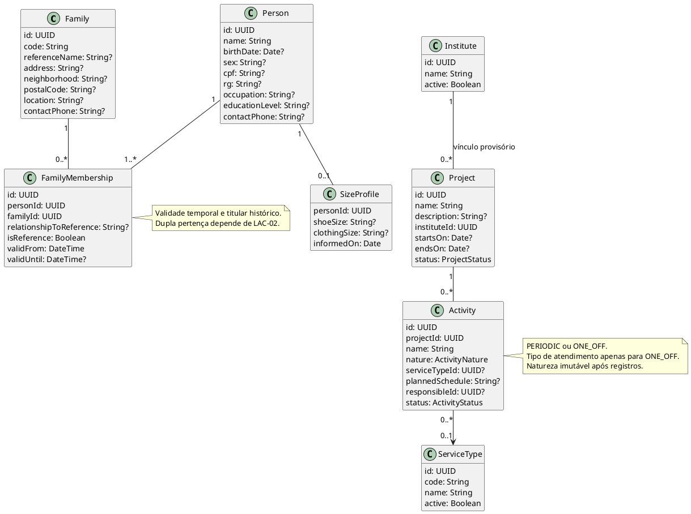
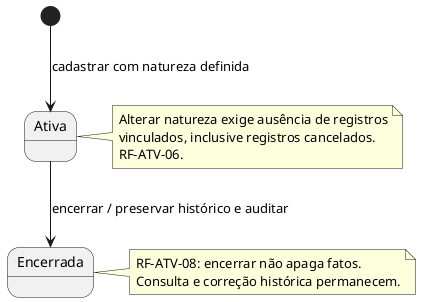
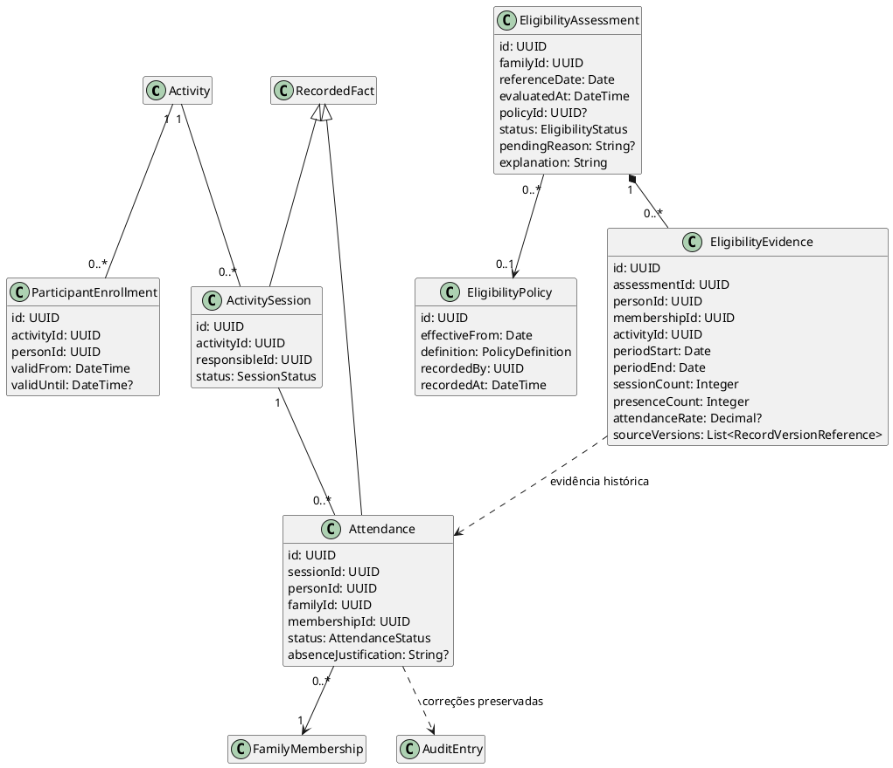
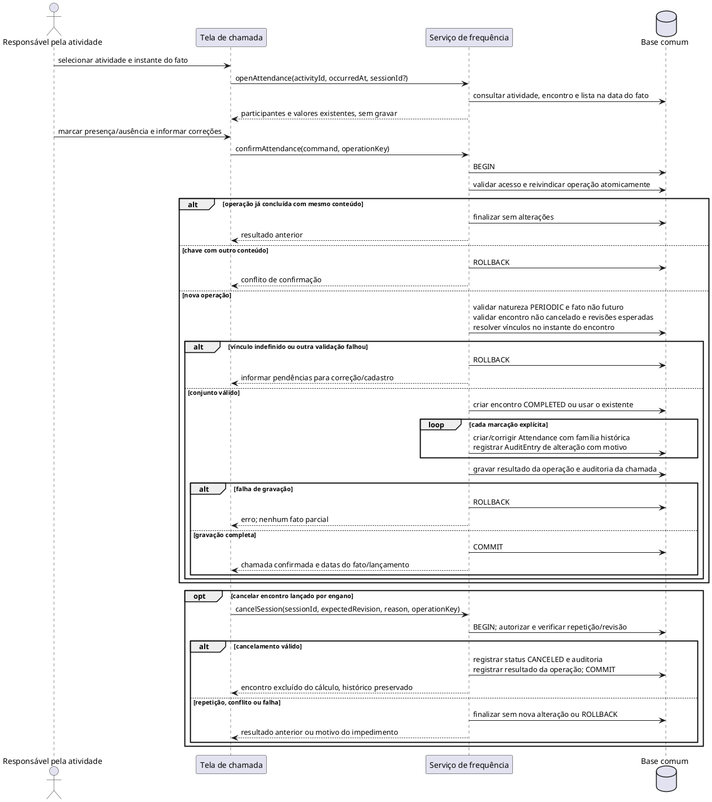
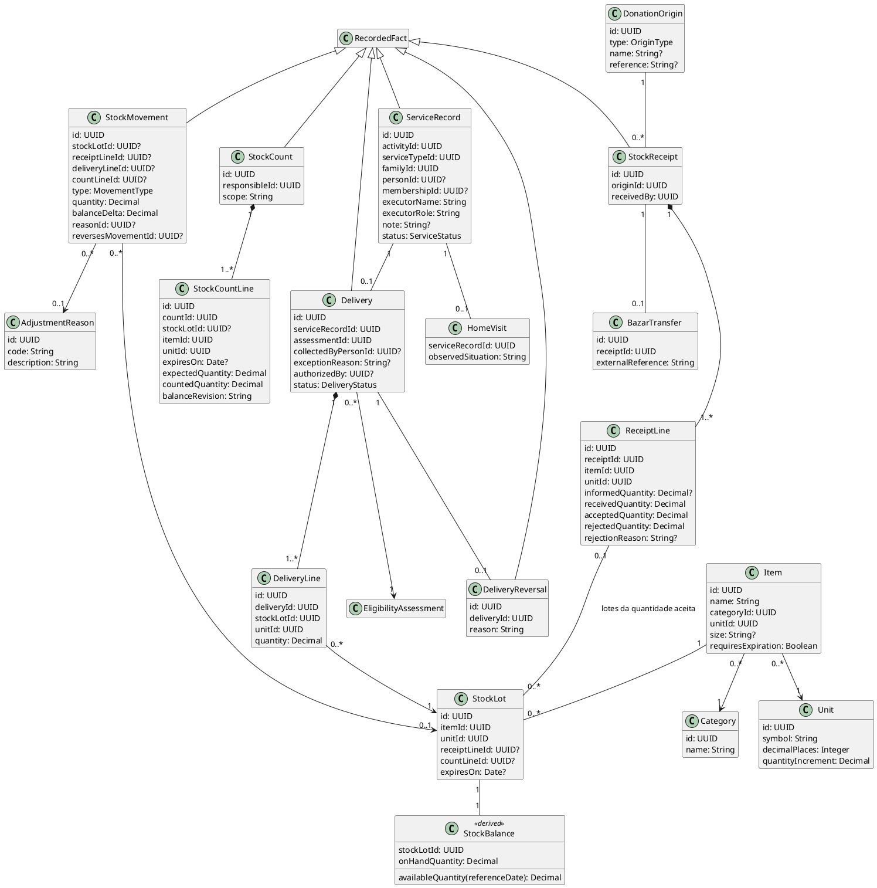
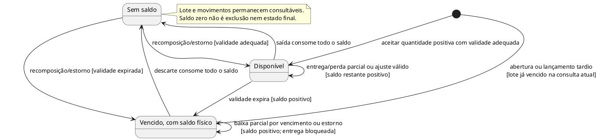
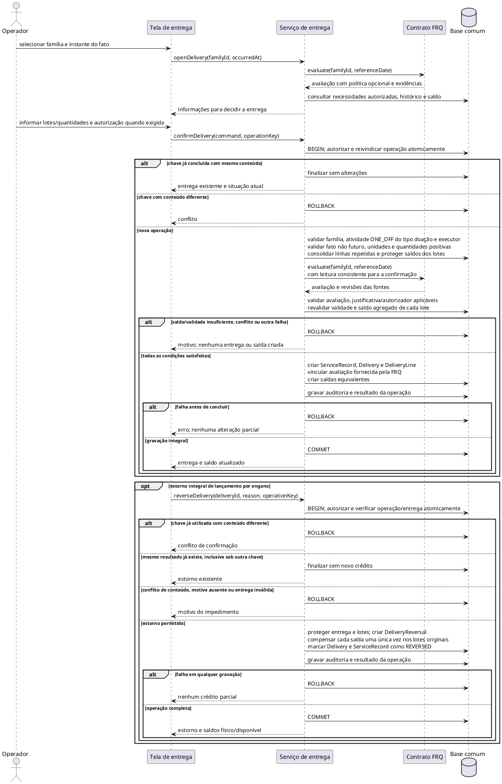
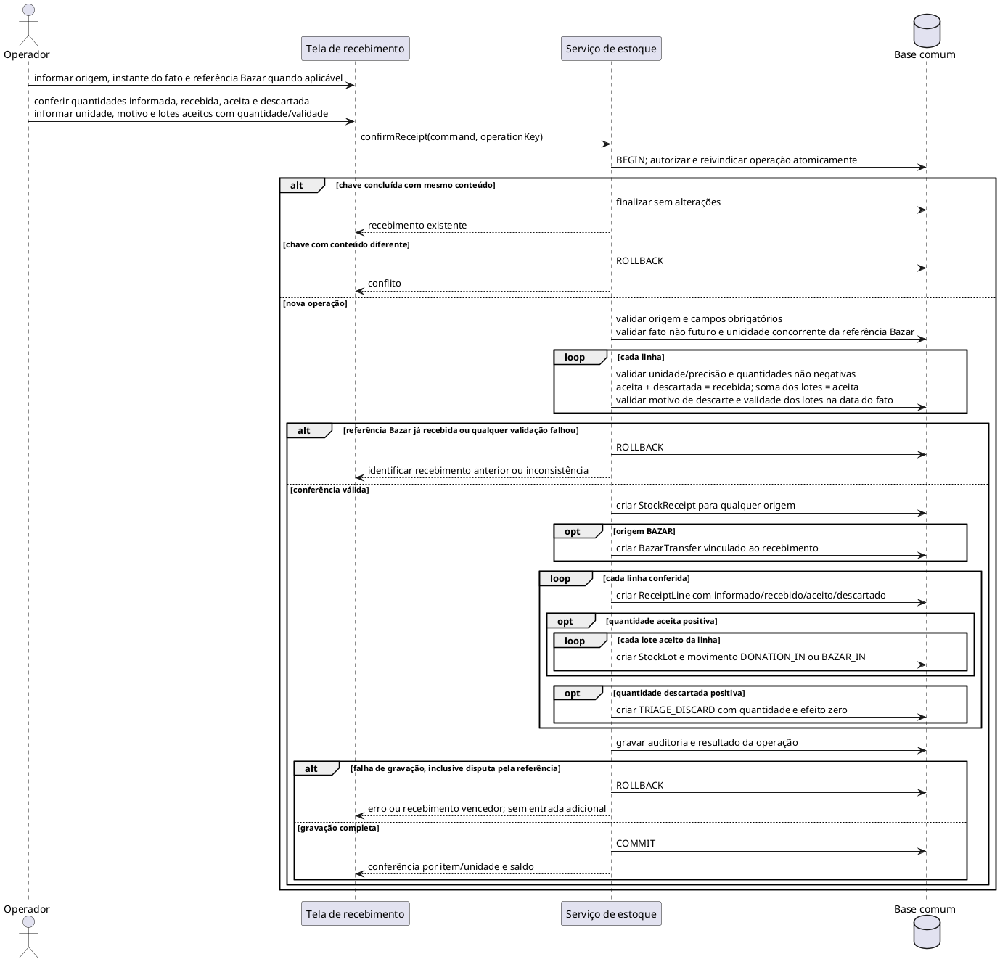
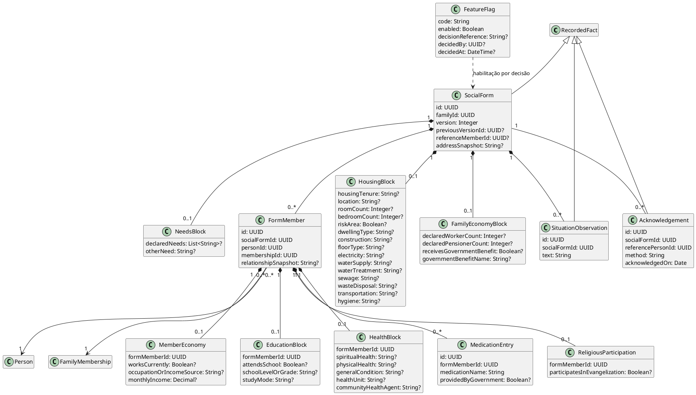
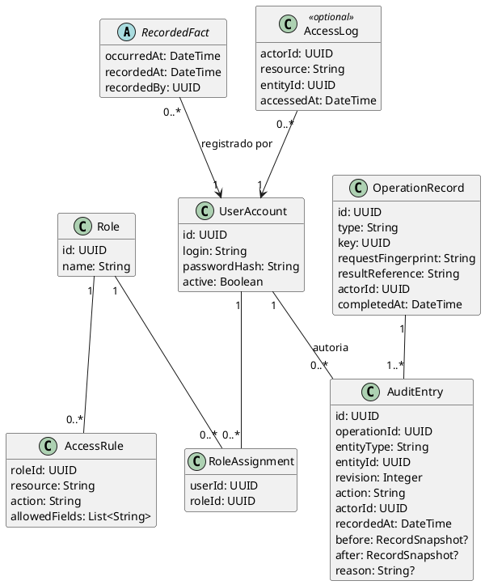

# Modelagem lógica do ERP Social — v1.1

## 1. Controle e contexto

| Campo | Valor |
|---|---|
| Arquivo | MODELAGEM-v1.md |
| Versão | 1.1 — revisão do modelo lógico |
| Data | 28/09/2026 |
| Situação | Revisado documentalmente; políticas pendentes de validação institucional |
| Escopo | Cadastro, atividades, frequência, aptidão, atendimentos, estoque, entregas, ficha e contratos transversais |
| Aprovação | A versão anterior declarava aprovação em plan-mode, sem registro verificável nesta pasta. Isso não comprova aprovação de negócio. |

O problema é substituir o Bússola Social preservando a assistência e o histórico familiar. Pessoas participam de atividades; a família reúne a situação social e o auxílio recebido. Presença, aptidão, atendimento realizado, disponibilidade de estoque e entrega são fatos distintos.

### 1.1 Fontes e autoridade

| Fonte disponível | Papel |
|---|---|
| [PRD 1.1](PRD-ERP-Luz-da-Esperanca-v1.1.md) | Referência canônica de negócio: CAP, RN, AC e DEC. |
| [ERS 1.0](<ERS — ERP Social Luz da Esperança.md>) | Detalhamento dos requisitos RF, RNF, RES e LAC; tratamentos provisórios sujeitos a ratificação. |
| [Ficha de Cadastro de Famílias 2025](ficha_cadastro_familias_2025.md) | Representação em Markdown do formulário; não torna seus campos obrigatórios no ERP. |
| [Pesquisa documental](Pesquisa-Documental-Sistemas-ERP-Social.md) | Contexto de mercado e continuidade operacional; não amplia o escopo. |
| [Bibliografia 1.1](Bibliografia-ERP-Social-v1.1.md) | Fundamentação e limites das conclusões documentais. |

A transcrição F1, a análise anterior ARQ e os PDFs citados na versão anterior não estão disponíveis nesta pasta. Afirmações provenientes deles são consideradas apenas na forma consolidada no PRD e na ERS; não se declara consulta direta nem se presume aprovação ausente.

Nenhuma política aberta é resolvida por este modelo: PRD §9.2 e ERS RES-06. A hierarquia instituto–projeto e o tratamento de entrega a família Não apta/Pendente seguem as propostas explícitas da ERS, identificadas como provisórias. Em caso de divergência de negócio, prevalece o PRD e registra-se a decisão antes da ativação.

### 1.2 Convenções e contratos comuns

- Explicações e rótulos de negócio estão em português; identificadores de classes, atributos e operações estão em inglês. Os IDs D-01 a D-10 são locais. Não se atribuem casos de uso UC à ERS, que não contém esse catálogo.
- Os diagramas são vistas do mesmo modelo. Classes repetidas sem atributos são referências à definição completa em outro diagrama. Chaves estrangeiras e associações representam a mesma relação, não duas fontes de verdade.
- `?` indica dado opcional ou ainda desconhecido. Ausência de informação não equivale a zero, falso, ausência em encontro ou incompatibilidade. Obrigatoriedade de campos cadastrais e sociais depende de LAC-02/LAC-05.
- `Date` representa data civil; `DateTime`, instante com fuso definido para a operação. A data de referência de aptidão é a data civil do fato. Intervalos de vínculo e participação usam início inclusivo e fim exclusivo; fim nulo significa sem término conhecido. Vigência de política usa datas, sem sobreposição.
- Registros operacionais identificam `occurredAt`, `recordedAt` e `recordedBy` por meio de `RecordedFact` (D-10). Executor/recebedor físico e operador que lançou são responsabilidades separadas.
- Alteração de registro existente exige revisão esperada, autorização e auditoria atômica com antes/depois. Conflito não sobrescreve outra alteração silenciosamente. Histórico é preservado no uso normal; guarda e eliminação seguem LAC-08, inclusive em auditoria e cópias.
- Operações repetíveis utilizam `OperationRecord` (D-10): chave única por tipo de operação, conteúdo normalizado e resultado. Mesma chave/conteúdo retorna o resultado anterior; conteúdo diferente é conflito. A reivindicação da chave e os efeitos são atômicos, inclusive sob concorrência. Falha não consome a chave. O mecanismo físico fica para ADR.
- Todo acesso, inclusive retorno de operação repetida, passa pela autorização vigente. Consultas, buscas, auditoria, relatórios e exportações respeitam a mesma matriz de acesso.
- Enquanto LAC-08 não estiver decidida, não há uso de dados pessoais reais em nenhum módulo. Demonstrações usam dados sintéticos. A liberação de cada função depende também das demais lacunas que a afetam.

### 1.3 Histórico de revisão

| Versão | Alteração |
|---|---|
| 1.0 | Nove diagramas com declaração de aprovação não verificável nesta pasta. |
| 1.1 | Correção de atomicidade, repetição, conferência do Bazar, lotes/validade, precisão de quantidades, aptidão pendente, vínculos históricos, ficha por pessoa, auditoria e rastreabilidade. |

## 2. Índice dos diagramas

Todos os diagramas abaixo são propostas técnicas revisadas. Sua presença não ativa funções nem resolve lacunas institucionais.

| ID | Assunto | Tipo | Dependências principais |
|---|---|---|---|
| D-01 | Cadastro e organização | Classes | LAC-02, LAC-04, LAC-12 |
| D-02 | Ciclo da atividade | Estados | RF-ATV-06, RF-ATV-08 |
| D-03 | Frequência e aptidão | Classes e contrato FRQ → AD | LAC-01, LAC-02, LAC-04 |
| D-04 | Lançamento e correção de chamada | Sequência | RF-FRQ-01 a RF-FRQ-07, RF-ACS-05 |
| D-05 | Atendimentos e estoque | Classes | LAC-03, LAC-06, LAC-07, LAC-13 |
| D-06 | Disponibilidade por lote | Estados derivados | RF-EST-04, RF-EST-09, RF-ENT-07 |
| D-07 | Entrega e estorno | Sequência | RF-ENT-01 a RF-ENT-07, RNF-CON-01 |
| D-08 | Recebimento e triagem | Sequência | RF-EST-03, RF-EST-04, RF-BAZ-01 a RF-BAZ-04 |
| D-09 | Ficha versionada e dados por membro | Classes | LAC-05, LAC-08 |
| D-10 | Autoria, acesso, auditoria e repetição | Classes | RF-ACS-01 a RF-ACS-06, LAC-08 |

Contratos complementares de duplicidade, relatórios e migração constam da seção 4. Modelo físico, APIs e mecanismos de concorrência são detalhados posteriormente, preservando estas garantias.

## 3. Diagramas e invariantes

### D-01 — Cadastro e organização

`Person` representa assistidos; usuários, executores e doadores não precisam tornar-se assistidos. Cada fato individual aponta para o vínculo familiar válido quando ocorreu. Encerrar ou corrigir um vínculo não transfere fatos anteriores para outra família (RF-CAD-05, RN-09).



**Invariantes e limites:**

- `Family.code` é único. Pessoa assistida e primeiro vínculo são cadastrados juntos. CPF, RG e telefone não condicionam assistência; CPF informado participa da busca de duplicidade, sem impor uma política de unicidade ainda não validada.
- A data de nascimento ausente é sinalizada, preservando RF-CAD-08. O mínimo de RF-CAD-11 e sua obrigatoriedade final precisam ser conciliados em LAC-02; não se inventa data para cadastrar alguém.
- Um titular por família em cada instante é a proposta da ERS §3.4. Troca de titular ou parentesco encerra a versão temporal anterior e abre outra; `isReference` não é sobrescrito retroativamente. Cadastro incompleto sinaliza a pendência, sem inventar titular.
- Número de membros conta pessoas distintas com vínculo vigente na data consultada. Pessoa com mais de um vínculo admissível no instante exige resolução explícita do contexto; nenhuma família é escolhida silenciosamente.
- `ProjectStatus` e `ActivityStatus`: `ACTIVE`, `CLOSED`. `ActivityNature`: `PERIODIC`, `ONE_OFF`. `ServiceType` é cadastro configurável, sem enum fechado para os tipos de atendimento (RF-ATV-05, RNF-MAN-01).
- Instituto único por projeto é a proposta provisória de LAC-04, não uma política confirmada pelo PRD. Horários, organização de encontros e inscrição continuam vinculados à mesma lacuna.
- Atualizações de tamanho têm data e auditoria. A inclusão para adultos continua sujeita a LAC-12; ausência de tamanho não prova incompatibilidade.

### D-02 — Ciclo da atividade

Encerramento preserva registros e permite sua consulta/correção. A situação atual não invalida um fato ocorrido durante a vigência anterior.



Projeto encerrado preserva suas atividades e fatos. Reabertura, suspensão e novas restrições de atendimento não são presumidas por este ciclo.

### D-03 — Frequência e aptidão

Inscrição é expectativa de participação. Somente presença em atividade periódica serve de evidência de aptidão. Justificativa de ausência não altera essa conclusão sem decisão em LAC-01.



**Frequência:**

- `SessionStatus`: `COMPLETED`, `CANCELED`; `AttendanceStatus`: `PRESENT`, `ABSENT`. Falta de lançamento é informação incompleta, não ausência automática.
- Uma presença por `(sessionId, personId)`. Não se presume encontro único por atividade/data: encontros distintos no mesmo dia têm identidades próprias; correções selecionam o encontro existente.
- Uma chamada só cria encontro realizado ao confirmar o fato. Abrir uma tela ou abandonar rascunho não altera relatórios.
- Lista e vínculo são resolvidos no instante do encontro: `validFrom <= occurredAt` e fim ausente ou posterior. `familyId` e `membershipId` ficam associados ao fato; mudança cadastral posterior não os recalcula.
- Participante fora da lista pode ter presença registrada se possui vínculo válido no fato. Isso não o inscreve automaticamente nos próximos encontros.
- Cancelamento auditado retira o encontro do denominador e das evidências. Correção/cancelamento mantém o conteúdo anterior em `AuditEntry`; não se registra presença nova em encontro cancelado.
- Cálculo percentual explicita encontros considerados, numerador e denominador. Denominador zero resulta em percentual desconhecido; não se presume 0% nem 100%.

**Critério e avaliação:**

`PolicyDefinition` é um valor lógico estruturado para período de referência, tipo e valor do mínimo, atividades consideradas, efeito de justificativas, recessos, novos participantes e tolerância. A forma exata depende de LAC-01. Não se limita antecipadamente o período a dias corridos nem se presume combinação entre mínimo absoluto e percentual. Todos os parâmetros necessários devem estar explícitos para ativar a versão.

`EligibilityStatus`: `ELIGIBLE` (Apta), `INELIGIBLE` (Não apta), `PENDING` (Pendente). Sem política vigente na data avaliada, `policyId=null`, resultado `PENDING` e motivo `POLICY_UNDEFINED`. Evidência insuficiente também gera `PENDING`, com a versão aplicável quando existir. `ELIGIBLE` e `INELIGIBLE` exigem política identificada e fundamentação; não se conclui Não apta por informação incompleta.

RN-02 e AC-02: basta pelo menos um membro cumprir o critério para a família ser Apta, mesmo que outros não participem ou tenham dados incompletos. Sem membro que comprove o critério, a família só é Não apta quando a evidência pertinente permite essa conclusão; se faltam dados necessários, fica Pendente. Aptidão permite considerar a família e não garante entrega (RN-03). O efeito de mudanças de composição sobre o período avaliado deve ser explicitado em LAC-01/LAC-02, preservando a família de cada fato histórico.

Cada nova política tem identidade, início de vigência e autor; não altera versões anteriores. A versão aplicável é a de maior início de vigência não posterior à referência, sem dois inícios iguais. Cada avaliação é um registro imutável de data, política e evidência conhecida naquele momento. `RecordVersionReference` identifica o fato e sua revisão auditada; uma correção pode produzir nova avaliação sem reescrever a usada em entrega anterior.

**Contrato FRQ → AD:** `evaluate(familyId, referenceDate)` retorna `assessmentId`, família, referência, instante da avaliação, situação, política opcional, motivo de pendência e evidências. AD não recalcula a aptidão. FRQ garante validade para a data pedida e para as revisões dos dados lidos: passagem do tempo, mudança de política, vínculo, presença ou cancelamento invalidam resultados reutilizáveis. Fila/cache não é requisito deste modelo. Na confirmação da entrega, a avaliação deve ser consistente com a leitura transacional ou ter suas revisões validadas antes da gravação.

RF-ENT-06 propõe justificativa e autorizador para Não apta/Pendente; não autoriza criar bloqueio automático por aptidão. Seu uso real depende de LAC-01/LAC-03 e da validação institucional prevista no PRD.

### D-04 — Lançamento e correção de chamada

A abertura apenas consulta. A confirmação valida o conjunto inteiro, grava os fatos e a auditoria na mesma operação. Uma correção informa revisão esperada e motivo; repetir a mesma confirmação não cria encontro ou correção adicional.



Atividade hoje encerrada não impede corrigir chamada histórica válida. Cadastro mínimo e resolução de vínculo acontecem antes de confirmar a chamada; presença não cria parentesco nem muda automaticamente a lista de participantes. O cancelamento só é considerado concluído quando situação, auditoria e resultado forem gravados juntos; qualquer falha reverte o conjunto.

### D-05 — Atendimentos e estoque

O catálogo `Item` descreve o material e sua unidade. `ReceiptLine` registra a conferência física; `StockLot` separa quantidades com a mesma origem e validade. Uma entrega consome quantidades de lotes, sem mudar o estado de todo o catálogo. Não há reserva obrigatória.



**Atendimentos e autoria — RF-ATD-01 a RF-ATD-08:**

- `ServiceRecord` sempre tem família e atividade `ONE_OFF`, com tipo compatível. Entrega exige o tipo de doação de itens; visita exige o tipo de visita domiciliar. Pessoa é opcional para atendimento à família; quando informada, seu vínculo no fato precisa corresponder à família registrada.
- `ServiceStatus`: `COMPLETED`, `CANCELED`, `REVERSED`. Executor tem nome/função mesmo sem conta. O operador vem de `RecordedFact`. `HomeVisit` é detalhe de atendimento à família, condicionado a LAC-13.
- Correção/cancelamento exige motivo, revisão esperada e `AuditEntry` com valores anteriores e novos. Não se usa um único campo de motivo para substituir o histórico.
- Atendimento com entrega não pode ser cancelado isoladamente: passa pelo estorno de D-07. Alterar itens, família ou quantidade de uma entrega concluída exige estorno e novo registro, preservando a operação original.
- Observações e situação encontrada seguem controle de acesso; texto livre não autoriza armazenar prontuário, diagnóstico ou prescrição (RES-05).

**Recebimento e conferência — RF-EST-02 a RF-EST-04; RF-BAZ-01 a RF-BAZ-04:**

- `OriginType`: `PERSON`, `ORGANIZATION`, `CAMPAIGN`, `BAZAR`, `AD_HOC`, `UNKNOWN`. O cadastro de origem é identificação mínima; não inclui gestão de relacionamento, valoração ou captação financeira.
- Todo recebimento tem origem explícita, inclusive `UNKNOWN` quando admitida pela política de LAC-06. Uma origem Bazar exige exatamente uma transferência; outra origem não pode ter transferência associada.
- `BazarTransfer.receiptId` e `externalReference` são únicos. A referência e todos os fatos do recebimento são persistidos juntos. Rascunhos não consomem referência nem produzem saldo.
- Linha do Bazar exige quantidade informada, inclusive quando nada chegou. `receivedQuantity - informedQuantity` é a divergência física; `acceptedQuantity + rejectedQuantity = receivedQuantity` é a conferência da triagem. Quantidades são não negativas; descarte positivo exige motivo.
- Recebimentos externos podem não ter quantidade anunciada; nesse caso `informedQuantity=null`, sem apresentar divergência inventada.
- Cada linha com quantidade aceita positiva gera um ou mais lotes, cada um com uma única entrada inicial. A soma dessas entradas equivale exatamente à quantidade aceita da linha. Descarte na triagem preserva quantidade e motivo, sem entrar ou sair do saldo distribuível. Linhas totalmente faltantes ou rejeitadas continuam no recebimento, mesmo sem lote.
- Material com validades diferentes ocupa lotes diferentes dentro da linha conferida. A quantidade informada pelo Bazar pertence à linha e não é repetida por lote. Validade é obrigatória em cada lote quando exigida pelo item. Material já vencido na data do recebimento não é aceito como distribuível; em lançamento tardio, lotes que venceram depois são registrados com disponibilidade atual zero. Critério de aceitação e limite de vencimento dependem de LAC-06.

**Quantidades, lotes e saldo — RF-EST-01, RF-EST-05 a RF-EST-10:**

- Quantidades usam decimal exato; precisão e incremento permitido pertencem à unidade, configurados em LAC-06. Precisão é não negativa; incremento é positivo e representável nessa precisão. Exemplo de representação: 0,5 kg. Não se arredonda uma quantidade para satisfazer o incremento.
- A unidade de linhas, lote e movimentos corresponde à do item. Não há conversão implícita. Sem regra de conversão aprovada/modelada, unidade divergente é rejeitada; isso atende à proibição de somar unidades incomparáveis.
- Categoria e unidade são cadastros configuráveis. Alterar a unidade de item com movimentos não reinterpreta quantidades antigas; é necessária identidade distinta ou migração explicitamente reconciliada.
- `StockLot` tem origem em exatamente uma linha de recebimento ou de contagem: saldo inicial e material identificado em contagem não precisam de doação fictícia. Linha de recebimento admite vários lotes; linha de contagem que inaugura estoque identifica um lote homogêneo. Repetir a confirmação não recria lotes nem suas entradas.
- `onHandQuantity` é a soma dos efeitos de movimentos no lote e nunca é negativa. `availableQuantity` exclui lotes vencidos na referência consultada. Vencimento bloqueia disponibilidade sem apagar o saldo físico; descarte posterior registra a baixa.
- Em consulta histórica, saldo físico e disponibilidade são reconstruídos com movimentos cuja data do fato não excede a referência e com a validade nessa mesma referência. Entradas posteriores não antecipam saldo. A confirmação de operação consulta também o saldo atual protegido contra concorrência; ele não é substituído pelo saldo histórico exibido.
- Item/tamanho/unidade agregam lotes compatíveis. Entrega parcial afeta apenas a quantidade retirada. Seleção de lote não presume prioridade automática de distribuição nem uma regra de separação ainda não validada.
- Ajuste, perda, avaria, vencimento e saldo inicial têm motivo, responsável e trilha. `StockCountLine` registra saldo observado no sistema, quantidade física e revisão usada. Diferença não altera estoque antes da confirmação do ajuste. Uma revisão desatualizada exige reconciliação, não aplicação silenciosa sobre outro saldo.
- Entrada positiva por contagem de material sem lote cria lote identificado por item/unidade/validade. A necessidade de conhecer validade não é dispensada pela origem em contagem.
- `StockMovement` é imutável no uso operacional. Retificações geram movimentos compensatórios e auditoria; eliminação institucional segue LAC-08. Cada movimento identifica sua origem estruturada, sem depender de texto livre.

| `MovementType` | Quantidade e efeito | Origem obrigatória |
|---|---|---|
| `DONATION_IN` / `BAZAR_IN` | Quantidade positiva; efeito `+quantity` | Linha de recebimento e lote aceito |
| `TRIAGE_DISCARD` | Quantidade descartada positiva; efeito zero | Linha de recebimento, sem lote |
| `DELIVERY_OUT` | Quantidade positiva; efeito `-quantity` | Linha de entrega e lote |
| `ADJUSTMENT_IN` / `ADJUSTMENT_OUT` | Quantidade positiva; efeito positivo/negativo | Motivo e lote; linha de contagem quando aplicável |
| `OPENING_BALANCE` | Quantidade positiva; efeito positivo | Contagem física e lote |
| `DELIVERY_REVERSAL` | Mesma quantidade da saída; efeito inverso | `reversesMovementId` apontando para `DELIVERY_OUT` |

`balanceDelta` é determinado pelo tipo; não é valor livre. O movimento de descarte deriva item/unidade da linha de recebimento; os demais derivam do lote. A origem deve existir e ser coerente com o movimento. Saldo após cada movimento é reconstruível em ordem determinística de contabilização; relatórios por data do fato identificam lançamentos retroativos. A confirmação de fato retroativo verifica também os saldos históricos afetados; inconsistência requer reconciliação, sem inventar entradas.

**Entrega e estorno — RF-ENT-01 a RF-ENT-07:**

- `Delivery.serviceRecordId` é único. Família e instante do fato correspondem ao atendimento; a avaliação pertence à mesma família e data. Cada linha corresponde a exatamente uma saída com mesmo lote, unidade e quantidade.
- `DeliveryStatus`: `COMPLETED`, `REVERSED`. Entrega concluída tem ao menos uma linha positiva. Linhas repetidas do mesmo lote são consolidadas para validar a quantidade total.
- Membro que retirou, se informado, deve pertencer à família na data do fato. Aptidão, justificativa e autorizador são preservados como contexto da confirmação.
- `DeliveryReversal.deliveryId` é único; `StockMovement.reversesMovementId` também é único quando preenchido. O fluxo cobre estorno integral de entrega lançada por engano, conforme RF-ENT-07; devoluções físicas parciais não são presumidas.
- Estorno recompõe os lotes originais e muda entrega/atendimento juntos. Se o lote venceu, a recomposição aumenta o saldo físico, mas continua indisponível para nova entrega.

### D-06 — Disponibilidade por lote

Os estados abaixo são derivados da quantidade e da validade de `StockLot`, não pertencem a `Item`. Recebimento, triagem e descarte anterior à aceitação são representados por `StockReceipt`/`ReceiptLine`/`TRIAGE_DISCARD`; somente a parte aceita entra em um lote.



A conferência de vencimento acontece na consulta e na confirmação, mesmo se nenhum processo agendado tiver executado. Lote inicial identificado como vencido em contagem é registrado diretamente como indisponível, conforme a política de LAC-06. Prazo do alerta de proximidade de vencimento não tem valor presumido.

### D-07 — Entrega e estorno

A consulta inicial é informativa. A confirmação repete as validações dentro da operação atômica, usando saldo protegido contra concorrência e aptidão obtida da FRQ para a data do fato. O requisito é a garantia; bloqueio, isolamento, atualização condicional e implantação ficam para ADR.



Duas confirmações de quatro unidades sobre saldo cinco não podem ambas concluir. Requisição repetida é resolvida antes de exigir saldo para uma nova saída; mudanças posteriores de saldo não impedem recuperar o resultado já concluído. Autorização de acesso continua obrigatória.

Se outra operação ganhar a mesma chave durante a confirmação, a perdedora não produz efeitos e recupera o resultado vencedor após conferir igualdade do conteúdo, conforme o contrato comum. Identidade do atendimento, linhas, movimentos e avaliação fica preservada para relatórios, sem contar entrega e atendimento como duas realizações.

Em lançamento tardio, a aptidão e a validade usam a data do fato, mantendo identificável a data de lançamento. O saldo físico atual e a consistência dos saldos históricos também são conferidos; registro retroativo não autoriza saldo negativo. A avaliação apurada posteriormente não é apresentada como decisão originalmente consultada no papel.

### D-08 — Recebimento e triagem

Abertura e edição apenas montam o comando. Recebimento, referência Bazar, linhas, lotes, movimentos, auditoria e resultado da operação são confirmados juntos. Nenhuma referência é consumida antes dessa confirmação.



Dez unidades informadas e oito recebidas, todas aceitas, produzem divergência de duas unidades faltantes, oito de entrada e nenhum descarte. O destino das divergências é definido em LAC-07; não se força sua conversão em descarte.

Reapresentação de referência já recebida com outra chave identifica o registro existente e não cria segunda entrada. Mesma chave/conteúdo retorna sucesso anterior. Falha ou abandono antes do commit deixa referência e chave disponíveis para nova tentativa. Recebimento sem quantidade aceita continua conferível e não altera o saldo.

### D-09 — Ficha versionada e dados por membro

A ficha é uma fotografia familiar datada. Cada versão possui membros identificados; renda, escolaridade, evangelização e informações de saúde não ficam soltas na família. O cadastro atual não substitui o contexto de uma ficha antiga. Os campos abaixo são candidatos derivados da ficha/ERS, condicionados à seleção de LAC-05; presença no diagrama não autoriza coleta.



**Versionamento e identidade — RF-FIC-01 a RF-FIC-09:**

- `(familyId, version)` é único; a versão anterior pertence à mesma família. Alteração de conteúdo publica uma nova versão completa, com autoria e data. Blocos e membros da versão anterior não são modificados por edição do cadastro ou da nova ficha.
- `FormMember` é único por pessoa dentro da versão, pertence à família da ficha e aponta para o vínculo selecionado na data do preenchimento. `referenceMemberId`, quando conhecido, aponta para um desses membros; trocar titular depois não altera essa referência histórica.
- Toda informação individual aponta ao `FormMember` daquela versão. Saúde e medicamentos seguem o titular registrado na ficha recebida; não se ampliam automaticamente para todos. Escolaridade e evangelização são registradas individualmente para crianças/adolescentes, conforme os campos aprovados.
- Endereço e parentesco usados para interpretar a ficha são preservados na versão. Dados atuais continuam no cadastro e não substituem esses valores históricos.
- Campos ausentes permanecem desconhecidos. Contagens econômicas são declaradas, identificadas como tal; não se transformam em uma pontuação de vulnerabilidade.
- RF-FIC-03 é evolução: se incluído, total/per capita derivam das rendas e membros da versão. Renda desconhecida não vira zero; soma parcial e denominador devem ser identificados. Não há classificação automática.
- Necessidades preservam alimento, vestuário, calçado, emprego, médico e outros conforme a seleção aprovada. A equipe de distribuição recebe apenas o subconjunto autorizado pela matriz.
- Texto livre de situação encontrada recebe data, autor e acesso restrito. A habilitação de um campo de observação não permite contornar o bloqueio de saúde/religião ou registrar prontuário.
- `Acknowledgement` registra a ciência conhecida, incluindo assinatura em papel e data. Ausência de registro significa não informado; não é consentimento presumido. A forma e a finalidade seguem LAC-08. Uma correção desse registro é auditada.
- Alerta de desatualização é RF-FIC-10, desejável, sem prazo padrão. Nenhum alerta impede atendimento automaticamente.

**Condição de uso com dados reais — LAC-05/LAC-08:**

As flags abaixo começam em `false`; não existe bloco social liberado por padrão:

| Flag | Condição para ativar |
|---|---|
| `REAL_PERSONAL_DATA` | Decisão registrada de LAC-08 sobre finalidades, acesso, guarda/eliminação e responsabilidades; demais lacunas da função também resolvidas. |
| `FIC_HOUSING`, `FIC_ECONOMY`, `FIC_NEEDS`, `FIC_SITUATION` | Seleção dos campos em LAC-05 e matriz de acesso aprovada em LAC-08. |
| `FIC_EDUCATION` | Aprovação dos dados de crianças/adolescentes em LAC-05/LAC-08, com identidade por membro. |
| `FIC_HEALTH`, `FIC_MEDICATION`, `FIC_RELIGION` | Aprovação específica da finalidade e dos campos, perfis autorizados e proteção correspondente. |
| `FIC_UPDATE_ALERT` | Prazo e responsabilidade definidos em LAC-05; evolução explicitamente incluída. |

Ativar uma flag exige referência, autor e data da decisão; a flag não substitui aprovação nem autorização por perfil. Todas as flags de bloco dependem de `REAL_PERSONAL_DATA` para uso real. Controles também se aplicam a importações, auditoria, exportações e observações de atendimentos. Dados sintéticos permitem validar os fluxos antes da liberação.

### D-10 — Autoria, acesso, auditoria e repetição

Este contrato atende à base comum; não se restringe às presenças ou aos dados sensíveis. A autoria de lançamento é diferente da execução física e permanece identificável após desativação de usuário.



- Login é individual e único; senha é representada apenas por hash apropriado (RF-ACS-01, RNF-SEG-01). Desativação não remove referências de autoria.
- A matriz da ERS §2.3 continua uma proposta sujeita a LAC-08. Nenhum perfil recebe acesso automaticamente por operar outro módulo; administração de contas não implica acesso à ficha.
- `AuditEntry` cobre criação, alteração, correção, cancelamento, estorno e unificação de todas as entidades relevantes, incluindo cadastro, vínculo, ficha, política, atendimento e estoque (RF-ACS-04). Catálogos e configurações também têm alterações identificáveis.
- `RecordSnapshot` preserva os valores necessários para reconstruir a revisão, incluindo justificativas anteriores; não copia senhas ou segredos. `RecordVersionReference` em D-03 identifica `entityType`, `entityId` e `revision`. Alterar um registro e gravar auditoria é uma única operação.
- Correção, cancelamento, estorno, ajuste e unificação exigem motivo. Em criação, `before=null`; a ausência de motivo não é usada para omitir autor/data/conteúdo. Revisões históricas não são editáveis no uso normal.
- Auditoria recebe a proteção dos dados que contém. Permissão para frequência não permite recuperar renda, saúde ou religião pelo histórico de alterações. Retenção e eliminação também abrangem essas cópias.
- `OperationRecord` é único por `(type, key)` e contém resultado apenas de operação concluída. Seu fingerprint considera os dados que determinam o efeito; não guarda um segundo payload irrestrito com dados pessoais. Tipos/chaves pertencem ao comando, não ao momento de abrir a tela.
- Concorrentes com a mesma chave têm um único efeito. Identidades de negócio, como referência Bazar e entrega estornada, continuam únicas mesmo com chaves diferentes. Falhas liberam tentativa sem permitir efeito parcial.
- `AccessLog` corresponde a RF-ACS-07, desejável; não é requisito adicional obrigatório para habilitar a ficha. Se incluído, registra consultas autorizadas sem ampliar o acesso.
- Auditoria de importação identifica o operador/importador e o lançamento atual, preservando datas/autores de origem quando disponíveis. Dados históricos desconhecidos não recebem autoria inventada.

## 4. Contratos complementares e cobertura

### 4.1 Duplicidade e unificação

RF-CAD-06, RF-CAD-07, RF-REL-09 e AC-15 exigem busca prévia e tratamento identificado. A busca considera nome, nascimento, CPF e endereço disponíveis; semelhança não produz fusão automática.

O registro lógico de análise de duplicidade guarda `entityType`, `candidateIds`, `identifiedAt`, `resolvedAt?`, `resolution?` e `resolvedBy?`. A decisão de unificação registra origem, destino, autor e motivo, mantendo o mapeamento das identidades anteriores.

Unificação é atômica com auditoria e atualização coerente das referências. Conflitos de duas presenças no mesmo encontro, vínculos sobrepostos, titularidade, fichas e operações de estoque exigem reconciliação explícita; não se descartam registros nem se contabiliza duas vezes o mesmo fato. O histórico continua recuperável por referências anteriores, inclusive as usadas em avaliações de aptidão. Critérios institucionais ficam em LAC-02.

### 4.2 Relatórios e histórico

RF-REL-01 a RF-REL-09 são consultas sobre os fatos e versões acima, sem outro saldo ou cadastro paralelo.

- Histórico familiar usa a família registrada no fato; histórico pessoal reúne seus vínculos e fatos ao longo do tempo. Alteração do cadastro atual não transfere assistência passada.
- Relatório de alcance distingue pessoas únicas, famílias únicas, encontros realizados, atendimentos e quantidades por item/unidade. Entrega corresponde a um atendimento; não se somam ambos como dois atendimentos (RN-19, AC-10).
- Cancelamentos/estornos não entram como realizações válidas nos totais operacionais, mas permanecem consultáveis com seus efeitos e motivos. Estoque conserva as saídas originais e os movimentos inversos; não se apagam ambos do cálculo.
- Saldo inicial + efeitos das entradas/saídas/ajustes/estornos = saldo final físico. Disponibilidade exclui quantidade vencida sem apagar o físico. Descarte de triagem tem efeito zero; transferência Bazar não compõe nova arrecadação externa.
- Período, unidade, referência temporal, situação dos registros e critério de contagem acompanham cada total. A lista de origem do total usa os mesmos filtros e permissões. Retificações tardias são identificáveis, sem apresentar versão atual como relatório original.
- CSV/PDF continuam desejáveis (RF-REL-10). A condição de acesso é a mesma das consultas e não depende de a saída ser uma tela.

### 4.3 Migração e abertura do estoque

CAP-12 é parte do mínimo; não é retirado do produto por o formato de exportação ser desconhecido. O contrato lógico de RF-MIG-01 a RF-MIG-06 permanece necessário:

| Registro lógico | Conteúdo e garantia |
|---|---|
| `ImportBatch` | Origem, data de importação, operador, conjunto de arquivos identificado, contagens por tipo/período e resultado da conferência. |
| `ImportRecord` | Lote, tipo/identidade estável de origem, identidade de destino, situação e motivo de rejeição quando houver. |
| Identificação no destino | Cada fato importado conserva origem, data da importação e acesso à correspondência de origem. |

A identidade de origem deve ser estável entre execuções, não apenas dentro de um lote de importação. Quando não houver ID exportado, a estratégia de correspondência precisa ser definida e conferida em LAC-11; não se promete deduplicação sem essa definição. Mesma identidade não gera novo destino; conteúdo alterado exige atualização auditada ou revisão, sem sobrescrita silenciosa.

Famílias, pessoas e vínculos são conferidos antes dos fatos dependentes. Rejeições não aparecem como dados migrados. Histórico indisponível exige alternativa de consulta acordada pela instituição. Entrada em produção e encerramento do Bússola dependem de conferência, continuidade e aceite — AC-12/AC-13.

Saldo inicial vem de `StockCount` e `OPENING_BALANCE` por item/unidade/lote/validade. Se movimentos históricos forem importados, a data de corte e a conciliação impedem somá-los novamente ao saldo inicial. Importação não contorna autorização de dados reais nem de campos desativados.

### 4.4 Mapa de rastreabilidade

| Capacidade | Modelo/contrato | Requisitos e aceite principais |
|---|---|---|
| CAP-01 — Pessoas e famílias | D-01, D-10, §4.1 | RF-CAD-01 a RF-CAD-11; AC-01, AC-08, AC-15 |
| CAP-02 — Ficha social | D-09, D-10 | RF-FIC-01 a RF-FIC-10; LAC-05/LAC-08 |
| CAP-03 — Projetos e atividades | D-01, D-02 | RF-ATV-01 a RF-ATV-08; RF-ATV-09 como evolução |
| CAP-04 — Frequência | D-03, D-04 | RF-FRQ-01 a RF-FRQ-08; AC-08, AC-18 |
| CAP-05 — Aptidão | D-03, D-07 | RF-APT-01 a RF-APT-07; AC-02, AC-03, AC-14 |
| CAP-06 — Atendimentos | D-05, D-10 | RF-ATD-01 a RF-ATD-08; AC-04, AC-16; RF-ATD-09 como evolução |
| CAP-07 — Estoque | D-05, D-06, D-08 | RF-EST-01 a RF-EST-10; AC-11; RF-EST-11 como evolução |
| CAP-08 — Entregas | D-05, D-07 | RF-ENT-01 a RF-ENT-07; AC-05, AC-06, AC-10 |
| CAP-09 — Bazar | D-05, D-08 | RF-BAZ-01 a RF-BAZ-04, INT-01; AC-07 |
| CAP-10 — Histórico e resultados | §4.2 | RF-REL-01 a RF-REL-09; RF-REL-10 como evolução |
| CAP-11 — Acesso e autoria | D-09, D-10 | RF-ACS-01 a RF-ACS-06, RNF-SEG-04; AC-09; RF-ACS-07 como evolução |
| CAP-12 — Substituição do Bússola | §4.3 | RF-MIG-01 a RF-MIG-06, INT-02; AC-12, AC-13 |

O mapa indica cobertura lógica, não implementação ou aprovação. Requisitos desejáveis citados não são ativados automaticamente. Metas de desempenho, disponibilidade, backup, restauração e operação permanecem na ERS para o projeto técnico e o piloto.

## 5. Decisões pendentes

As condições abaixo indicam o momento da decisão, não atribuem aprovação. É possível revisar e demonstrar a modelagem com dados sintéticos enquanto as decisões não chegam.

| Lacuna | Condição que depende da decisão |
|---|---|
| LAC-01 / DEC-02 | Definição completa de frequência válida, período, atividades, evidência incompleta, justificativas e tolerâncias. Sem critério, aptidão Pendente; não se inventa um padrão. |
| LAC-02 / DEC-01 | Núcleo familiar, dupla pertença, titularidade, documentos, dados incompletos e reconciliação de duplicidades; antes de cadastros reais. |
| LAC-03 / DEC-03 | Exceções e quem autoriza entregas, além de prioridade/limites/intervalos. A parte de autorização afeta o fluxo mínimo, não apenas EVO-05. |
| LAC-04 / DEC-04 | Instituto–projeto, organização dos encontros, horários e lista de participantes; turmas/vagas/agenda apenas se incluídas como evolução. |
| LAC-05 / DEC-05 | Seleção campo a campo da ficha, finalidade, obrigatoriedade e atualização; afeta blocos comuns e sensíveis. |
| LAC-06 / DEC-06 | Unidades, precisão, categorias, triagem, validade/alertas, contagem, ajustes e estornos; antes do estoque real. |
| LAC-07 / DEC-07 | Referência Bazar, comunicação, conferência e encaminhamento das divergências; sem fluxo inverso confirmado. |
| LAC-08 / DEC-08 | Finalidades e bases aplicáveis, matriz de acesso, guarda/eliminação, ciência e responsabilidades; antes de qualquer dado pessoal real. |
| LAC-09 / DEC-09 | Responsabilidade por doadores/campanhas e valoração; mínimo conserva apenas identificação da origem. |
| LAC-10 / DEC-10 | Volumes, equipamentos, horários, produto, operação, manutenção e custos; antes de compromissos de desempenho e implantação. |
| LAC-11 / DEC-11 | Exportação, identidade de origem, históricos, corte, conciliação e continuidade; antes da migração real e substituição do Bússola. |
| LAC-12 | Coleta de tamanhos para adultos e inclusão da consulta de compatibilidade. |
| LAC-13 | Natureza e conteúdo da visita domiciliar; tipo de atendimento familiar ainda provisório. |

## 6. Limites do escopo

- Não há frequência mínima, janela de 30 dias, percentual ou renovação por doação presumidos.
- Não há pontuação de vulnerabilidade, prioridade por renda, intervalo obrigatório entre entregas, suspensão de famílias ou política emergencial criada pelo modelo.
- Compatibilidade é EVO-01/RF-ENT-08: caso incluída, distingue tamanho compatível de desconhecido e mantém decisão humana, sem tolerância presumida. Prioridade/limites são EVO-05/RF-ENT-09.
- Consolidação monetária por doador/campanha é EVO-02; alertas de interrupção e ficha são EVO-03; turmas, vagas, fila e agenda são EVO-04. Não são pré-requisitos ocultos do ciclo mínimo.
- O fluxo confirmado é Bazar → social. Retorno ao Bazar, CRM financeiro, estoque comercial, caixa, contabilidade, Escola Espírita e gestão de voluntários não são incorporados.
- Atendimento de saúde comprova realização; prontuário, diagnóstico e prescrição ficam fora.
- Esta revisão não define banco, linguagem, endpoints, índices, fila, infraestrutura ou mecanismo físico de concorrência. O projeto técnico deve demonstrar as garantias de atomicidade, unicidade, auditoria e acesso descritas aqui.

## 7. Cenários para conferência da modelagem

Estes cenários são verificações de mesa e referências para testes futuros; não são relato de execução de um sistema implementado.

| Cenário | Resultado exigido | Local |
|---|---|---|
| Duas entregas de quatro unidades disputam saldo cinco | No máximo uma conclui; saldo não negativo e nenhum atendimento parcial | D-07 |
| Confirmação de entrega é repetida após perda da resposta | Mesmo resultado, sem nova saída, mesmo que o saldo tenha mudado depois | D-07, D-10 |
| Mesma chave é reutilizada com outra quantidade | Conflito, sem efeito adicional | §1.2, D-10 |
| Estorno é repetido com a mesma chave ou outra | Um único crédito por saída original; retorno do estorno existente | D-05, D-07 |
| Falha no meio de entrega, estorno ou recebimento | Reversão integral, inclusive auditoria e registro da operação | D-07, D-08 |
| Recebimento Bazar falha antes do commit e é tentado novamente | Referência continua utilizável; só a confirmação integral produz recebimento | D-08 |
| Mesma referência Bazar chega com outra chave | Segundo recebimento impedido, registro anterior identificável | D-05, D-08 |
| Bazar informa dez, chegam oito, todas aceitas | Divergência de duas faltantes, oito de entrada, zero descartadas | D-08 |
| Uma linha anuncia dez unidades, recebidas em dois lotes de quatro e seis | Dez informadas uma única vez; dez recebidas/aceitas, com validade própria por lote | D-05, D-08 |
| Cinco unidades recebidas, três aceitas e duas descartadas | Saldo aumenta três; duas descartadas permanecem rastreáveis com efeito zero | D-05, D-08 |
| Mesmo item tem lotes com vencimentos distintos | Só os lotes adequados compõem a disponibilidade na data consultada | D-05, D-06 |
| Estorno devolve saldo a lote agora vencido | Saldo físico aumenta; disponibilidade continua zero | D-06, D-07 |
| Entrada de 0,5 kg em unidade que admite esse incremento | Quantidade exata preservada; nenhuma conversão ou arredondamento implícito | D-05 |
| Não há política na data avaliada | Pendente com critério nulo e motivo explícito | D-03 |
| Só um membro comprova o critério, outros não participam ou têm dados incompletos | Família Apta com a evidência desse membro; entrega não é garantida | D-03 |
| Política existe, mas faltam evidências | Pendente com a versão aplicável, sem negativa automática | D-03 |
| Critério muda ou chamada antiga é corrigida | Nova consulta usa referência/política/revisões corretas; avaliação anterior é preservada | D-03 |
| Chamada antiga é lançada após mudança de família | Lista e vínculo do instante original; histórico permanece naquela família | D-03, D-04 |
| Participante presente está fora da lista | Presença permitida com vínculo válido, sem inscrição automática | D-04 |
| Tela de chamada é aberta e abandonada | Nenhum encontro realizado ou presença é criado | D-04 |
| Duas crianças têm séries e evangelização diferentes | Dados separados por membro e versão da ficha | D-09 |
| Titular muda após ficha de saúde preenchida | Informação continua ligada ao titular registrado naquela versão | D-09 |
| Atendimento é corrigido ou cancelado | Antes/depois, operador, data e motivo recuperáveis por perfil autorizado | D-05, D-10 |
| Perfil de frequência tenta acessar renda via auditoria | Acesso não permitido, assim como na ficha e nas exportações | D-10 |
| Flag social é ativada sem decisão/global de dados reais | Uso real permanece não autorizado | D-09 |
| Uma família recebe duas entregas | Uma família, dois atendimentos de entrega e quantidades por unidade | §4.2 |
| Importação é repetida ou inclui abertura mais histórico | Sem duplicação por identidade de origem; saldo conciliado no corte | §4.3 |

## Brandbook — Luz da Esperança

## Centro Espírita e Obras Sociais | Parnaíba (PI)

Documento de engenharia reversa de marca elaborado a partir do conteúdo público do site luzdaesperanca.org — briefing definitivo para uso de design.

## 1. Diagnóstico e Posicionamento (DNA da Marca)

## 1.1 Público-alvo e Nicho

O site fala, ao mesmo tempo, com três públicos distintos, e a marca precisa equilibrar essas vozes:

Beneficiários da assistência social — famílias em situação de vulnerabilidade em Parnaíba (PI) e região, com destaque explícito para crianças e adolescentes em risco social, além de idosos. A linguagem do site ("assistir materialmente, moralmente e espiritualmente a todos que a ela procurarem") mostra um público que busca acolhimento prático e imediato: doação de roupas e alimentos, reforço escolar, cursos profissionalizantes (manicure e pedicure), sopa fraterna.

Adeptos e simpatizantes do Espiritismo — pessoas que buscam tratamento espiritual (passes, cirurgia espiritual, desobsessão, água fluidificada) e formação doutrinária (evangelização infantil e de adultos, estudo do Evangelho no Lar, textos sobre evolução espiritual). Esse público já conhece o vocabulário kardecista e busca profundidade doutrinária, não superficialidade.

Doadores, voluntários e comunidade local — pessoas sensibilizadas pela causa social que querem contribuir com doações em gênero, depósito bancário ou trabalho voluntário.

Nicho: terceiro setor religioso-assistencial — um centro espírita kardecista que atua simultaneamente como instituição de caridade material (assistência social) e casa de tratamento e doutrina espiritual. É um nicho de confiança e proximidade local, não de escala nacional.

## 1.2 Missão, Visão e Valores

Missão (explícita no site): assistir material, moral e espiritualmente a todos que procurarem a instituição, praticando a caridade e prestando serviços gratuitos e permanentes à comunidade, com prioridade para crianças e adolescentes em situação de risco social.

Visão (deduzida da "meta" declarada): tornar-se um polo educacional e assistencial completo através da futura Escola Esperança, atendendo do berçário às séries finais do Ensino Fundamental, com clínica médica e odontológica integradas — ampliando o atendimento hoje restrito a cerca de 100 famílias cadastradas.

## Valores centrais:

- Caridade — moral e material, como prática cotidiana e não discurso ("busca praticar a caridade moral e material").

- Gratuidade — serviços sempre gratuitos e permanentes, nunca comerciais (mesmo o bazar de doações reverte 100% para a obra).

- Fé e evangelho de Jesus — referência espírita explícita como fonte de conduta ("Evangelho no lar: convidando Jesus para o seu ambiente familiar").

- Acolhimento incondicional — inclusão de neurodiversidades, idosos, crianças e adultos sem distinção.


- Educação como transformação social — do reforço escolar aos cursos profissionalizantes, a marca trata educação como ferramenta concreta de mudança de vida.

- Fraternidade e comunidade — presença de "mocidade", "sopa fraterna" e atividades em grupo reforçam a ideia de família estendida.

## 1.3 Arquétipo e Personalidade

Arquétipo primário: O Cuidador (Caregiver) — a marca existe para servir, proteger e nutrir quem está em situação de vulnerabilidade. Toda a comunicação gira em torno de "assistir", "acolher", "ajudar", "prestar serviços gratuitos".

Arquétipo secundário: O Sábio (Sage) — presente nos conteúdos doutrinários (evolução espiritual, evangelho no lar, respostas sobre tratamento espiritual), que buscam explicar e ensinar, não vender.

Um terceiro traço, mais discreto, de O Inocente aparece no tom esperançoso e na fé simples que dá nome à marca ("Luz da Esperança"). Para o dia a dia de design, trabalhe a dupla Cuidador + Sábio: calor humano na assistência social, serenidade e clareza na comunicação doutrinária.

Personalidade de marca: acolhedora, serena, fraterna, esperançosa, simples (nunca hermética ou elitista), confiável, comunitária.

## 1.4 Tom de Voz

- Acolhedor e caloroso, nunca institucional-frio — o site convida em primeira pessoa do plural ("Vem pro LUZ!", "Conheça melhor a gente, faça-nos uma visita!").

- Simples e humano, mesmo ao tratar de doutrina espírita — explica conceitos como "perispírito" e "desobsessão" em linguagem acessível, sem jargão hermético.

- Esperançoso e encorajador, coerente com o próprio nome da instituição — evita tom de lamento ou vitimização ao falar do público assistido, preferindo "oportunidade de transformação".

- Fraterno, tratando o visitante como parte da família ("nossa casa", "Instituto da Caridade").

- Espiritualmente confiante, porém não proselitista — fala de fé e de Jesus com naturalidade, mas sem tom de conversão forçada; é informativo antes de ser persuasivo.

Evitar: linguagem corporativa genérica, tom de urgência ou apelo emocional forçado ("comova-se", "ajude agora ou..."), jargão religioso fechado, formalidade excessiva.

## 2. Diretrizes de Design e Identidade Visual

## 2.1 Paleta de Cores Estratégica

O logo já traz uma pista visual valiosa: uma flor/moinho de papel com pétalas multicoloridas (vermelho, laranja, amarelo, verde, azul, roxo) ao redor de um centro branco, com o logotipo em script marrom-dourado. O restante do site reforça o verde como cor institucional dominante (menus, títulos de seção, faixas). Proponho consolidar isso em um sistema de cores hierarquizado:

## Cor primária — Verde Esperança #5B8C3E

Verde é a cor mais repetida no site (menus, títulos, faixas de destaque) e é a escolha mais coerente psicologicamente: remete a esperança, renovação, cura e crescimento — exatamente o que a marca promete tanto na assistência social ("recomeço") quanto no tratamento espiritual ("cura do perispírito"). É também a cor mais associada ao equilíbrio e à natureza, reforçando serenidade sem ser fria.


## Cor secundária — Dourado Terra #8C6D46

Extraída do logotipo (o script "Luz da Esperança" em tom marrom-dourado). Transmite tradição, acolhimento, solidez e calor humano — apropriado para uma instituição com mais de uma década de história e forte laço comunitário. Deve ser usada com moderação, em textos de destaque, ícones e elementos de assinatura institucional.

## Cor neutra de apoio — Branco-osso #FAF7F2

Fundo quente (não branco puro), para transmitir acolhimento e suavidade em vez de frieza clínica — evita que a comunicação de uma instituição de caridade pareça corporativa.

## Cinza-texto #4A4A4A

Para corpo de texto sobre fundo claro, garantindo legibilidade sem o peso visual do preto puro.

Paleta de acento (multicolor, herdada do logo) — uso pontual em materiais infantis, educacionais e comunitários:

| Cor | HEX | Uso sugerido |
| --- | --- | --- |
| Vermelho-coral | #E85D4C | Reforço de Luz, alertas de doação urgente |
| Laranja | #F2994A | Cursos profissionalizantes, chamadas de ação |
| Amarelo-sol | #F2C94C | Sopa Fraterna, calor humano, destaque positivo |
| Azul-céu | #3D9BD1 | Tratamentos e conteúdo espírita/doutrinário |
| Roxo-suave | #9B6FC4 | Mocidade e evangelização infantil |

Justificativa do sistema: a paleta multicolor não deve competir com o verde institucional — ela existe para marcar visualmente a diversidade das obras sociais (educação, saúde espiritual, juventude, alimentação), replicando a ideia das pétalas do logo, cada uma representando uma frente de atuação diferente sob a mesma "luz" central. Use no máximo 1–2 cores de acento por peça, nunca a paleta inteira de uma vez, para não infantilizar materiais institucionais mais sérios (ex.: prestação de contas, doutrina).

## 2.2 Tipografia Sugerida

## Títulos e display — Lora (serifada)

Uma serifada contemporânea, com curvas suaves e calorosas que dialogam com o script tradicional do logotipo, sem tentar imitá-lo. Transmite tradição, espiritualidade e confiança — adequada ao arquétipo Sábio/Cuidador. Alternativa: Playfair Display, para peças institucionais mais solenes (relatórios, convites).

## Corpo de texto — Nunito ou Nunito Sans (sans-serif humanista)

Terminações levemente arredondadas, alta legibilidade em telas pequenas, tom amigável e acessível — ideal para o público heterogêneo do site (desde crianças até idosos). Evita a frieza de uma grotesca geométrica pura.

## Uso pontual/lúdico — Patrick Hand ou Caveat (manuscrita)

O próprio site já usa uma tipografia manuscrita e colorida para "Reforço de Luz". Recomenda-se formalizar esse recurso como um "selo tipográfico" exclusivo de materiais infantis e comunitários (reforço escolar, evangelização infantil, mocidade), nunca em peças institucionais sérias (doutrina, prestação de contas, comunicados oficiais).

## 2.3 Direção de Arte (Moodboard em texto)

Fotografia: luz natural, quente e difusa (nunca flash direto ou estúdio frio); registros documentais e não posados — crianças em atividades de reforço escolar, mãos em gestos de cuidado (passe, doação, ensino), mesas de sopa fraterna, ambiente doméstico e acolhedor da sede. Evitar fotos de stock genéricas de "caridade" (mãos estendidas em still branco); priorizar imagens reais da comunidade de Parnaíba, com diversidade etária (crianças, adultos, idosos) coerente com o público descrito.


Ilustração: traço orgânico e levemente artesanal, nunca vetores frios ou 3D corporativo. A pétala/flor do logo pode se desdobrar em um sistema de ícones simples de linha, com preenchimento eventual em uma das cores de acento — por exemplo, um ícone de livro para reforço escolar, uma xícara/prato para a sopa fraterna, uma mão aberta para passes.

Estética geral: "casa acolhedora", não "instituição". Uso generoso de espaço em branco (branco-osso) para não sobrecarregar visualmente; hierarquia clara entre conteúdo institucional (verde + dourado, sóbrio) e conteúdo comunitário/infantil (paleta de acento, mais lúdica). Texturas sutis de papel ou tecido podem reforçar o caráter artesanal e humano, evitando qualquer estética "tech" ou corporativa fria — a marca não vende eficiência, vende cuidado.

## 3. Estrutura de Comunicação (Mensagem-Chave)

## 3.1 Elevator Pitch

O Luz da Esperança é um Centro Espírita e Obras Sociais em Parnaíba (PI) que, desde 2013, une fé e caridade para oferecer assistência material, educacional e espiritual totalmente gratuita a cerca de 100 famílias, com prioridade para crianças e adolescentes em risco social. Seu diferencial é integrar tratamento espiritual (passes, cirurgia espiritual, desobsessão) a ações sociais concretas — reforço escolar, cursos profissionalizantes e sopa fraterna — caminhando para a criação da Escola Esperança, um projeto educacional completo do berçário ao Ensino Fundamental.

## 3.2 Palavras-chave Visuais e Verbais

- 1. Luz — esperança, orientação, clareza espiritual.

- 2. Caridade — o valor fundador e não negociável da marca.

- 3. Acolhimento — a experiência que todo público deve sentir ao entrar em contato com a marca.

- 4. Fé — o motor espiritual por trás de cada ação, sem proselitismo.

- 5. Transformação — a promessa concreta (educação, saúde, dignidade) por trás do discurso espiritual.

Documento preparado para uso interno de design e comunicação. Sempre que uma informação não estava explícita no site, ela foi deduzida a partir de boas práticas de branding para o nicho de instituições espíritas e assistenciais, sem contradizer o conteúdo publicado em luzdaesperanca.org.

web application/stitch/projects/8449679133653481303/screens/15704196542968648800
---
version: "alpha"
name: "Luz da Esperança — Gestão Social"
description: "Design system para ERP social interno, com foco em clareza, acolhimento e baixa carga visual."
colors:
  primary: "#5B8C3E"
  primary-action: "#4F7A35"
  secondary: "#8C6D46"
  background: "#FAF7F2"
  surface: "#FFFFFF"
  text: "#4A4A4A"
  text-strong: "#222222"
  text-muted: "#6B6B6B"
  border: "#DDD8CF"
  focus: "#2F6F9F"
  coral: "#E85D4C"
  orange: "#F2994A"
  yellow: "#F2C94C"
  blue: "#3D9BD1"
  purple: "#9B6FC4"
typography:
  page-title:
    fontFamily: "Lora"
    fontSize: "2rem"
    fontWeight: 600
    lineHeight: 1.2
  section-title:
    fontFamily: "Lora"
    fontSize: "1.25rem"
    fontWeight: 600
    lineHeight: 1.3
  body:
    fontFamily: "Nunito Sans"
    fontSize: "1rem"
    fontWeight: 400
    lineHeight: 1.5
  body-sm:
    fontFamily: "Nunito Sans"
    fontSize: "0.875rem"
    fontWeight: 400
    lineHeight: 1.45
  label:
    fontFamily: "Nunito Sans"
    fontSize: "0.875rem"
    fontWeight: 600
    lineHeight: 1.35
  metadata:
    fontFamily: "Nunito Sans"
    fontSize: "0.75rem"
    fontWeight: 400
    lineHeight: 1.35
rounded:
  sm: "6px"
  md: "10px"
  lg: "14px"
spacing:
  xs: "4px"
  sm: "8px"
  md: "16px"
  lg: "24px"
  xl: "32px"
  2xl: "48px"
components:
  button-primary:
    backgroundColor: "{colors.primary-action}"
    textColor: "#FFFFFF"
    typography: "{typography.label}"
    rounded: "{rounded.md}"
    padding: "10px 16px"
    height: "40px"
  button-secondary:
    backgroundColor: "{colors.surface}"
    textColor: "{colors.text-strong}"
    typography: "{typography.label}"
    rounded: "{rounded.md}"
    padding: "10px 16px"
    height: "40px"
  input:
    backgroundColor: "{colors.surface}"
    textColor: "{colors.text}"
    typography: "{typography.body}"
    rounded: "{rounded.md}"
    height: "44px"
  status-tag:
    backgroundColor: "{colors.background}"
    textColor: "{colors.text-strong}"
    typography: "{typography.metadata}"
    rounded: "{rounded.sm}"
    padding: "4px 8px"
---

## Overview

ERP web interno para o Centro Espírita e Obras Sociais Luz da Esperança. A interface deve transmitir acolhimento, serenidade, clareza e confiança sem parecer uma landing page, um produto financeiro ou um painel corporativo genérico.

A prioridade é a tarefa operacional atual. Regras de negócio, auditoria, permissões e validações devem orientar o comportamento da interface. Elas não devem virar parágrafos visíveis, cards explicativos ou alertas permanentes sem necessidade.

## Colors

Use o Verde Esperança #5B8C3E como assinatura institucional em navegação ativa, ícones e detalhes. Para botões preenchidos com texto branco, use o verde derivado acessível #4F7A35. O Dourado Terra #8C6D46 é secundário e deve aparecer com moderação.

O fundo principal é Branco-osso #FAF7F2. Superfícies de trabalho podem usar branco. O texto padrão é #4A4A4A, com #222222 para títulos e conteúdo que exige maior contraste.

A paleta multicolorida do logotipo é de acento. Use no máximo duas cores de acento por tela, apenas quando tiverem significado funcional. Não distribua as cores das pétalas entre cards ou módulos como decoração.

## Typography

Use Lora apenas em títulos de página e títulos de seção. Use Nunito Sans em campos, tabelas, botões, navegação, textos e metadados. Não use tipografia manuscrita no ERP operacional.

Mantenha títulos curtos. Evite subtítulos explicativos quando o próprio layout já deixa a tarefa clara. Corpo de texto visível deve ser curto e contextual.

## Layout

Desktop-first. Trabalhe em largura de referência de 1440 px. Use sidebar recolhível entre 220 e 240 px e topbar compacta. O conteúdo principal deve ter largura confortável e margens amplas.

Use uma coluna para formulários e tarefas lineares. Use duas colunas apenas para comparação, revisão ou painel master-detail. Não use mosaicos de cards como estrutura padrão.

Aplique progressive disclosure. Informações frequentes ficam no primeiro nível. Histórico, auditoria, evidências, filtros avançados e detalhes raros ficam em drawer, accordion, aba secundária ou “Mais ações”. Não ultrapasse dois níveis de revelação.

Tabelas devem mostrar de quatro a seis colunas úteis. Filtros visíveis ficam limitados a busca e dois ou três filtros frequentes. Formulários longos usam etapas, com quatro a sete campos visíveis por vez.

## Elevation & Depth

Prefira bordas leves e separação por espaçamento. Use sombras apenas em overlays, modais e drawers, com baixa intensidade. Não use elevação para transformar cada seção em um card.

## Shapes

Cantos suaves, sem aparência infantil. Use raio médio nos controles e pequeno em tags. Ícones devem ser simples, de linha, consistentes e funcionais.

## Components

Reutilize um conjunto pequeno e consistente de componentes: Sidebar, Topbar, PageHeader, Button, IconButton, Input, Select, SearchField, FilterBar, DataTable, StatusTag, EmptyState, Tabs, Stepper, Accordion, Drawer, Modal, Toast e Pagination.

Uma tela tem no máximo uma ação primária preenchida por contexto. Ações secundárias usam estilo neutro. Ações raras ou destrutivas ficam em “Mais ações” e pedem confirmação quando a regra de negócio exigir.

Alertas aparecem somente quando exigem decisão, correção ou bloqueio. Use no máximo um alerta de destaque no primeiro nível da tela. Mensagens comuns usam validação inline, texto auxiliar curto ou toast.

## Do's and Don'ts

Faça:
- use espaço vazio como parte do design;
- priorize nome, status e próxima ação;
- agrupe campos por proximidade e sequência de trabalho;
- mantenha labels persistentes;
- use ícone e texto em status importantes;
- revele histórico, auditoria e evidências sob demanda;
- preserve estados vazios e de acesso negado sem mostrar vários estados ao mesmo tempo;
- use dados sintéticos em português do Brasil.

Não faça:
- não transforme regras do prompt em textos visíveis na interface;
- não repita a mesma informação em título, card, tabela e alerta;
- não use KPI cards, gráficos ou métricas decorativas fora das telas que realmente precisam;
- não use mais de três blocos principais no primeiro nível da tela;
- não use parágrafos longos de ajuda;
- não use gradiente, neon, glassmorphism, 3D ou dark mode;
- não use imagens de banco de “caridade”;
- não use todas as cores do logotipo ao mesmo tempo;
- não invente regras, prazos, percentuais, prioridades ou parâmetros de negócio.


## Design:


name: Esperança Serena

colors:

surface: '#fbf9f8'

surface-dim: '#dbd9d9'

surface-bright: '#fbf9f8'

surface-container-lowest: '#ffffff'

surface-container-low: '#f5f3f3'

surface-container: '#efeded'

surface-container-high: '#eae8e7'

surface-container-highest: '#e4e2e2'

on-surface: '#1b1c1c'

on-surface-variant: '#42493c'

inverse-surface: '#303030'

inverse-on-surface: '#f2f0f0'

outline: '#72796b'

outline-variant: '#c2c9b8'

surface-tint: '#3b6a20'

primary: '#39671d'

on-primary: '#ffffff'

primary-container: '#508134'

on-primary-container: '#f8ffed'

inverse-primary: '#a0d57e'

secondary: '#765934'

on-secondary: '#ffffff'

secondary-container: '#fed6a7'

on-secondary-container: '#795b36'

tertiary: '#5d5c58'

on-tertiary: '#ffffff'

tertiary-container: '#767471'

on-tertiary-container: '#fbffe4'

error: '#ba1a1a'

on-error: '#ffffff'

error-container: '#ffdad6'

on-error-container: '#93000a'

primary-fixed: '#bbf297'

primary-fixed-dim: '#a0d57e'

on-primary-fixed: '#092100'

on-primary-fixed-variant: '#245107'

secondary-fixed: '#ffddb6'

secondary-fixed-dim: '#e6c093'

on-secondary-fixed: '#2a1800'

on-secondary-fixed-variant: '#5c421f'

tertiary-fixed: '#e5e2dd'

tertiary-fixed-dim: '#c8c6c2'

on-tertiary-fixed: '#1c1c19'

on-tertiary-fixed-variant: '#474743'

background: '#fbf9f8'

on-background: '#1b1c1c'

surface-variant: '#e4e2e2'

typography:

display-lg:

fontFamily: Source Serif 4

fontSize: 36px

fontWeight: '600'

lineHeight: 44px

letterSpacing: -0.02em

display-lg-mobile:

fontFamily: Source Serif 4

fontSize: 28px

fontWeight: '600'

lineHeight: 36px

letterSpacing: -0.01em

headline-lg:

fontFamily: Source Serif 4

fontSize: 28px

fontWeight: '600'

lineHeight: 36px

letterSpacing: -0.01em

headline-lg-mobile:

fontFamily: Source Serif 4

fontSize: 22px

fontWeight: '600'

lineHeight: 30px

letterSpacing: 0em

headline-md:

fontFamily: Source Serif 4

fontSize: 22px

fontWeight: '600'

lineHeight: 30px

letterSpacing: 0em

headline-sm:

fontFamily: Source Serif 4

fontSize: 18px

fontWeight: '600'

lineHeight: 26px

letterSpacing: 0em

title-md:

fontFamily: Nunito Sans

fontSize: 16px

fontWeight: '700'

lineHeight: 24px

letterSpacing: 0em

title-sm:

fontFamily: Nunito Sans

fontSize: 14px

fontWeight: '700'

lineHeight: 20px

letterSpacing: 0.01em

body-lg:

fontFamily: Nunito Sans

fontSize: 16px

fontWeight: '400'

lineHeight: 24px

letterSpacing: 0em

body-md:

fontFamily: Nunito Sans

fontSize: 14px

fontWeight: '400'

lineHeight: 20px

letterSpacing: 0em

body-sm:

fontFamily: Nunito Sans

fontSize: 12px

fontWeight: '400'

lineHeight: 16px

letterSpacing: 0.01em

data-mono:

fontFamily: JetBrains Mono

fontSize: 13px

fontWeight: '500'

lineHeight: 18px

letterSpacing: -0.01em

label-lg:

fontFamily: Nunito Sans

fontSize: 14px

fontWeight: '600'

lineHeight: 20px

letterSpacing: 0.01em

label-md:

fontFamily: Nunito Sans

fontSize: 12px

fontWeight: '600'

lineHeight: 16px

letterSpacing: 0.02em

label-sm:

fontFamily: Nunito Sans

fontSize: 11px

fontWeight: '700'

lineHeight: 14px

letterSpacing: 0.04em

rounded:

sm: 0.125rem

DEFAULT: 0.25rem

md: 0.375rem

lg: 0.5rem

xl: 0.75rem

full: 9999px

spacing:

gutter: 1rem

gutter-md: 1.5rem

gutter-lg: 2rem

margin: 1rem

margin-md: 2rem

margin-lg: 3rem

space-xxs: 0.125rem

space-xs: 0.25rem

space-sm: 0.5rem

space-md: 1rem

space-lg: 1.5rem

space-xl: 2rem

space-2xl: 3rem

space-3xl: 4rem
Brand & Style
Identidade e Filosofia
A identidade deste sistema apoia-se na interseção de dois arquétipos fundamentais: o Cuidador (acolhimento, proteção, empatia incondicional) e o Sábio (sobriedade técnica, precisão documental, discernimento e verdade factual). Projetado para a operação diária da assistência social em Parnaíba (PI), o design equilibra o calor humano necessário para lidar com histórias de vulnerabilidade social à precisão analítica exigida pela gestão de estoques, auditoria contábil e concessão de benefícios.
Resposta Emocional
A interface transmite serenidade, confiabilidade e respeito. Elimina o aspecto burocrático hostil tradicional de softwares legados do setor público e do terceiro setor, substituindo-o por um ambiente calmo, livre de estímulos cognitivos excessivos, com legibilidade impecável sob qualquer condição de iluminação e conforto visual durante jornadas operacionais extensas.
Estilo Visual: Humanismo Estruturado
O estilo funde o minimalismo funcional contemporâneo com uma abordagem tátil e orgânica:
·	Superfícies Quentes: O branco puro (#FFFFFF) é restrito a contêineres de dados e cartões de foco ativo, ancorados sobre um fundo quente osso (#FAF7F2) que reduz a fadiga ocular.
·	Hierarquia Nobre: Títulos editoriais transmitem dignidade institucional e peso histórico, enquanto os componentes de entrada e leitura densa mantêm clareza geométrica e acessibilidade estrita.
·	Sóbrio e Transparente: Cores de status operam estritamente como indicadores semânticos, nunca como ornamentação decorativa superficial. A densidade de dados é equilibrada através de espaçamento modular e contraste deliberado.
Colors
A paleta é orientada pela conformidade WCAG 2.2 AA (mínimo de 4.5:1 para texto normal, 3:1 para componentes gráficos e texto display).
1. Tons Fundamentais e Estruturais
·	Primária (Verde Esperança - #5B8C3E): Representa renovação, acolhimento e confirmação. Aplicada em ações primárias, botões de submissão, seleção de navegação principal e confirmação de elegibilidade.
o	Variações: #375823 (Dark/Hover ativo), #466E2E (Pressed), #EBF3E6 (Soft Background).
·	Secundária (Dourado Terra - #8C6D46): Evoca a terra fértil do Piauí, sustentação e nobreza da caridade. Empregada em metadados contextuais, cabeçalhos de seções de histórico social e badges de auditoria.
o	Variações: #5E472B (Hover/Dark), #D9C7B2 (Bordas nobres), #F7F2EB (Background sutil).
·	Superfície Base (Branco-osso - #FAF7F2): Fundo global do viewport, reduzindo o ofuscamento característico do branco digital padrão.
·	Superfície Elevada (Branco Puro - #FFFFFF): Usada estritamente em cartões, linhas de tabelas ativas, modais e gavetas para criar separação óptica.
·	Texto Principal (Cinza-texto - #292929 refinado a partir de #4A4A4A para conformidade estrita AA em fundos neutros):
o	#292929 (Título e corpo principal, contraste > 10.5:1 contra #FAF7F2).
o	#525252 (Texto secundário, rótulos de formulários, contraste > 5.5:1).
o	#757575 (Metadados terciários e textos desabilitados, contraste controlado).
2. Sinais Semânticos e Estados de Ficha Social
·	Aptidão Social:
o	Apta: Fundo #EAF5E9, Borda #5B8C3E, Texto #264A15 (Símbolo de aprovação clara).
o	Não Apta: Fundo #FDF0ED, Borda #E85D4C, Texto #7D1F14 (Símbolo de impedimento com exigência de justificativa técnica).
o	Pendente: Fundo #FEF8EC, Borda #F2994A, Texto #8A4C07 (Aguardando documentação ou vistoria).
·	Integridade de Estoque & Fatos Críticos:
o	Vencimento Crítico / Ruptura: Coral #E85D4C.
o	Atenção / Quarentena de Lote: Laranja #F2994A.
o	Saldo Reservado / Em Trânsito: Amarelo #C79800 (escurecido para manter legibilidade sobre claro).
o	Fato Social Registrado / Informativo: Azul #217CA3 (modificado do #3D9BD1 para contraste acessível de 4.8:1 sobre branco).
o	Acompanhamento Especializado / Proteção Legal: Roxo #6F4299 (baseado no acento #9B6FC4, ajustado para leitura técnica).
Typography
A tipografia estabelece uma clara divisão entre narrativa e operação:
·	Títulos e Narrativa (Serifada / Humanista): Utilizada no nível de páginas, fichas familiares e títulos de blocos de prontuário social. Confere autoridade e serenidade às histórias de vida registradas.
·	Interface, Dados e Formulários (Nunito Sans): Com curvas humanizadas e excelente x-height, Nunito Sans garante leitura fluida em formulários extensos, tabelas operacionais e chips de auditoria sem a rigidez mecânica excessiva dos sem-serifas industriais.
·	Identificadores Numéricos e Fiscais (data-mono): Utilizado para CPFs, códigos NIS, códigos de lote de suprimentos, carimbos de data/hora (ISO) e saldos físicos de estoque para evitar ambiguidades entre caracteres (como 0 e O, 1 e l).
Layout & Spacing
Modelo Estrutural
O sistema utiliza um layout baseado em grade de 12 colunas no desktop com barra lateral fixa de 260px para navegação operacional e área de trabalho contida com largura máxima recomendada de 1600px para leitura de relatórios.
Adaptação por Dispositivo
·	Mobile (< 768px): Grade fluida de 4 colunas. Margem externa de 1rem, gutter de 1rem. Formulários empilham em 1 coluna única. Tabelas densas ativam modo de cartão de resumo expansível com drawer lateral para edição.
·	Tablet (768px a 1199px): Grade fluida de 8 colunas. Margem de 2rem, gutter de 1.5rem. A barra lateral recolhe-se em modo mini-ícone (64px) ou menu gaveta.
·	Desktop (≥ 1200px): Grade de 12 colunas com suporte a visões duplas: Ficha Social à esquerda (7 colunas) e Histórico de Visitas/Concessões à direita (5 colunas).
Modos de Densidade (ERP Toggle)
·	Densidade Confortável (Padrão): Linhas de tabela com 48px de altura, inputs com 44px de altura mínima (garantindo alvo tátil recomendado), padding de células de 0.75rem 1rem. Ideal para triagem, cadastro de famílias e atendimento.
·	Densidade Compacta: Linhas de tabela com 36px, inputs com 36px, padding de 0.375rem 0.75rem. Ideal para conferência de estoque de lotes, importação de dados e conferência de frequência em massa.
Elevation & Depth
Princípios de Profundidade: Camadas Tonais e Luz Suave
O sistema dispensa sombras pesadas ou artificiais. A hierarquia é obtida primordialmente por estratificação de cores de superfície e bordas de contenção:
1.	Superfície Nível 0 (Lona Global):#FAF7F2 (Branco-osso quente). Onde repousam os agrupamentos e cabeçalhos de visualização.
2.	Superfície Nível 1 (Cartões e Painéis):#FFFFFF com contorno de contenção de 1px em #E8E3DA. Separa blocos de informação (ex.: Ficha de Identificação vs. Composição Familiar).
3.	Superfície Nível 2 (Elementos Interativos e Dropdowns):#FFFFFF com sombra de contato ultra-difusa:
o	box-shadow: 0 4px 16px -2px rgba(92, 75, 50, 0.08), 0 1px 3px 0 rgba(92, 75, 50, 0.04);
o	O tom da sombra é matizado pelo marrom-terra, eliminando o efeito acinzentado frio.
4.	Superfície Nível 3 (Diálogos Modais, Painéis de Auditoria e Gavetas Laterais):#FFFFFF com borda de 1px solid #D9C7B2 e sombra de profundidade:
o	box-shadow: 0 12px 32px -4px rgba(60, 48, 30, 0.12), 0 4px 8px -2px rgba(60, 48, 30, 0.06);
o	Backdrop com desfoque moderado: rgba(41, 41, 41, 0.4) acompanhado de backdrop-filter: blur(4px).
Shapes
O sistema adota uma linguagem de contorno Soft (Nível 1), priorizando a retidão e precisão funcional exigidas por interfaces de alta densidade técnica, amenizada por micro-arredondamentos nas extremidades:
·	Bordas Base (Inputs, Botões, Células destacadas):0.25rem (4px). Garante alinhamento rigoroso em grelhas e tabelas.
·	Cartões e Painéis de Conteúdo (rounded-lg):0.5rem (8px). Proporciona acabamento acolhedor sem dispersar a área útil de tela.
·	Modais e Gavetas de Auditoria (rounded-xl):0.75rem (12px).
·	Badges, Tags e Chips de Aptidão:0.25rem (4px) para dados estruturados, ou 9999px (Pill) exclusivamente quando o chip representa uma pessoa ou estado de frequência rápida (Presente/Ausente).
Components
1. Botões
·	Primário: Fundo #5B8C3E, texto #FFFFFF, peso 600, raio 4px. No hover: #466E2E. No foco: anel duplo (2px branco interno, 2px#5B8C3E externo).
·	Secundário (Terra): Fundo #F7F2EB, borda 1px solid #8C6D46, texto #5E472B. Hover: #EFE6DA.
·	Destrutivo Controlado: Fundo #FFFFFF, borda 1px solid #E85D4C, texto #B83222. Ao confirmar com duplo clique/trava de auditoria: fundo #E85D4C, texto #FFFFFF.
2. Badges de Estado e Aptidão Social
Devem sempre incluir um ícone distintivo além da cor para atender às diretrizes WCAG:
·	Apta: Ícone de check circular, fundo #EAF5E9, texto #264A15, borda #94C87A.
·	Não Apta: Ícone de alerta octogonal, fundo #FDF0ED, texto #7D1F14, borda #F4A499.
·	Pendente: Ícone de relógio/espera, fundo #FEF8EC, texto #8A4C07, borda #F8C68C.
3. Formulários & Campos de Entrada (Ficha Social)
·	Estados: Padrão com fundo #FFFFFF, borda 1px solid #D1C9BE. Foco: borda 2px solid #5B8C3E sem deslocamento de layout.
·	Campos Imutáveis / Fatos Históricos: Fundo #F3EFEA, borda pontilhada 1px solid #C4BCB0, texto #525252, acompanhado de ícone de cadeado e tooltip: "Dado auditado e selado em [Data/Hora] por [Assistente Social]".
4. Tabelas de Operação e Estoque
·	Cabeçalho: Fundo #F2ECE2, texto #5E472B, peso 700, com linha divisória de 2px solid #D9C7B2.
·	Diferenciação de Saldos:
o	Saldo Físico: Apresentado em tipografia regular (13px JetBrains Mono).
o	Saldo Disponível: Exibido em destaque ponderado; caso haja reserva pendente de entrega, exibe indicador de retenção ao lado com badge amarelo suave (#FEF8EC).
·	Alertas de Validade: Lotes a menos de 30 dias do vencimento recebem flag sutil com a cor Coral (#E85D4C) na coluna de validade.
5. Histórico Social & Trilha de Auditoria (Timeline)
·	Linha de conexão vertical sólida de 2px em #D9C7B2.
·	Marcadores temporais com círculos de status coloridos segundo a natureza do evento (visita domiciliar, entrega de cesta básica, parecer psicológico, atualização cadastral).
·	Caixa de conteúdo com registro irredutível: autor do lançamento, timestamp indelével e versão da ficha social.


## Telas:
1.  ``` <!DOCTYPE html><html lang="pt-BR"><head><meta charset="utf-8"><meta content="width=device-width, initial-scale=1.0" name="viewport"><meta content="web_blank" name="shell-type"><link href="https://fonts.googleapis.com" rel="preconnect"><link crossorigin="" href="https://fonts.gstatic.com" rel="preconnect"><link href="https://fonts.googleapis.com/css2?family=JetBrains+Mono:wght@400;500;600&amp;family=Nunito+Sans:ital,wght@0,300;0,400;0,600;0,700;1,400&amp;family=Source+Serif+4:ital,opsz,wght@0,8..60,400;0,8..60,600;0,8..60,700;1,8..60,400&amp;display=swap" rel="stylesheet"><link href="https://fonts.googleapis.com/css2?family=Material+Symbols+Outlined:opsz,wght,FILL,GRAD@20..48,100..700,0..1,-50..200" rel="stylesheet">
<link href="https://fonts.googleapis.com/css2?family=Material+Symbols+Outlined:wght,FILL@100..700,0..1&amp;display=swap" rel="stylesheet"><style>@layer base{html,body{margin:0;padding:0;}body{overscroll-behavior:none;}main>:first-child{margin-top:0!important;}main>:last-child{margin-bottom:0!important;}}::-webkit-scrollbar{display:none;}</style><script src="https://cdn.tailwindcss.com"></script><script id="tailwind-config">tailwind.config={darkMode:"class",theme:{extend:{"colors":{"tertiary-fixed":"#e5e2dd","primary-fixed-dim":"#a0d57e","on-surface":"#1b1c1c","surface-bright":"#fbf9f8","on-primary-fixed":"#092100","inverse-on-surface":"#f2f0f0","outline":"#72796b","on-secondary-container":"#795b36","on-tertiary-container":"#fbffe4","on-error-container":"#93000a","on-secondary-fixed":"#2a1800","on-background":"#1b1c1c","secondary-fixed":"#ffddb6","surface-container-low":"#f5f3f3","surface":"#fbf9f8","surface-tint":"#3b6a20","primary-fixed":"#bbf297","surface-variant":"#e4e2e2","on-primary-fixed-variant":"#245107","error":"#ba1a1a","surface-dim":"#dbd9d9","background":"#fbf9f8","outline-variant":"#c2c9b8","tertiary":"#5d5c58","error-container":"#ffdad6","surface-container-highest":"#e4e2e2","on-primary":"#ffffff","on-tertiary-fixed":"#1c1c19","primary-container":"#508134","surface-container":"#efeded","on-secondary-fixed-variant":"#5c421f","inverse-primary":"#a0d57e","on-error":"#ffffff","tertiary-container":"#767471","secondary-container":"#fed6a7","secondary":"#765934","on-surface-variant":"#42493c","on-tertiary-fixed-variant":"#474743","primary":"#39671d","on-tertiary":"#ffffff","surface-container-high":"#eae8e7","secondary-fixed-dim":"#e6c093","tertiary-fixed-dim":"#c8c6c2","on-primary-container":"#f8ffed","surface-container-lowest":"#ffffff","inverse-surface":"#303030","on-secondary":"#ffffff"},"borderRadius":{"DEFAULT":"0.125rem","lg":"0.25rem","xl":"0.5rem","full":"0.75rem"},"spacing":{"space-xxs":"0.125rem","space-2xl":"3rem","margin-md":"2rem","margin":"1rem","space-md":"1rem","margin-lg":"3rem","space-sm":"0.5rem","gutter":"1rem","space-xl":"2rem","space-lg":"1.5rem","space-xs":"0.25rem","gutter-lg":"2rem","gutter-md":"1.5rem","space-3xl":"4rem"},"fontFamily":{"body-md":["Nunito Sans"],"title-sm":["Nunito Sans"],"label-md":["Nunito Sans"],"headline-lg":["\"Source Serif 4\""],"headline-sm":["\"Source Serif 4\""],"label-lg":["Nunito Sans"],"headline-lg-mobile":["\"Source Serif 4\""],"data-mono":["JetBrains Mono"],"body-lg":["Nunito Sans"],"display-lg":["\"Source Serif 4\""],"display-lg-mobile":["\"Source Serif 4\""],"body-sm":["Nunito Sans"],"headline-md":["\"Source Serif 4\""],"title-md":["Nunito Sans"],"label-sm":["Nunito Sans"]},"fontSize":{"body-md":["14px",{"lineHeight":"20px","letterSpacing":"0em","fontWeight":"400"}],"title-sm":["14px",{"lineHeight":"20px","letterSpacing":"0.01em","fontWeight":"700"}],"label-md":["12px",{"lineHeight":"16px","letterSpacing":"0.02em","fontWeight":"600"}],"headline-lg":["28px",{"lineHeight":"36px","letterSpacing":"-0.01em","fontWeight":"600"}],"headline-sm":["18px",{"lineHeight":"26px","letterSpacing":"0em","fontWeight":"600"}],"label-lg":["14px",{"lineHeight":"20px","letterSpacing":"0.01em","fontWeight":"600"}],"headline-lg-mobile":["22px",{"lineHeight":"30px","letterSpacing":"0em","fontWeight":"600"}],"data-mono":["13px",{"lineHeight":"18px","letterSpacing":"-0.01em","fontWeight":"500"}],"body-lg":["16px",{"lineHeight":"24px","letterSpacing":"0em","fontWeight":"400"}],"display-lg":["36px",{"lineHeight":"44px","letterSpacing":"-0.02em","fontWeight":"600"}],"display-lg-mobile":["28px",{"lineHeight":"36px","letterSpacing":"-0.01em","fontWeight":"600"}],"body-sm":["12px",{"lineHeight":"16px","letterSpacing":"0.01em","fontWeight":"400"}],"headline-md":["22px",{"lineHeight":"30px","letterSpacing":"0em","fontWeight":"600"}],"title-md":["16px",{"lineHeight":"24px","letterSpacing":"0em","fontWeight":"700"}],"label-sm":["11px",{"lineHeight":"14px","letterSpacing":"0.04em","fontWeight":"700"}]}}}};</script></head><body class="bg-background font-body-md text-on-surface min-h-screen"><main class="min-h-screen w-full flex items-center justify-center p-gutter md:p-gutter-lg bg-background"><div class="flex flex-col w-full items-center justify-center">
<div class="w-full max-w-[380px] bg-surface-container-lowest rounded-xl shadow-sm p-8 flex flex-col items-center">
<!-- Topo do Cartão: Logo e Identidade Institucional -->
<div class="flex flex-col items-center mb-6">

<h1 class="font-headline-md text-headline-md text-on-surface text-center">
        Gestão Social
      </h1>
</div>
<!-- Formulário Estrito -->
<form class="w-full flex flex-col gap-4" onsubmit="event.preventDefault();">
<!-- Campo Login -->
<div class="flex flex-col gap-1.5 w-full">
<label class="font-label-md text-label-md text-on-surface-variant font-semibold" for="login-user">
          Login
        </label>
<div class="relative w-full">
<input autocomplete="username" class="w-full h-[44px] px-3.5 bg-surface-container-low rounded-lg font-body-md text-body-md text-on-surface placeholder:text-outline outline-none transition-colors duration-200 focus:bg-surface-container-lowest focus:ring-2 focus:ring-primary-container" id="login-user" name="username" placeholder="Digite seu usuário ou e-mail" required="" type="text">
</div>
</div>
<!-- Campo Senha -->
<div class="flex flex-col gap-1.5 w-full">
<label class="font-label-md text-label-md text-on-surface-variant font-semibold" for="login-pass">
          Senha
        </label>
<div class="relative w-full flex items-center">
<input autocomplete="current-password" class="w-full h-[44px] pl-3.5 pr-11 bg-surface-container-low rounded-lg font-body-md text-body-md text-on-surface placeholder:text-outline outline-none transition-colors duration-200 focus:bg-surface-container-lowest focus:ring-2 focus:ring-primary-container" id="login-pass" name="password" placeholder="Digite sua senha" required="" type="password">
<button aria-label="Alternar visibilidade da senha" class="absolute right-2.5 p-1.5 text-outline hover:text-on-surface transition-colors flex items-center justify-center rounded" id="toggle-password" type="button">
<span class="material-symbols-outlined text-[20px]" id="password-icon">visibility</span>
</button>
</div>
</div>
<!-- Botão Primário de Ação -->
<div class="pt-2 w-full">
<button class="w-full h-[44px] bg-primary-container hover:bg-primary text-on-primary font-label-lg text-label-lg rounded-lg shadow-sm transition-all duration-150 flex items-center justify-center cursor-pointer active:scale-[0.99]" type="submit">
          Entrar
        </button>
</div>
<!-- Link de Suporte -->
<div class="w-full text-center pt-1">
<a class="font-body-md text-body-md text-secondary hover:text-on-secondary-fixed-variant transition-colors underline-offset-2 hover:underline" href="#">
          Precisa de ajuda para acessar?
        </a>
</div>
</form>
</div>
</div>
<script>
  (function() {
    const toggleBtn = document.getElementById('toggle-password');
    const passInput = document.getElementById('login-pass');
    const passIcon = document.getElementById('password-icon');

    if (toggleBtn && passInput && passIcon) {
      toggleBtn.addEventListener('click', function() {
        const isPassword = passInput.type === 'password';
        passInput.type = isPassword ? 'text' : 'password';
        passIcon.textContent = isPassword ? 'visibility_off' : 'visibility';
      });
    }
  })();
</script></main></body></html> ```

2.  ``` <!DOCTYPE html><html lang="pt-BR" style=""><head><meta charset="utf-8"><meta content="width=device-width, initial-scale=1.0" name="viewport"><meta content="web_dashboard" name="shell-type"><link href="https://fonts.googleapis.com/css2?family=Material+Symbols+Outlined:opsz,wght,FILL,GRAD@20..48,100..700,0..1,-50..200" rel="stylesheet"><link href="https://fonts.googleapis.com" rel="preconnect"><link crossorigin="" href="https://fonts.gstatic.com" rel="preconnect"><link href="https://fonts.googleapis.com/css2?family=JetBrains+Mono:wght@500&amp;family=Nunito+Sans:wght@400;600;700&amp;family=Source+Serif+4:wght@600&amp;display=swap" rel="stylesheet">
<link href="https://fonts.googleapis.com/css2?family=Material+Symbols+Outlined:wght,FILL@100..700,0..1&amp;display=swap" rel="stylesheet"><style>@layer base { html, body { margin: 0; padding: 0; } body { overscroll-behavior: none; } main > :first-child { margin-top: 0 !important; } main > :last-child { margin-bottom: 0 !important; } } ::-webkit-scrollbar { display: none; }</style><script src="https://cdn.tailwindcss.com"></script><script id="tailwind-config">tailwind.config = { darkMode: "class", theme: { extend: { "colors": { "secondary-container": "#fed6a7", "error": "#ba1a1a", "on-primary-fixed": "#092100", "surface-container": "#efeded", "surface": "#fbf9f8", "surface-container-lowest": "#ffffff", "background": "#fbf9f8", "tertiary-fixed": "#e5e2dd", "on-tertiary-fixed-variant": "#474743", "primary-container": "#508134", "outline": "#72796b", "on-surface-variant": "#42493c", "on-primary": "#ffffff", "surface-container-high": "#eae8e7", "secondary-fixed": "#ffddb6", "inverse-primary": "#a0d57e", "on-error": "#ffffff", "on-tertiary": "#ffffff", "primary-fixed": "#bbf297", "on-secondary-fixed-variant": "#5c421f", "surface-bright": "#fbf9f8", "surface-dim": "#dbd9d9", "tertiary-fixed-dim": "#c8c6c2", "tertiary": "#5d5c58", "surface-container-low": "#f5f3f3", "tertiary-container": "#767471", "secondary": "#765934", "inverse-on-surface": "#f2f0f0", "inverse-surface": "#303030", "surface-variant": "#e4e2e2", "outline-variant": "#c2c9b8", "on-tertiary-container": "#fbffe4", "on-background": "#1b1c1c", "on-primary-fixed-variant": "#245107", "primary-fixed-dim": "#a0d57e", "on-tertiary-fixed": "#1c1c19", "surface-container-highest": "#e4e2e2", "on-surface": "#1b1c1c", "on-primary-container": "#f8ffed", "primary": "#39671d", "on-secondary": "#ffffff", "on-error-container": "#93000a", "surface-tint": "#3b6a20", "on-secondary-fixed": "#2a1800", "secondary-fixed-dim": "#e6c093", "error-container": "#ffdad6", "on-secondary-container": "#795b36" }, "borderRadius": { "DEFAULT": "0.125rem", "lg": "0.25rem", "xl": "0.5rem", "full": "0.75rem" }, "spacing": { "space-xs": "0.25rem", "space-xxs": "0.125rem", "gutter-md": "1.5rem", "gutter-lg": "2rem", "space-lg": "1.5rem", "space-3xl": "4rem", "space-md": "1rem", "margin": "1rem", "margin-lg": "3rem", "gutter": "1rem", "space-sm": "0.5rem", "space-xl": "2rem", "margin-md": "2rem", "space-2xl": "3rem" }, "fontFamily": { "headline-sm": ["\"Source Serif 4\""], "label-sm": ["Nunito Sans"], "label-md": ["Nunito Sans"], "body-lg": ["Nunito Sans"], "body-md": ["Nunito Sans"], "label-lg": ["Nunito Sans"], "body-sm": ["Nunito Sans"], "title-md": ["Nunito Sans"], "display-lg": ["\"Source Serif 4\""], "title-sm": ["Nunito Sans"], "display-lg-mobile": ["\"Source Serif 4\""], "data-mono": ["JetBrains Mono"], "headline-md": ["\"Source Serif 4\""], "headline-lg-mobile": ["\"Source Serif 4\""], "headline-lg": ["\"Source Serif 4\""] }, "fontSize": { "headline-sm": ["18px", { "lineHeight": "26px", "letterSpacing": "0em", "fontWeight": "600" }], "label-sm": ["11px", { "lineHeight": "14px", "letterSpacing": "0.04em", "fontWeight": "700" }], "label-md": ["12px", { "lineHeight": "16px", "letterSpacing": "0.02em", "fontWeight": "600" }], "body-lg": ["16px", { "lineHeight": "24px", "letterSpacing": "0em", "fontWeight": "400" }], "body-md": ["14px", { "lineHeight": "20px", "letterSpacing": "0em", "fontWeight": "400" }], "label-lg": ["14px", { "lineHeight": "20px", "letterSpacing": "0.01em", "fontWeight": "600" }], "body-sm": ["12px", { "lineHeight": "16px", "letterSpacing": "0.01em", "fontWeight": "400" }], "title-md": ["16px", { "lineHeight": "24px", "letterSpacing": "0em", "fontWeight": "700" }], "display-lg": ["36px", { "lineHeight": "44px", "letterSpacing": "-0.02em", "fontWeight": "600" }], "title-sm": ["14px", { "lineHeight": "20px", "letterSpacing": "0.01em", "fontWeight": "700" }], "display-lg-mobile": ["28px", { "lineHeight": "36px", "letterSpacing": "-0.01em", "fontWeight": "600" }], "data-mono": ["13px", { "lineHeight": "18px", "letterSpacing": "-0.01em", "fontWeight": "500" }], "headline-md": ["22px", { "lineHeight": "30px", "letterSpacing": "0em", "fontWeight": "600" }], "headline-lg-mobile": ["22px", { "lineHeight": "30px", "letterSpacing": "0em", "fontWeight": "600" }], "headline-lg": ["28px", { "lineHeight": "36px", "letterSpacing": "-0.01em", "fontWeight": "600" }] } } } };</script></head><body class="bg-background font-body-md text-body-md text-on-surface antialiased"><aside class="fixed left-0 top-0 h-screen w-60 bg-surface-container-low flex flex-col justify-between z-50 shadow-[0_1px_8px_rgba(0,0,0,0.04)]"><div class="flex flex-col flex-1 overflow-y-auto"><div class="px-space-md pt-space-lg pb-space-md flex items-center gap-space-sm"></div><nav class="flex flex-col gap-space-xxs px-space-xs mt-space-sm flex-1" data-active-classes="bg-primary text-on-primary font-bold shadow-sm"><a class="flex items-center gap-space-sm px-space-sm py-space-sm rounded-lg text-on-surface-variant hover:bg-surface-container-high hover:text-on-surface transition-all" data-path="inicio" href="#"><span class="material-symbols-outlined text-title-md">home</span><span class="font-label-lg text-label-lg truncate">Início</span></a><a class="flex items-center gap-space-sm px-space-sm py-space-sm rounded-lg text-on-surface-variant hover:bg-surface-container-high hover:text-on-surface transition-all" data-path="pessoas-e-familias" href="#"><span class="material-symbols-outlined text-title-md">group</span><span class="font-label-lg text-label-lg truncate">Pessoas e famílias</span></a><a class="flex items-center gap-space-sm px-space-sm py-space-sm rounded-lg text-on-surface-variant hover:bg-surface-container-high hover:text-on-surface transition-all" data-path="projetos-e-atividades" href="#"><span class="material-symbols-outlined text-title-md">event_note</span><span class="font-label-lg text-label-lg truncate">Projetos e atividades</span></a><a class="flex items-center gap-space-sm px-space-sm py-space-sm rounded-lg text-on-surface-variant hover:bg-surface-container-high hover:text-on-surface transition-all" data-path="frequencia-e-aptidao" href="#"><span class="material-symbols-outlined text-title-md">fact_check</span><span class="font-label-lg text-label-lg truncate">Frequência e aptidão</span></a><a class="flex items-center gap-space-sm px-space-sm py-space-sm rounded-lg text-on-surface-variant hover:bg-surface-container-high hover:text-on-surface transition-all" data-path="atendimentos-e-entregas" href="#"><span class="material-symbols-outlined text-title-md">handshake</span><span class="font-label-lg text-label-lg truncate">Atendimentos e entregas</span></a><a class="flex items-center gap-space-sm px-space-sm py-space-sm rounded-lg text-on-surface-variant hover:bg-surface-container-high hover:text-on-surface transition-all" data-path="estoque" href="#"><span class="material-symbols-outlined text-title-md">inventory_2</span><span class="font-label-lg text-label-lg truncate">Estoque</span></a><a class="flex items-center gap-space-sm px-space-sm py-space-sm rounded-lg text-on-surface-variant hover:bg-surface-container-high hover:text-on-surface transition-all" data-path="relatorios" href="#"><span class="material-symbols-outlined text-title-md">assessment</span><span class="font-label-lg text-label-lg truncate">Relatórios</span></a><div class="my-space-xs h-px bg-surface-container-highest mx-space-xs"></div><a class="flex items-center justify-between px-space-sm py-space-sm rounded-lg text-on-surface-variant hover:bg-surface-container-high hover:text-on-surface transition-all" data-path="administracao" href="#"><div class="flex items-center gap-space-sm min-w-0"><span class="material-symbols-outlined text-title-md">admin_panel_settings</span><span class="font-label-lg text-label-lg truncate">Administração</span></div><span class="material-symbols-outlined text-label-sm text-outline">lock</span></a></nav></div><div class="p-space-xs bg-surface-container-high rounded-xl m-space-xs flex items-center justify-between gap-space-xs"><div class="flex items-center gap-space-xs min-w-0"><div class="w-8 h-8 rounded-full bg-secondary-fixed flex items-center justify-center text-on-secondary-fixed font-title-sm text-title-sm flex-shrink-0">MC</div><div class="min-w-0 flex-1"><p class="font-label-md text-label-md text-on-surface font-semibold truncate">Maria Clara V.</p><p class="font-body-sm text-body-sm text-on-surface-variant truncate">Assistente Social</p></div></div><button class="p-space-xs rounded text-outline hover:text-error hover:bg-surface-container-lowest transition-colors flex items-center justify-center" title="Sair do sistema" type="button"><span class="material-symbols-outlined text-title-md">logout</span></button></div></aside><div class="pl-60 min-h-screen flex flex-col"><header class="fixed top-0 left-60 right-0 h-16 bg-surface/90 backdrop-blur-md shadow-[0_1px_8px_rgba(0,0,0,0.04)] z-40 flex items-center justify-between px-space-lg"><div class="flex-1 max-w-lg"><div class="relative flex items-center w-full"><span class="material-symbols-outlined absolute left-space-sm text-outline pointer-events-none text-title-md">search</span><input class="w-full h-10 pl-10 pr-space-md bg-surface-container-lowest text-on-surface placeholder:text-outline text-body-md font-body-md rounded-lg focus:outline-none focus:ring-1 focus:ring-primary shadow-sm" placeholder="Buscar por família, pessoa ou código..." type="text"></div></div><div class="flex items-center gap-space-md"><div class="flex items-center gap-space-xs px-space-sm py-space-xxs rounded bg-surface-container text-on-surface-variant font-label-sm text-label-sm"><span class="w-2 h-2 rounded-full bg-primary inline-block"></span><span class="uppercase tracking-wider">Operação Ativa</span></div></div></header><main class="w-full pt-16 flex-1 px-space-lg py-space-md bg-background"><div class="flex flex-col w-full">
<div class="max-w-[1400px] w-full mx-auto space-y-space-lg pb-space-2xl">
<section class="flex flex-col md:flex-row md:items-baseline justify-between gap-space-xs pt-space-xs pb-space-sm">
<h1 class="font-headline-lg text-headline-lg text-on-surface tracking-tight">
        Bom dia, Maria Clara. Paz e bem.
      </h1>
<p class="font-body-md text-body-md text-on-surface-variant font-normal">
        Terça-feira, 14 de outubro de 2026
      </p>
</section>
<section aria-label="Ações rápidas" class="bg-surface-container-lowest p-space-sm rounded-lg shadow-sm flex flex-wrap items-center gap-space-sm">
<button class="inline-flex items-center gap-space-xs px-space-md py-space-xs bg-primary text-on-primary font-label-lg text-label-lg rounded hover:bg-primary-container transition-colors shadow-sm focus:outline-none" type="button">
<span class="material-symbols-outlined text-[18px]">person_add</span>
<span class="">Cadastrar família</span>
</button>
<button class="inline-flex items-center gap-space-xs px-space-md py-space-xs bg-surface-container-low text-secondary font-label-lg text-label-lg rounded hover:bg-surface-container transition-colors focus:outline-none" type="button">
<span class="material-symbols-outlined text-[18px] text-tertiary">how_to_reg</span>
<span class="">Lançar chamada</span>
</button>
<button class="inline-flex items-center gap-space-xs px-space-md py-space-xs bg-surface-container-low text-secondary font-label-lg text-label-lg rounded hover:bg-surface-container transition-colors focus:outline-none" type="button">
<span class="material-symbols-outlined text-[18px] text-tertiary">support_agent</span>
<span class="">Registrar atendimento</span>
</button>
<button class="inline-flex items-center gap-space-xs px-space-md py-space-xs bg-surface-container-low text-secondary font-label-lg text-label-lg rounded hover:bg-surface-container transition-colors focus:outline-none" type="button">
<span class="material-symbols-outlined text-[18px] text-tertiary">move_to_inbox</span>
<span class="">Registrar recebimento</span>
</button>
<button class="inline-flex items-center gap-space-xs px-space-md py-space-xs bg-surface-container-low text-secondary font-label-lg text-label-lg rounded hover:bg-surface-container transition-colors focus:outline-none" type="button">
<span class="material-symbols-outlined text-[18px] text-tertiary">inventory_2</span>
<span class="">Nova entrega</span>
</button>
</section>
<div class="grid grid-cols-1 lg:grid-cols-10 gap-space-lg items-start">
<section class="lg:col-span-7 bg-surface-container-lowest p-space-lg rounded-xl shadow-sm space-y-space-md">
<div class="flex items-center justify-between pb-space-xs">
<h2 class="font-headline-md text-headline-md text-on-surface">Para hoje</h2>
<span class="font-data-mono text-data-mono text-outline uppercase tracking-wider">4 prioridades</span>
</div>
<div class="flex flex-col gap-space-sm">
<div class="group flex flex-col sm:flex-row sm:items-center justify-between p-space-md rounded-lg bg-surface-container-low hover:bg-surface-container transition-colors gap-space-md">
<div class="space-y-space-xxs min-w-0">
<p class="font-title-md text-title-md text-on-surface truncate">
                Concluir chamada: Reforço de Luz — Turma Alvorada
              </p>
<div class="flex items-center gap-space-xs text-on-surface-variant font-body-sm text-body-sm">
<span class="material-symbols-outlined text-[15px] text-secondary">pending</span>
<span class="">Status: Rascunho pendente</span>
</div>
</div>
<button class="inline-flex items-center justify-center gap-space-xs px-space-md py-space-xs bg-surface-container-lowest text-primary font-label-md text-label-md rounded hover:bg-surface-container-high transition-colors shadow-sm self-start sm:self-auto shrink-0" type="button">
<span class="">Revisar e confirmar</span>
<span class="material-symbols-outlined text-[16px]">arrow_forward</span>
</button>
</div>
<div class="group flex flex-col sm:flex-row sm:items-center justify-between p-space-md rounded-lg bg-surface-container-low hover:bg-surface-container transition-colors gap-space-md">
<div class="space-y-space-xxs min-w-0">
<p class="font-title-md text-title-md text-on-surface truncate">
                Conferir lote de Leite em Pó Integral
              </p>
<div class="flex items-center gap-space-xs text-error font-body-sm text-body-sm">
<span class="material-symbols-outlined text-[15px]">event_busy</span>
<span class="font-data-mono text-data-mono">Status: Validade em 14 dias</span>
</div>
</div>
<button class="inline-flex items-center justify-center gap-space-xs px-space-md py-space-xs bg-surface-container-lowest text-primary font-label-md text-label-md rounded hover:bg-surface-container-high transition-colors shadow-sm self-start sm:self-auto shrink-0" type="button">
<span class="">Ver no almoxarifado</span>
<span class="material-symbols-outlined text-[16px]">open_in_new</span>
</button>
</div>
<div class="group flex flex-col sm:flex-row sm:items-center justify-between p-space-md rounded-lg bg-surface-container-low hover:bg-surface-container transition-colors gap-space-md">
<div class="space-y-space-xxs min-w-0">
<p class="font-title-md text-title-md text-on-surface truncate">
                Acolhimento agendado: Família Silva dos Santos
              </p>
<div class="flex items-center gap-space-xs text-on-surface-variant font-body-sm text-body-sm">
<span class="material-symbols-outlined text-[15px] text-tertiary">schedule</span>
<span class="font-data-mono text-data-mono">Horário: 14:30</span>
</div>
</div>
<button class="inline-flex items-center justify-center gap-space-xs px-space-md py-space-xs bg-surface-container-lowest text-primary font-label-md text-label-md rounded hover:bg-surface-container-high transition-colors shadow-sm self-start sm:self-auto shrink-0" type="button">
<span class="">Abrir prontuário</span>
<span class="material-symbols-outlined text-[16px]">folder_shared</span>
</button>
</div>
<div class="group flex flex-col sm:flex-row sm:items-center justify-between p-space-md rounded-lg bg-surface-container-low hover:bg-surface-container transition-colors gap-space-md">
<div class="space-y-space-xxs min-w-0">
<p class="font-title-md text-title-md text-on-surface truncate">
                Finalizar triagem: Bazar Beneficente
              </p>
<div class="flex items-center gap-space-xs text-on-surface-variant font-body-sm text-body-sm">
<span class="material-symbols-outlined text-[15px] text-secondary">sync</span>
<span class="">Status: Em andamento</span>
</div>
</div>
<button class="inline-flex items-center justify-center gap-space-xs px-space-md py-space-xs bg-surface-container-lowest text-primary font-label-md text-label-md rounded hover:bg-surface-container-high transition-colors shadow-sm self-start sm:self-auto shrink-0" type="button">
<span class="">Retomar conferência</span>
<span class="material-symbols-outlined text-[16px]">check_box</span>
</button>
</div>
</div>
</section>
<section class="lg:col-span-3 bg-surface-container-lowest p-space-lg rounded-xl shadow-sm space-y-space-md">
<div class="flex items-center justify-between pb-space-xs">
<h2 class="font-headline-md text-headline-md text-on-surface">Atividade recente</h2>
<span class="material-symbols-outlined text-outline text-[18px]">history</span>
</div>
<ul class="flex flex-col gap-space-md">
<li class="flex items-start gap-space-sm">
<span class="material-symbols-outlined text-[16px] text-primary mt-1 shrink-0">check_circle</span>
<div class="min-w-0">
<p class="font-body-sm text-body-sm text-on-surface font-semibold leading-snug">
                Entrega de Cesta Fraterna — FAM-2023-0042
              </p>
<p class="font-label-sm text-label-sm text-on-surface-variant font-normal">
                Carlos E. • <span class="font-data-mono text-data-mono">10:15</span>
</p>
</div>
</li>
<li class="flex items-start gap-space-sm">
<span class="material-symbols-outlined text-[16px] text-primary mt-1 shrink-0">check_circle</span>
<div class="min-w-0">
<p class="font-body-sm text-body-sm text-on-surface font-semibold leading-snug">
                Cadastramento de membro — FAM-2024-0105
              </p>
<p class="font-label-sm text-label-sm text-on-surface-variant font-normal">
                Maria Clara V. • <span class="font-data-mono text-data-mono">09:40</span>
</p>
</div>
</li>
<li class="flex items-start gap-space-sm">
<span class="material-symbols-outlined text-[16px] text-primary mt-1 shrink-0">check_circle</span>
<div class="min-w-0">
<p class="font-body-sm text-body-sm text-on-surface font-semibold leading-snug">
                Chamada confirmada: Evangelização — Encontro 12
              </p>
<p class="font-label-sm text-label-sm text-on-surface-variant font-normal">
                Ana Lúcia • <span class="font-data-mono text-data-mono">09:10</span>
</p>
</div>
</li>
<li class="flex items-start gap-space-sm">
<span class="material-symbols-outlined text-[16px] text-primary mt-1 shrink-0">check_circle</span>
<div class="min-w-0">
<p class="font-body-sm text-body-sm text-on-surface font-semibold leading-snug">
                Recebimento Bazar BAZ-8912 — Triagem iniciada
              </p>
<p class="font-label-sm text-label-sm text-on-surface-variant font-normal">
                Carlos E. • <span class="font-data-mono text-data-mono">08:45</span>
</p>
</div>
</li>
<li class="flex items-start gap-space-sm">
<span class="material-symbols-outlined text-[16px] text-secondary mt-1 shrink-0">history_toggle_off</span>
<div class="min-w-0">
<p class="font-body-sm text-body-sm text-on-surface font-semibold leading-snug">
                Estorno de item — Entrega #1089
              </p>
<p class="font-label-sm text-label-sm text-on-surface-variant font-normal">
                Auditoria • <span class="font-data-mono text-data-mono">ontem 16:30</span>
</p>
</div>
</li>
</ul>
</section>
</div>
</div>
</div></main></div>


</body></html>```

3. ``` <!DOCTYPE html><html lang="pt-BR" style=""><head><meta charset="utf-8"><meta content="width=device-width, initial-scale=1.0" name="viewport"><meta content="web_dashboard" name="shell-type"><link href="https://fonts.googleapis.com/css2?family=Material+Symbols+Outlined:opsz,wght,FILL,GRAD@20..48,100..700,0..1,-50..200" rel="stylesheet"><link href="https://fonts.googleapis.com" rel="preconnect"><link crossorigin="" href="https://fonts.gstatic.com" rel="preconnect"><link href="https://fonts.googleapis.com/css2?family=JetBrains+Mono:wght@500&amp;family=Nunito+Sans:wght@400;600;700&amp;family=Source+Serif+4:wght@600&amp;display=swap" rel="stylesheet">
<link href="https://fonts.googleapis.com/css2?family=Material+Symbols+Outlined:wght,FILL@100..700,0..1&amp;display=swap" rel="stylesheet">
<link href="https://fonts.googleapis.com/css2?family=Material+Symbols+Outlined:wght,FILL@100..700,0..1&amp;display=swap" rel="stylesheet"><style>@layer base { html, body { margin: 0; padding: 0; } body { overscroll-behavior: none; } main > :first-child { margin-top: 0 !important; } main > :last-child { margin-bottom: 0 !important; } } ::-webkit-scrollbar { display: none; }</style><script src="https://cdn.tailwindcss.com"></script><script id="tailwind-config">tailwind.config = { darkMode: "class", theme: { extend: { "colors": { "secondary-container": "#fed6a7", "error": "#ba1a1a", "on-primary-fixed": "#092100", "surface-container": "#efeded", "surface": "#fbf9f8", "surface-container-lowest": "#ffffff", "background": "#fbf9f8", "tertiary-fixed": "#e5e2dd", "on-tertiary-fixed-variant": "#474743", "primary-container": "#508134", "outline": "#72796b", "on-surface-variant": "#42493c", "on-primary": "#ffffff", "surface-container-high": "#eae8e7", "secondary-fixed": "#ffddb6", "inverse-primary": "#a0d57e", "on-error": "#ffffff", "on-tertiary": "#ffffff", "primary-fixed": "#bbf297", "on-secondary-fixed-variant": "#5c421f", "surface-bright": "#fbf9f8", "surface-dim": "#dbd9d9", "tertiary-fixed-dim": "#c8c6c2", "tertiary": "#5d5c58", "surface-container-low": "#f5f3f3", "tertiary-container": "#767471", "secondary": "#765934", "inverse-on-surface": "#f2f0f0", "inverse-surface": "#303030", "surface-variant": "#e4e2e2", "outline-variant": "#c2c9b8", "on-tertiary-container": "#fbffe4", "on-background": "#1b1c1c", "on-primary-fixed-variant": "#245107", "primary-fixed-dim": "#a0d57e", "on-tertiary-fixed": "#1c1c19", "surface-container-highest": "#e4e2e2", "on-surface": "#1b1c1c", "on-primary-container": "#f8ffed", "primary": "#39671d", "on-secondary": "#ffffff", "on-error-container": "#93000a", "surface-tint": "#3b6a20", "on-secondary-fixed": "#2a1800", "secondary-fixed-dim": "#e6c093", "error-container": "#ffdad6", "on-secondary-container": "#795b36" }, "borderRadius": { "DEFAULT": "0.125rem", "lg": "0.25rem", "xl": "0.5rem", "full": "0.75rem" }, "spacing": { "space-xs": "0.25rem", "space-xxs": "0.125rem", "gutter-md": "1.5rem", "gutter-lg": "2rem", "space-lg": "1.5rem", "space-3xl": "4rem", "space-md": "1rem", "margin": "1rem", "margin-lg": "3rem", "gutter": "1rem", "space-sm": "0.5rem", "space-xl": "2rem", "margin-md": "2rem", "space-2xl": "3rem" }, "fontFamily": { "headline-sm": ["\"Source Serif 4\""], "label-sm": ["Nunito Sans"], "label-md": ["Nunito Sans"], "body-lg": ["Nunito Sans"], "body-md": ["Nunito Sans"], "label-lg": ["Nunito Sans"], "body-sm": ["Nunito Sans"], "title-md": ["Nunito Sans"], "display-lg": ["\"Source Serif 4\""], "title-sm": ["Nunito Sans"], "display-lg-mobile": ["\"Source Serif 4\""], "data-mono": ["JetBrains Mono"], "headline-md": ["\"Source Serif 4\""], "headline-lg-mobile": ["\"Source Serif 4\""], "headline-lg": ["\"Source Serif 4\""] }, "fontSize": { "headline-sm": ["18px", { "lineHeight": "26px", "letterSpacing": "0em", "fontWeight": "600" }], "label-sm": ["11px", { "lineHeight": "14px", "letterSpacing": "0.04em", "fontWeight": "700" }], "label-md": ["12px", { "lineHeight": "16px", "letterSpacing": "0.02em", "fontWeight": "600" }], "body-lg": ["16px", { "lineHeight": "24px", "letterSpacing": "0em", "fontWeight": "400" }], "body-md": ["14px", { "lineHeight": "20px", "letterSpacing": "0em", "fontWeight": "400" }], "label-lg": ["14px", { "lineHeight": "20px", "letterSpacing": "0.01em", "fontWeight": "600" }], "body-sm": ["12px", { "lineHeight": "16px", "letterSpacing": "0.01em", "fontWeight": "400" }], "title-md": ["16px", { "lineHeight": "24px", "letterSpacing": "0em", "fontWeight": "700" }], "display-lg": ["36px", { "lineHeight": "44px", "letterSpacing": "-0.02em", "fontWeight": "600" }], "title-sm": ["14px", { "lineHeight": "20px", "letterSpacing": "0.01em", "fontWeight": "700" }], "display-lg-mobile": ["28px", { "lineHeight": "36px", "letterSpacing": "-0.01em", "fontWeight": "600" }], "data-mono": ["13px", { "lineHeight": "18px", "letterSpacing": "-0.01em", "fontWeight": "500" }], "headline-md": ["22px", { "lineHeight": "30px", "letterSpacing": "0em", "fontWeight": "600" }], "headline-lg-mobile": ["22px", { "lineHeight": "30px", "letterSpacing": "0em", "fontWeight": "600" }], "headline-lg": ["28px", { "lineHeight": "36px", "letterSpacing": "-0.01em", "fontWeight": "600" }] } } } };</script></head><body class="bg-background font-body-md text-body-md text-on-surface antialiased"><aside class="fixed left-0 top-0 h-screen w-60 bg-surface-container-low flex flex-col justify-between z-50 shadow-[0_1px_8px_rgba(0,0,0,0.04)]"><div class="flex flex-col flex-1 overflow-y-auto"><div class="px-space-md pt-space-lg pb-space-md flex items-center gap-space-sm"></div><nav class="flex flex-col gap-space-xxs px-space-xs mt-space-sm flex-1" data-active-classes="bg-primary text-on-primary font-bold shadow-sm"><a class="flex items-center gap-space-sm px-space-sm py-space-sm rounded-lg text-on-surface-variant hover:bg-surface-container-high hover:text-on-surface transition-all" data-path="inicio" href="#"><span class="material-symbols-outlined text-title-md">home</span><span class="font-label-lg text-label-lg truncate">Início</span></a><a class="flex items-center gap-space-sm px-space-sm py-space-sm rounded-lg text-on-surface-variant hover:bg-surface-container-high hover:text-on-surface transition-all" data-path="pessoas-e-familias" href="#"><span class="material-symbols-outlined text-title-md">group</span><span class="font-label-lg text-label-lg truncate">Pessoas e famílias</span></a><a class="flex items-center gap-space-sm px-space-sm py-space-sm rounded-lg text-on-surface-variant hover:bg-surface-container-high hover:text-on-surface transition-all" data-path="projetos-e-atividades" href="#"><span class="material-symbols-outlined text-title-md">event_note</span><span class="font-label-lg text-label-lg truncate">Projetos e atividades</span></a><a class="flex items-center gap-space-sm px-space-sm py-space-sm rounded-lg text-on-surface-variant hover:bg-surface-container-high hover:text-on-surface transition-all" data-path="frequencia-e-aptidao" href="#"><span class="material-symbols-outlined text-title-md">fact_check</span><span class="font-label-lg text-label-lg truncate">Frequência e aptidão</span></a><a class="flex items-center gap-space-sm px-space-sm py-space-sm rounded-lg text-on-surface-variant hover:bg-surface-container-high hover:text-on-surface transition-all" data-path="atendimentos-e-entregas" href="#"><span class="material-symbols-outlined text-title-md">handshake</span><span class="font-label-lg text-label-lg truncate">Atendimentos e entregas</span></a><a class="flex items-center gap-space-sm px-space-sm py-space-sm rounded-lg text-on-surface-variant hover:bg-surface-container-high hover:text-on-surface transition-all" data-path="estoque" href="#"><span class="material-symbols-outlined text-title-md">inventory_2</span><span class="font-label-lg text-label-lg truncate">Estoque</span></a><a class="flex items-center gap-space-sm px-space-sm py-space-sm rounded-lg text-on-surface-variant hover:bg-surface-container-high hover:text-on-surface transition-all" data-path="relatorios" href="#"><span class="material-symbols-outlined text-title-md">assessment</span><span class="font-label-lg text-label-lg truncate">Relatórios</span></a><div class="my-space-xs h-px bg-surface-container-highest mx-space-xs"></div><a class="flex items-center justify-between px-space-sm py-space-sm rounded-lg text-on-surface-variant hover:bg-surface-container-high hover:text-on-surface transition-all" data-path="administracao" href="#"><div class="flex items-center gap-space-sm min-w-0"><span class="material-symbols-outlined text-title-md">admin_panel_settings</span><span class="font-label-lg text-label-lg truncate">Administração</span></div><span class="material-symbols-outlined text-label-sm text-outline">lock</span></a></nav></div><div class="p-space-xs bg-surface-container-high rounded-xl m-space-xs flex items-center justify-between gap-space-xs"><div class="flex items-center gap-space-xs min-w-0"><div class="w-8 h-8 rounded-full bg-secondary-fixed flex items-center justify-center text-on-secondary-fixed font-title-sm text-title-sm flex-shrink-0">MC</div><div class="min-w-0 flex-1"><p class="font-label-md text-label-md text-on-surface font-semibold truncate">Maria Clara V.</p><p class="font-body-sm text-body-sm text-on-surface-variant truncate">Assistente Social</p></div></div><button class="p-space-xs rounded text-outline hover:text-error hover:bg-surface-container-lowest transition-colors flex items-center justify-center" title="Sair do sistema" type="button"><span class="material-symbols-outlined text-title-md">logout</span></button></div></aside><div class="pl-60 min-h-screen flex flex-col"><header class="fixed top-0 left-60 right-0 h-16 bg-surface/90 backdrop-blur-md shadow-[0_1px_8px_rgba(0,0,0,0.04)] z-40 flex items-center justify-between px-space-lg"><div class="flex-1 max-w-lg"><div class="relative flex items-center w-full"><span class="material-symbols-outlined absolute left-space-sm text-outline pointer-events-none text-title-md">search</span><input class="w-full h-10 pl-10 pr-space-md bg-surface-container-lowest text-on-surface placeholder:text-outline text-body-md font-body-md rounded-lg focus:outline-none focus:ring-1 focus:ring-primary shadow-sm" placeholder="Buscar por família, pessoa ou código..." type="text"></div></div><div class="flex items-center gap-space-md"><div class="flex items-center gap-space-xs px-space-sm py-space-xxs rounded bg-surface-container text-on-surface-variant font-label-sm text-label-sm"><span class="w-2 h-2 rounded-full bg-primary inline-block"></span><span class="uppercase tracking-wider">Parnaíba — Operação Ativa</span></div><div class="flex items-center gap-space-xs pl-space-xs"><div class="hidden md:block text-left"><p class="font-label-sm text-label-sm text-on-surface font-semibold leading-tight">Maria Clara</p><p class="font-label-sm text-label-sm text-outline text-[10px] leading-tight">Luz da Esperança</p></div></div></div></header><main class="w-full pt-16 flex-1 px-space-lg py-space-md bg-background"><div class="flex flex-col w-full relative">
<!-- Fundo do Painel Operacional Atenuado pelo Scrim -->
<div class="w-full pointer-events-none select-none opacity-40 filter blur-[1px]">
<!-- Cabeçalho Rápido do Dashboard Operacional -->
<div class="flex flex-col md:flex-row md:items-end justify-between gap-space-md mb-space-lg">
<div>
<span class="font-label-sm text-label-sm text-secondary tracking-widest uppercase font-bold">Unidade Parnaíba • Assistência Social</span>
<h1 class="font-headline-lg text-headline-lg text-on-surface mt-space-xxs">Painel de Acolhimento &amp; Triagem</h1>
</div>
<div class="flex items-center gap-space-sm">
<span class="px-space-sm py-space-xs rounded bg-surface-container text-on-surface-variant font-label-md text-label-md">Ciclo Vigente: 2024 / Q2</span>
<span class="px-space-sm py-space-xs rounded bg-primary-fixed text-on-primary-fixed font-label-md text-label-md font-bold">87 Entregas Hoje</span>
</div>
</div>
<!-- Mosaico / Bento Cards do ERP Operacional -->
<div class="grid grid-cols-1 md:grid-cols-3 lg:grid-cols-4 gap-space-md mb-space-lg">
<div class="bg-surface-container-lowest p-space-md rounded-xl shadow-sm flex flex-col justify-between">
<div class="flex items-center justify-between mb-space-sm">
<span class="font-label-md text-label-md text-outline">Famílias Ativas</span>
<span class="material-symbols-outlined text-primary">diversity_1</span>
</div>
<div class="font-headline-md text-headline-md text-on-surface">412</div>
<span class="font-label-sm text-label-sm text-primary mt-space-xs">↑ 8 cadastradas este mês</span>
</div>
<div class="bg-surface-container-lowest p-space-md rounded-xl shadow-sm flex flex-col justify-between">
<div class="flex items-center justify-between mb-space-sm">
<span class="font-label-md text-label-md text-outline">Cestas Entregues</span>
<span class="material-symbols-outlined text-secondary">inventory</span>
</div>
<div class="font-headline-md text-headline-md text-on-surface">1.280</div>
<span class="font-label-sm text-label-sm text-secondary mt-space-xs">94% da cota mensal</span>
</div>
<div class="bg-surface-container-lowest p-space-md rounded-xl shadow-sm flex flex-col justify-between">
<div class="flex items-center justify-between mb-space-sm">
<span class="font-label-md text-label-md text-outline">Aptas para Retirada</span>
<span class="material-symbols-outlined text-primary">verified</span>
</div>
<div class="font-headline-md text-headline-md text-on-surface">328</div>
<span class="font-label-sm text-label-sm text-outline mt-space-xs">Frequência validada</span>
</div>
<div class="bg-surface-container-lowest p-space-md rounded-xl shadow-sm flex flex-col justify-between">
<div class="flex items-center justify-between mb-space-sm">
<span class="font-label-md text-label-md text-outline">Pendências Documentais</span>
<span class="material-symbols-outlined text-error">pending_actions</span>
</div>
<div class="font-headline-md text-headline-md text-error">24</div>
<span class="font-label-sm text-label-sm text-error mt-space-xs">Exigem intervenção social</span>
</div>
</div>
<!-- Tabela Sintética de Fundo -->
<div class="bg-surface-container-lowest rounded-xl shadow-sm overflow-hidden p-space-md">
<div class="h-6 w-48 bg-surface-container rounded mb-space-md"></div>
<div class="space-y-space-xs">
<div class="h-10 bg-surface-container-low rounded"></div>
<div class="h-10 bg-surface-container rounded"></div>
<div class="h-10 bg-surface-container-low rounded"></div>
<div class="h-10 bg-surface-container rounded"></div>
<div class="h-10 bg-surface-container-low rounded"></div>
</div>
</div>
</div>
<!-- Overlay Modal de Busca Global (Scrim Suave e Caixa no Terço Superior) -->
<div class="fixed inset-0 z-50 bg-[#1b1c1c]/40 backdrop-blur-[3px] flex justify-center items-start pt-[6vh] px-space-md" id="search-modal-backdrop">
<!-- Caixa do Diálogo Modal de Busca (~680px) -->
<div aria-label="Busca Global no Sistema" aria-modal="true" class="w-full max-w-[680px] bg-surface-container-lowest rounded-xl shadow-[0_20px_48px_-8px_rgba(40,32,20,0.18),0_6px_16px_rgba(0,0,0,0.06)] overflow-hidden flex flex-col max-h-[82vh] transform transition-all animate-in fade-in zoom-in-95 duration-150" role="dialog">
<!-- Topo: Campo de Busca com Foco Ativo -->
<div class="p-space-md bg-surface-container-lowest"><div class="relative flex items-center w-full px-space-md py-space-sm bg-surface-container-lowest rounded-lg border border-surface-container-high focus-within:border-primary focus-within:ring-1 focus-within:ring-primary transition-all"><span class="material-symbols-outlined text-outline text-title-md select-none mr-space-sm">search</span><input autofocus="" class="w-full bg-transparent font-body-md text-on-surface placeholder:text-outline focus:outline-none" id="global-search-input" placeholder="Buscar família, pessoa ou item..." type="text" value="Silva"><button type="button" class="flex items-center gap-1 px-1.5 py-0.5 rounded bg-surface-container-low hover:bg-surface-container text-on-surface-variant transition-colors select-none ml-space-xs"><kbd class="font-data-mono text-[10px] leading-none uppercase font-semibold text-outline">Esc</kbd><span class="material-symbols-outlined text-[14px] text-outline">close</span></button></div></div>
<!-- Divisor Visual Tonal -->
<div class="h-px w-full bg-surface-container-high"></div>
<!-- Lista de Resultados Agrupados -->
<div class="flex-1 overflow-y-auto px-space-sm py-space-xs"><section class="py-space-xs px-space-sm"><div class="flex items-center justify-between px-space-xs py-space-xxs text-outline font-label-sm uppercase tracking-wider text-[11px] font-bold"><span class="">Famílias</span><span class="font-data-mono">3</span></div><div class="space-y-0.5 mt-0.5"><button class="w-full text-left px-space-sm py-2 rounded-lg bg-surface-container-low hover:bg-surface-container flex items-center justify-between transition-colors" type="button"><div class="flex items-center gap-space-sm min-w-0"><span class="font-data-mono text-label-sm text-primary font-bold flex-shrink-0">FAM-2024-0089</span><span class="font-body-md text-on-surface font-semibold truncate">Família <span class="bg-secondary-fixed/50 px-0.5 rounded">Silva</span> dos Santos</span><span class="font-body-sm text-outline truncate">• São Vicente</span></div><span class="material-symbols-outlined text-outline text-title-sm">chevron_right</span></button><button class="w-full text-left px-space-sm py-2 rounded-lg hover:bg-surface-container-low flex items-center justify-between transition-colors" type="button"><div class="flex items-center gap-space-sm min-w-0"><span class="font-data-mono text-label-sm text-outline font-semibold flex-shrink-0">FAM-2023-0142</span><span class="font-body-md text-on-surface font-semibold truncate">Família Ferreira da <span class="bg-secondary-fixed/50 px-0.5 rounded">Silva</span></span><span class="font-body-sm text-outline truncate">• Pindorama</span></div><span class="material-symbols-outlined text-outline text-title-sm">chevron_right</span></button><button class="w-full text-left px-space-sm py-2 rounded-lg hover:bg-surface-container-low flex items-center justify-between transition-colors" type="button"><div class="flex items-center gap-space-sm min-w-0"><span class="font-data-mono text-label-sm text-outline font-semibold flex-shrink-0">FAM-2024-0105</span><span class="font-body-md text-on-surface font-semibold truncate">Família <span class="bg-secondary-fixed/50 px-0.5 rounded">Silva</span> Costa</span><span class="font-body-sm text-outline truncate">• Alvorada</span></div><span class="material-symbols-outlined text-outline text-title-sm">chevron_right</span></button></div></section><section class="py-space-xs px-space-sm"><div class="flex items-center justify-between px-space-xs py-space-xxs text-outline font-label-sm uppercase tracking-wider text-[11px] font-bold"><span class="">Pessoas</span><span class="font-data-mono">3</span></div><div class="space-y-0.5 mt-0.5"><button class="w-full text-left px-space-sm py-2 rounded-lg hover:bg-surface-container-low flex items-center justify-between transition-colors" type="button"><div class="flex items-center gap-space-sm min-w-0"><span class="font-body-md text-on-surface font-semibold truncate">Maria Helena <span class="bg-secondary-fixed/50 px-0.5 rounded">Silva</span></span><span class="font-body-sm text-outline truncate">• Família 0089 (Titular)</span></div><span class="material-symbols-outlined text-outline text-title-sm">chevron_right</span></button><button class="w-full text-left px-space-sm py-2 rounded-lg hover:bg-surface-container-low flex items-center justify-between transition-colors" type="button"><div class="flex items-center gap-space-sm min-w-0"><span class="font-body-md text-on-surface font-semibold truncate">Carlos Eduardo <span class="bg-secondary-fixed/50 px-0.5 rounded">Silva</span></span><span class="font-body-sm text-outline truncate">• Evangelização</span></div><span class="material-symbols-outlined text-outline text-title-sm">chevron_right</span></button><button class="w-full text-left px-space-sm py-2 rounded-lg hover:bg-surface-container-low flex items-center justify-between transition-colors" type="button"><div class="flex items-center gap-space-sm min-w-0"><span class="font-body-md text-on-surface font-semibold truncate">Lucas <span class="bg-secondary-fixed/50 px-0.5 rounded">Silva</span> dos Santos</span><span class="font-body-sm text-outline truncate">• Família 0089</span></div><span class="material-symbols-outlined text-outline text-title-sm">chevron_right</span></button></div></section><section class="py-space-xs px-space-sm pb-space-sm"><div class="flex items-center justify-between px-space-xs py-space-xxs text-outline font-label-sm uppercase tracking-wider text-[11px] font-bold"><span class="">Itens</span><span class="font-data-mono">2</span></div><div class="space-y-0.5 mt-0.5"><button class="w-full text-left px-space-sm py-2 rounded-lg hover:bg-surface-container-low flex items-center justify-between transition-colors" type="button"><div class="flex items-center gap-space-sm min-w-0"><span class="font-body-md text-on-surface font-semibold truncate">Leite em Pó Integral</span><span class="font-body-sm text-outline truncate">• 18 kg</span></div><span class="material-symbols-outlined text-outline text-title-sm">chevron_right</span></button><button class="w-full text-left px-space-sm py-2 rounded-lg hover:bg-surface-container-low flex items-center justify-between transition-colors" type="button"><div class="flex items-center gap-space-sm min-w-0"><span class="font-body-md text-on-surface font-semibold truncate">Cesta Fraterna Padrão</span><span class="font-body-sm text-outline truncate">• 24 un</span></div><span class="material-symbols-outlined text-outline text-title-sm">chevron_right</span></button></div></section></div>
<!-- Rodapé do Diálogo com Avisos e Atalhos -->
<div class="px-space-md py-space-sm bg-surface-container-low flex flex-col sm:flex-row items-center justify-between gap-space-xs text-outline select-none"><div class="flex items-center gap-1.5 text-outline"><span class="material-symbols-outlined text-[15px]">lock</span><span class="font-body-sm text-[11px]">Alguns resultados foram ocultados por sigilo social</span></div><div class="flex items-center gap-space-sm text-outline select-none"><span class="inline-flex items-center gap-1 font-body-sm text-[11px]"><kbd class="px-1.5 py-0.5 rounded bg-surface-container-lowest font-data-mono text-[10px] text-on-surface-variant shadow-sm border border-surface-container-high">↑</kbd><kbd class="px-1.5 py-0.5 rounded bg-surface-container-lowest font-data-mono text-[10px] text-on-surface-variant shadow-sm border border-surface-container-high">↓</kbd> navegar</span><span class="inline-flex items-center gap-1 font-body-sm text-[11px]"><kbd class="px-1.5 py-0.5 rounded bg-surface-container-lowest font-data-mono text-[10px] text-on-surface-variant shadow-sm border border-surface-container-high">↵</kbd> abrir</span><span class="inline-flex items-center gap-1 font-body-sm text-[11px]"><kbd class="px-1.5 py-0.5 rounded bg-surface-container-lowest font-data-mono text-[10px] text-on-surface-variant shadow-sm border border-surface-container-high">Esc</kbd> fechar</span></div></div>
</div>
</div>
</div></main></div>
</body></html>```

4. ``` <!DOCTYPE html><html lang="pt-BR" style=""><head><meta charset="utf-8"><meta content="width=device-width, initial-scale=1.0" name="viewport"><meta content="web_dashboard" name="shell-type"><link href="https://fonts.googleapis.com/css2?family=Material+Symbols+Outlined:opsz,wght,FILL,GRAD@20..48,100..700,0..1,-50..200" rel="stylesheet"><link href="https://fonts.googleapis.com" rel="preconnect"><link crossorigin="" href="https://fonts.gstatic.com" rel="preconnect"><link href="https://fonts.googleapis.com/css2?family=JetBrains+Mono:wght@500&amp;family=Nunito+Sans:ital,wght@0,400;0,600;0,700;1,400&amp;family=Source+Serif+4:ital,opsz,wght@0,8..60,600;1,8..60,600&amp;display=swap" rel="stylesheet">
<link href="https://fonts.googleapis.com/css2?family=Material+Symbols+Outlined:wght,FILL@100..700,0..1&amp;display=swap" rel="stylesheet"><style>@layer base{html,body{margin:0;padding:0;}body{overscroll-behavior:none;}main>:first-child{margin-top:0!important;}main>:last-child{margin-bottom:0!important;}}::-webkit-scrollbar{display:none;}</style><script src="https://cdn.tailwindcss.com"></script><script id="tailwind-config">tailwind.config={darkMode:"class",theme:{extend:{colors:{"secondary-fixed":"#ffddb6","surface-container-high":"#eae8e7","on-secondary-fixed-variant":"#5c421f","tertiary-fixed":"#e5e2dd","surface-container-highest":"#e4e2e2","inverse-on-surface":"#f2f0f0","outline":"#72796b","on-tertiary-fixed":"#1c1c19","surface-container-low":"#f5f3f3","tertiary-fixed-dim":"#c8c6c2","secondary":"#765934","on-secondary-fixed":"#2a1800","inverse-primary":"#a0d57e","surface-container-lowest":"#ffffff","on-primary":"#ffffff","inverse-surface":"#303030","on-primary-fixed":"#092100","surface-tint":"#3b6a20","primary":"#39671d","surface-bright":"#fbf9f8","error":"#ba1a1a","on-secondary-container":"#795b36","secondary-fixed-dim":"#e6c093","error-container":"#ffdad6","surface-container":"#efeded","primary-fixed":"#bbf297","tertiary-container":"#767471","on-tertiary-fixed-variant":"#474743","on-error-container":"#93000a","tertiary":"#5d5c58","on-tertiary-container":"#fbffe4","background":"#fbf9f8","primary-container":"#508134","primary-fixed-dim":"#a0d57e","on-primary-container":"#f8ffed","surface-dim":"#dbd9d9","outline-variant":"#c2c9b8","surface":"#fbf9f8","on-error":"#ffffff","on-surface-variant":"#42493c","on-primary-fixed-variant":"#245107","on-tertiary":"#ffffff","secondary-container":"#fed6a7","surface-variant":"#e4e2e2","on-background":"#1b1c1c","on-secondary":"#ffffff","on-surface":"#1b1c1c"},borderRadius:{"DEFAULT":"0.125rem","lg":"0.25rem","xl":"0.5rem","full":"0.75rem"},spacing:{"space-3xl":"4rem","margin-lg":"3rem","space-md":"1rem","space-sm":"0.5rem","gutter":"1rem","space-xl":"2rem","space-xxs":"0.125rem","gutter-lg":"2rem","space-2xl":"3rem","gutter-md":"1.5rem","space-lg":"1.5rem","margin":"1rem","margin-md":"2rem","space-xs":"0.25rem"},fontFamily:{"data-mono":["JetBrains Mono"],"label-sm":["Nunito Sans"],"body-lg":["Nunito Sans"],"title-sm":["Nunito Sans"],"headline-md":["\"Source Serif 4\""],"headline-lg-mobile":["\"Source Serif 4\""],"label-md":["Nunito Sans"],"label-lg":["Nunito Sans"],"display-lg":["\"Source Serif 4\""],"title-md":["Nunito Sans"],"display-lg-mobile":["\"Source Serif 4\""],"headline-lg":["\"Source Serif 4\""],"headline-sm":["\"Source Serif 4\""],"body-md":["Nunito Sans"],"body-sm":["Nunito Sans"]},fontSize:{"data-mono":["13px",{"lineHeight":"18px","letterSpacing":"-0.01em","fontWeight":"500"}],"label-sm":["11px",{"lineHeight":"14px","letterSpacing":"0.04em","fontWeight":"700"}],"body-lg":["16px",{"lineHeight":"24px","letterSpacing":"0em","fontWeight":"400"}],"title-sm":["14px",{"lineHeight":"20px","letterSpacing":"0.01em","fontWeight":"700"}],"headline-md":["22px",{"lineHeight":"30px","letterSpacing":"0em","fontWeight":"600"}],"headline-lg-mobile":["22px",{"lineHeight":"30px","letterSpacing":"0em","fontWeight":"600"}],"label-md":["12px",{"lineHeight":"16px","letterSpacing":"0.02em","fontWeight":"600"}],"label-lg":["14px",{"lineHeight":"20px","letterSpacing":"0.01em","fontWeight":"600"}],"display-lg":["36px",{"lineHeight":"44px","letterSpacing":"-0.02em","fontWeight":"600"}],"title-md":["16px",{"lineHeight":"24px","letterSpacing":"0em","fontWeight":"700"}],"display-lg-mobile":["28px",{"lineHeight":"36px","letterSpacing":"-0.01em","fontWeight":"600"}],"headline-lg":["28px",{"lineHeight":"36px","letterSpacing":"-0.01em","fontWeight":"600"}],"headline-sm":["18px",{"lineHeight":"26px","letterSpacing":"0em","fontWeight":"600"}],"body-md":["14px",{"lineHeight":"20px","letterSpacing":"0em","fontWeight":"400"}],"body-sm":["12px",{"lineHeight":"16px","letterSpacing":"0.01em","fontWeight":"400"}]}}}}</script></head><body class="bg-background font-body-md text-on-surface antialiased"><aside class="fixed left-0 top-0 h-full w-64 bg-surface-container-low shadow-[0_1px_8px_rgba(92,75,50,0.06)] z-50 flex flex-col justify-between select-none"><div class="flex flex-col"><div class="h-16 px-space-md flex items-center gap-space-sm bg-surface-container-lowest/80 backdrop-blur"><div class="flex flex-col min-w-0"></div></div><nav class="flex flex-col gap-space-xxs px-space-sm" data-active-classes="bg-primary-container text-on-primary-container font-semibold rounded-lg shadow-sm"><a class="flex items-center gap-space-sm px-space-md py-space-sm rounded-lg text-on-surface-variant hover:bg-surface-container-high hover:text-on-surface transition-colors font-body-md text-body-md" data-path="inicio" href="#"><span class="material-symbols-outlined text-lg leading-none">home</span><span class="">Início</span></a><a class="flex items-center gap-space-sm px-space-md py-space-sm rounded-lg text-on-surface-variant hover:bg-surface-container-high hover:text-on-surface transition-colors font-body-md text-body-md" data-path="pessoas-e-familias" href="#"><span class="material-symbols-outlined text-lg leading-none">diversity_1</span><span class="">Pessoas e famílias</span></a><a class="flex items-center gap-space-sm px-space-md py-space-sm rounded-lg text-on-surface-variant hover:bg-surface-container-high hover:text-on-surface transition-colors font-body-md text-body-md" data-path="projetos-e-atividades" href="#"><span class="material-symbols-outlined text-lg leading-none">event_available</span><span class="">Projetos e atividades</span></a><a class="flex items-center gap-space-sm px-space-md py-space-sm rounded-lg text-on-surface-variant hover:bg-surface-container-high hover:text-on-surface transition-colors font-body-md text-body-md" data-path="frequencia-e-aptidao" href="#"><span class="material-symbols-outlined text-lg leading-none">fact_check</span><span class="">Frequência e aptidão</span></a><a class="flex items-center gap-space-sm px-space-md py-space-sm rounded-lg text-on-surface-variant hover:bg-surface-container-high hover:text-on-surface transition-colors font-body-md text-body-md" data-path="atendimentos-e-entregas" href="#"><span class="material-symbols-outlined text-lg leading-none">volunteer_activism</span><span class="">Atendimentos e entregas</span></a><a class="flex items-center gap-space-sm px-space-md py-space-sm rounded-lg text-on-surface-variant hover:bg-surface-container-high hover:text-on-surface transition-colors font-body-md text-body-md" data-path="estoque" href="#"><span class="material-symbols-outlined text-lg leading-none">inventory_2</span><span class="">Estoque</span></a><a class="flex items-center gap-space-sm px-space-md py-space-sm rounded-lg text-on-surface-variant hover:bg-surface-container-high hover:text-on-surface transition-colors font-body-md text-body-md" data-path="relatorios" href="#"><span class="material-symbols-outlined text-lg leading-none">bar_chart</span><span class="">Relatórios</span></a><a class="flex items-center justify-between px-space-md py-space-sm rounded-lg text-on-surface-variant hover:bg-surface-container-high hover:text-on-surface transition-colors font-body-md text-body-md" data-path="administracao" href="#"><div class="flex items-center gap-space-sm"><span class="material-symbols-outlined text-lg leading-none">admin_panel_settings</span><span class="">Administração</span></div><span class="material-symbols-outlined text-base text-tertiary leading-none">lock</span></a></nav></div><div class="p-space-sm bg-surface-container-lowest/80 backdrop-blur"><div class="flex items-center justify-between p-space-xs rounded-lg hover:bg-surface-container-high transition-colors"><div class="flex items-center gap-space-sm min-w-0"><div class="w-8 h-8 rounded-full bg-secondary-container text-on-secondary-container flex items-center justify-center font-title-sm text-title-sm shrink-0 font-bold select-none">MC</div><div class="flex flex-col min-w-0"><span class="font-title-sm text-title-sm text-on-surface truncate leading-tight">Maria Clara V.</span><span class="font-body-sm text-body-sm text-tertiary truncate leading-none">Assistente Social</span></div></div><a class="p-space-xs text-on-surface-variant hover:text-error hover:bg-error-container/40 rounded transition-colors flex items-center justify-center" data-path="logout" href="#" title="Encerrar sessão"><span class="material-symbols-outlined text-xl">logout</span></a></div></div></aside><div class="pl-64"><header class="fixed top-0 left-64 right-0 h-16 bg-surface/85 backdrop-blur-md shadow-[0_1px_8px_rgba(92,75,50,0.04)] z-40 flex items-center justify-between px-gutter-md"><div class="flex-1 max-w-lg"><div class="relative flex items-center w-full"><span class="material-symbols-outlined absolute left-space-md text-on-surface-variant text-lg pointer-events-none">search</span><input class="w-full bg-surface-container-lowest text-on-surface placeholder:text-outline font-body-md text-body-md pl-space-3xl pr-space-md py-space-xs rounded-lg shadow-sm focus:outline-none focus:ring-1 focus:ring-primary transition-all" placeholder="Buscar por família, pessoa ou código..." type="search"></div></div><div class="flex items-center gap-space-lg shrink-0"><div class="flex items-center gap-space-xs px-space-md py-space-xs rounded-full bg-surface-container-high text-on-surface-variant select-none"><span class="w-2 h-2 rounded-full bg-primary animate-pulse inline-block"></span><span class="font-data-mono text-data-mono text-on-surface tracking-wider font-semibold">OPERAÇÃO ATIVA</span></div><div class="flex items-center gap-space-sm"></div></div></header><main class="relative pt-16 bg-background min-h-screen"><div class="flex flex-col w-full">
<div class="w-full max-w-[1520px] mx-auto px-gutter-md py-space-xl flex flex-col gap-space-lg">
<!-- 1. Cabeçalho da página enxuto -->
<header class="flex flex-col sm:flex-row items-start sm:items-center justify-between gap-space-md">
<div class="flex flex-col">
<h1 class="font-headline-lg text-display-lg text-on-surface tracking-tight" style="font-family: &quot;Source Serif 4&quot;, Georgia, serif; font-size: 32px; line-height: 40px; font-weight: 600;">
          Pessoas e famílias
        </h1>
<span class="font-body-sm text-body-sm text-tertiary">
          Listagem central de núcleos familiares acompanhados pela unidade Parnaíba
        </span>
</div>
<div class="flex items-center gap-space-sm shrink-0">
<button aria-label="Cadastrar nova família" class="inline-flex items-center gap-space-xs bg-primary text-on-primary font-title-sm text-title-sm px-space-md py-[10px] rounded-[10px] shadow-sm hover:bg-primary-container active:scale-[0.99] transition-all focus:outline-none focus:ring-2 focus:ring-primary focus:ring-offset-2" style="min-height: 40px;" type="button">
<span aria-hidden="true" class="material-symbols-outlined text-[20px] leading-none">add</span>
<span class="">Nova família</span>
</button>
</div>
</header>
<!-- 2. Barra de busca e filtros operacionais -->
<section class="bg-surface-container-lowest rounded-[10px] shadow-sm p-space-md flex flex-col lg:flex-row items-stretch lg:items-center justify-between gap-space-md" style="box-shadow: 0 1px 3px rgba(92, 75, 50, 0.05);">
<!-- Campo de pesquisa amplo -->
<div class="flex-1 relative flex items-center min-w-0">
<label class="sr-only" for="search-families">Buscar por código, responsável familiar ou bairro</label>
<span aria-hidden="true" class="material-symbols-outlined absolute left-space-md text-tertiary text-[20px] pointer-events-none select-none">search</span>
<input class="w-full bg-surface-container-low text-on-surface placeholder:text-tertiary font-body-md text-body-md pl-[42px] pr-space-md py-[10px] rounded-[8px] focus:outline-none focus:bg-surface-container-lowest focus:ring-2 focus:ring-primary/60 transition-all" id="search-families" placeholder="Buscar por código, responsável familiar ou bairro..." style="min-height: 40px;" type="search">
</div>
<!-- Filtros Dropdowns e Ação Complementar -->
<div class="flex flex-wrap sm:flex-nowrap items-center gap-space-sm shrink-0">
<!-- Filtro 1: Localidade -->
<div class="relative min-w-[160px] flex-1 sm:flex-initial">
<label class="sr-only" for="filter-localidade">Filtrar por Localidade</label>
<select class="w-full appearance-none bg-surface-container-low text-on-surface font-label-lg text-label-lg pl-space-md pr-[36px] py-[10px] rounded-[8px] cursor-pointer hover:bg-surface-container-high focus:outline-none focus:ring-2 focus:ring-primary/60 transition-colors" id="filter-localidade" style="min-height: 40px;">
<option value="todas">Localidade: Todas</option>
<option value="sao-vicente">São Vicente</option>
<option value="ilha-grande">Ilha Grande</option>
<option value="bairro-piaui">Bairro Piauí</option>
<option value="centro">Centro</option>
<option value="tabuleiro">Tabuleiro</option>
</select>
<span aria-hidden="true" class="material-symbols-outlined absolute right-space-sm top-1/2 -translate-y-1/2 text-tertiary pointer-events-none text-[18px]">expand_more</span>
</div>
<!-- Filtro 2: Situação Cadastral -->
<div class="relative min-w-[170px] flex-1 sm:flex-initial">
<label class="sr-only" for="filter-situacao">Filtrar por Situação Cadastral</label>
<select class="w-full appearance-none bg-surface-container-low text-on-surface font-label-lg text-label-lg pl-space-md pr-[36px] py-[10px] rounded-[8px] cursor-pointer hover:bg-surface-container-high focus:outline-none focus:ring-2 focus:ring-primary/60 transition-colors" id="filter-situacao" style="min-height: 40px;">
<option value="todas">Situação: Todas</option>
<option value="ativo">Ativo</option>
<option value="em-atualizacao">Em atualização</option>
<option value="incompleto">Incompleto</option>
</select>
<span aria-hidden="true" class="material-symbols-outlined absolute right-space-sm top-1/2 -translate-y-1/2 text-tertiary pointer-events-none text-[18px]">expand_more</span>
</div>
<!-- Filtro 3: Atualização -->
<div class="relative min-w-[185px] flex-1 sm:flex-initial">
<label class="sr-only" for="filter-periodo">Filtrar por Período de Atualização</label>
<select class="w-full appearance-none bg-surface-container-low text-on-surface font-label-lg text-label-lg pl-space-md pr-[36px] py-[10px] rounded-[8px] cursor-pointer hover:bg-surface-container-high focus:outline-none focus:ring-2 focus:ring-primary/60 transition-colors" id="filter-periodo" style="min-height: 40px;">
<option value="qualquer">Atualização: Qualquer</option>
<option value="30-dias">Últimos 30 dias</option>
<option value="90-dias">Últimos 90 dias</option>
<option value="mais-1-ano">Mais de 1 ano</option>
</select>
<span aria-hidden="true" class="material-symbols-outlined absolute right-space-sm top-1/2 -translate-y-1/2 text-tertiary pointer-events-none text-[18px]">expand_more</span>
</div>
<!-- Botão Secundário Mais Filtros -->
<button class="inline-flex items-center gap-space-xs bg-surface-container-high text-on-surface-variant font-label-lg text-label-lg px-space-md py-[10px] rounded-[8px] hover:bg-surface-container-highest hover:text-on-surface active:scale-[0.99] transition-colors focus:outline-none focus:ring-2 focus:ring-secondary/60 shrink-0" style="min-height: 40px;" title="Abrir filtros adicionais" type="button">
<span aria-hidden="true" class="material-symbols-outlined text-[18px] leading-none">tune</span>
<span class="hidden sm:inline">Mais filtros</span>
</button>
</div>
</section>
<!-- 3. Tabela Operacional de Famílias -->
<div class="bg-surface-container-lowest rounded-[10px] shadow-sm flex flex-col overflow-hidden" style="box-shadow: 0 1px 4px rgba(92, 75, 50, 0.06);">
<div class="overflow-x-auto w-full">
<table aria-label="Tabela de famílias assistidas" class="w-full text-left border-collapse">
<thead>
<tr class="bg-surface-container-low text-secondary select-none">
<th class="py-space-md px-space-md font-title-sm text-label-md uppercase tracking-wider font-bold" scope="col">
                Código
              </th>
<th class="py-space-md px-space-md font-title-sm text-label-md uppercase tracking-wider font-bold" scope="col">
                Referência Atual
              </th>
<th class="py-space-md px-space-md font-title-sm text-label-md uppercase tracking-wider font-bold" scope="col">
                Membros
              </th>
<th class="py-space-md px-space-md font-title-sm text-label-md uppercase tracking-wider font-bold" scope="col">
                Localidade
              </th>
<th class="py-space-md px-space-md font-title-sm text-label-md uppercase tracking-wider font-bold" scope="col">
                Última Atualização
              </th>
<th class="py-space-md px-space-md font-title-sm text-label-md uppercase tracking-wider font-bold" scope="col">
                Situação
              </th>
<th class="py-space-md px-space-md text-right font-title-sm text-label-md uppercase tracking-wider font-bold w-12" scope="col">
<span class="sr-only">Ações contextuais</span>
</th>
</tr>
</thead>
<tbody class="text-on-surface font-body-md divide-y-0">
<!-- Linha 1 -->
<tr class="group hover:bg-surface-container-low/70 transition-colors cursor-pointer" onclick="console.log('Abrir prontuário FAM-2024-0089')">
<td class="py-space-md px-space-md whitespace-nowrap">
<span class="font-data-mono text-data-mono font-semibold text-primary">FAM-2024-0089</span>
</td>
<td class="py-space-md px-space-md whitespace-nowrap font-title-md text-title-md text-on-surface">
                Maria Helena Silva
              </td>
<td class="py-space-md px-space-md whitespace-nowrap text-on-surface-variant font-body-md text-body-md">
                5 pessoas
              </td>
<td class="py-space-md px-space-md whitespace-nowrap text-on-surface-variant font-body-md text-body-md">
                São Vicente
              </td>
<td class="py-space-md px-space-md whitespace-nowrap font-data-mono text-body-sm text-tertiary">
                14/10/2026
              </td>
<td class="py-space-md px-space-md whitespace-nowrap">
<span class="inline-flex items-center gap-space-xs px-space-sm py-[3px] rounded-[6px] bg-[#EAF5E9] text-[#264A15] font-label-md text-label-md font-semibold">
<span aria-hidden="true" class="w-1.5 h-1.5 rounded-full bg-[#264A15] inline-block"></span>
<span class="">Ativo</span>
</span>
</td>
<td class="py-space-md px-space-md text-right whitespace-nowrap" onclick="event.stopPropagation()">
<button aria-label="Opções para a família Maria Helena Silva" class="w-8 h-8 inline-flex items-center justify-center rounded-[6px] text-tertiary hover:text-on-surface hover:bg-surface-container-high transition-colors focus:outline-none focus:ring-1 focus:ring-primary" type="button">
<span aria-hidden="true" class="material-symbols-outlined text-[20px] leading-none">more_horiz</span>
</button>
</td>
</tr>
<!-- Linha 2 -->
<tr class="group hover:bg-surface-container-low/70 transition-colors cursor-pointer bg-surface-bright" onclick="console.log('Abrir prontuário FAM-2023-0142')">
<td class="py-space-md px-space-md whitespace-nowrap">
<span class="font-data-mono text-data-mono font-semibold text-primary">FAM-2023-0142</span>
</td>
<td class="py-space-md px-space-md whitespace-nowrap font-title-md text-title-md text-on-surface">
                Raimundo Nonato Silva
              </td>
<td class="py-space-md px-space-md whitespace-nowrap text-on-surface-variant font-body-md text-body-md">
                3 pessoas
              </td>
<td class="py-space-md px-space-md whitespace-nowrap text-on-surface-variant font-body-md text-body-md">
                Ilha Grande de Santa Isabel
              </td>
<td class="py-space-md px-space-md whitespace-nowrap font-data-mono text-body-sm text-tertiary">
                02/09/2026
              </td>
<td class="py-space-md px-space-md whitespace-nowrap">
<span class="inline-flex items-center gap-space-xs px-space-sm py-[3px] rounded-[6px] bg-[#EAF5E9] text-[#264A15] font-label-md text-label-md font-semibold">
<span aria-hidden="true" class="w-1.5 h-1.5 rounded-full bg-[#264A15] inline-block"></span>
<span class="">Ativo</span>
</span>
</td>
<td class="py-space-md px-space-md text-right whitespace-nowrap" onclick="event.stopPropagation()">
<button aria-label="Opções para a família Raimundo Nonato Silva" class="w-8 h-8 inline-flex items-center justify-center rounded-[6px] text-tertiary hover:text-on-surface hover:bg-surface-container-high transition-colors focus:outline-none focus:ring-1 focus:ring-primary" type="button">
<span aria-hidden="true" class="material-symbols-outlined text-[20px] leading-none">more_horiz</span>
</button>
</td>
</tr>
<!-- Linha 3 -->
<tr class="group hover:bg-surface-container-low/70 transition-colors cursor-pointer" onclick="console.log('Abrir prontuário FAM-2024-0105')">
<td class="py-space-md px-space-md whitespace-nowrap">
<span class="font-data-mono text-data-mono font-semibold text-primary">FAM-2024-0105</span>
</td>
<td class="py-space-md px-space-md whitespace-nowrap font-title-md text-title-md text-on-surface">
                Francisca das Chagas Silva
              </td>
<td class="py-space-md px-space-md whitespace-nowrap text-on-surface-variant font-body-md text-body-md">
                4 pessoas
              </td>
<td class="py-space-md px-space-md whitespace-nowrap text-on-surface-variant font-body-md text-body-md">
                Bairro Piauí
              </td>
<td class="py-space-md px-space-md whitespace-nowrap font-data-mono text-body-sm text-tertiary">
                18/07/2026
              </td>
<td class="py-space-md px-space-md whitespace-nowrap">
<span class="inline-flex items-center gap-space-xs px-space-sm py-[3px] rounded-[6px] bg-[#FEF8EC] text-[#8A4C07] font-label-md text-label-md font-semibold">
<span aria-hidden="true" class="w-1.5 h-1.5 rounded-full bg-[#8A4C07] inline-block"></span>
<span class="">Em atualização</span>
</span>
</td>
<td class="py-space-md px-space-md text-right whitespace-nowrap" onclick="event.stopPropagation()">
<button aria-label="Opções para a família Francisca das Chagas Silva" class="w-8 h-8 inline-flex items-center justify-center rounded-[6px] text-tertiary hover:text-on-surface hover:bg-surface-container-high transition-colors focus:outline-none focus:ring-1 focus:ring-primary" type="button">
<span aria-hidden="true" class="material-symbols-outlined text-[20px] leading-none">more_horiz</span>
</button>
</td>
</tr>
<!-- Linha 4 -->
<tr class="group hover:bg-surface-container-low/70 transition-colors cursor-pointer bg-surface-bright" onclick="console.log('Abrir prontuário FAM-2023-0042')">
<td class="py-space-md px-space-md whitespace-nowrap">
<span class="font-data-mono text-data-mono font-semibold text-primary">FAM-2023-0042</span>
</td>
<td class="py-space-md px-space-md whitespace-nowrap font-title-md text-title-md text-on-surface">
                Carlos Eduardo Santos
              </td>
<td class="py-space-md px-space-md whitespace-nowrap text-on-surface-variant font-body-md text-body-md">
                6 pessoas
              </td>
<td class="py-space-md px-space-md whitespace-nowrap text-on-surface-variant font-body-md text-body-md">
                Centro
              </td>
<td class="py-space-md px-space-md whitespace-nowrap font-data-mono text-body-sm text-tertiary">
                05/05/2026
              </td>
<td class="py-space-md px-space-md whitespace-nowrap">
<span class="inline-flex items-center gap-space-xs px-space-sm py-[3px] rounded-[6px] bg-[#EAF5E9] text-[#264A15] font-label-md text-label-md font-semibold">
<span aria-hidden="true" class="w-1.5 h-1.5 rounded-full bg-[#264A15] inline-block"></span>
<span class="">Ativo</span>
</span>
</td>
<td class="py-space-md px-space-md text-right whitespace-nowrap" onclick="event.stopPropagation()">
<button aria-label="Opções para a família Carlos Eduardo Santos" class="w-8 h-8 inline-flex items-center justify-center rounded-[6px] text-tertiary hover:text-on-surface hover:bg-surface-container-high transition-colors focus:outline-none focus:ring-1 focus:ring-primary" type="button">
<span aria-hidden="true" class="material-symbols-outlined text-[20px] leading-none">more_horiz</span>
</button>
</td>
</tr>
<!-- Linha 5 -->
<tr class="group hover:bg-surface-container-low/70 transition-colors cursor-pointer" onclick="console.log('Abrir prontuário FAM-2024-0118')">
<td class="py-space-md px-space-md whitespace-nowrap">
<span class="font-data-mono text-data-mono font-semibold text-primary">FAM-2024-0118</span>
</td>
<td class="py-space-md px-space-md whitespace-nowrap font-title-md text-title-md text-on-surface">
                Antônia Alves da Silva
              </td>
<td class="py-space-md px-space-md whitespace-nowrap text-on-surface-variant font-body-md text-body-md">
                2 pessoas
              </td>
<td class="py-space-md px-space-md whitespace-nowrap text-on-surface-variant font-body-md text-body-md">
                Bairro de Fátima
              </td>
<td class="py-space-md px-space-md whitespace-nowrap font-data-mono text-body-sm text-tertiary">
                12/03/2026
              </td>
<td class="py-space-md px-space-md whitespace-nowrap">
<span class="inline-flex items-center gap-space-xs px-space-sm py-[3px] rounded-[6px] bg-surface-container-highest text-tertiary font-label-md text-label-md font-semibold">
<span aria-hidden="true" class="w-1.5 h-1.5 rounded-full bg-tertiary inline-block"></span>
<span class="">Incompleto</span>
</span>
</td>
<td class="py-space-md px-space-md text-right whitespace-nowrap" onclick="event.stopPropagation()">
<button aria-label="Opções para a família Antônia Alves da Silva" class="w-8 h-8 inline-flex items-center justify-center rounded-[6px] text-tertiary hover:text-on-surface hover:bg-surface-container-high transition-colors focus:outline-none focus:ring-1 focus:ring-primary" type="button">
<span aria-hidden="true" class="material-symbols-outlined text-[20px] leading-none">more_horiz</span>
</button>
</td>
</tr>
<!-- Linha 6 -->
<tr class="group hover:bg-surface-container-low/70 transition-colors cursor-pointer bg-surface-bright" onclick="console.log('Abrir prontuário FAM-2024-0015')">
<td class="py-space-md px-space-md whitespace-nowrap">
<span class="font-data-mono text-data-mono font-semibold text-primary">FAM-2024-0015</span>
</td>
<td class="py-space-md px-space-md whitespace-nowrap font-title-md text-title-md text-on-surface">
                José Ribamar Ferreira
              </td>
<td class="py-space-md px-space-md whitespace-nowrap text-on-surface-variant font-body-md text-body-md">
                5 pessoas
              </td>
<td class="py-space-md px-space-md whitespace-nowrap text-on-surface-variant font-body-md text-body-md">
                Tabuleiro
              </td>
<td class="py-space-md px-space-md whitespace-nowrap font-data-mono text-body-sm text-tertiary">
                29/01/2026
              </td>
<td class="py-space-md px-space-md whitespace-nowrap">
<span class="inline-flex items-center gap-space-xs px-space-sm py-[3px] rounded-[6px] bg-[#EAF5E9] text-[#264A15] font-label-md text-label-md font-semibold">
<span aria-hidden="true" class="w-1.5 h-1.5 rounded-full bg-[#264A15] inline-block"></span>
<span class="">Ativo</span>
</span>
</td>
<td class="py-space-md px-space-md text-right whitespace-nowrap" onclick="event.stopPropagation()">
<button aria-label="Opções para a família José Ribamar Ferreira" class="w-8 h-8 inline-flex items-center justify-center rounded-[6px] text-tertiary hover:text-on-surface hover:bg-surface-container-high transition-colors focus:outline-none focus:ring-1 focus:ring-primary" type="button">
<span aria-hidden="true" class="material-symbols-outlined text-[20px] leading-none">more_horiz</span>
</button>
</td>
</tr>
</tbody>
</table>
</div>
<!-- Rodapé da tabela com paginação simples e discreta -->
<footer class="bg-surface-container-low px-space-md py-space-sm flex flex-col sm:flex-row items-center justify-between gap-space-sm text-tertiary font-body-sm text-body-sm">
<div class="select-none text-on-surface-variant">
          Mostrando <span class="font-semibold text-on-surface">1</span> a <span class="font-semibold text-on-surface">6</span> de <span class="font-semibold text-on-surface">102</span> famílias
        </div>
<nav aria-label="Navegação entre páginas da listagem" class="flex items-center gap-space-xs">
<button aria-disabled="true" class="px-space-md py-[6px] rounded-[6px] bg-surface-container-highest text-tertiary opacity-50 cursor-not-allowed font-title-sm text-label-md" disabled="" type="button">
            Anterior
          </button>
<span class="px-space-sm py-[6px] font-title-sm text-label-md text-on-surface font-semibold bg-surface-container-lowest rounded-[6px] shadow-sm select-none">
            1
          </span>
<button class="px-space-md py-[6px] rounded-[6px] bg-surface-container-lowest text-on-surface hover:bg-surface-container-high font-title-sm text-label-md transition-colors shadow-sm focus:outline-none focus:ring-1 focus:ring-primary" type="button">
            Próxima
          </button>
</nav>
</footer>
</div>
</div>
</div></main></div>


</body></html> ```

5.  ``` <!DOCTYPE html><html lang="pt-BR" style=""><head><meta charset="utf-8"><meta content="width=device-width, initial-scale=1.0" name="viewport"><meta content="web_dashboard" name="shell-type"><link href="https://fonts.googleapis.com/css2?family=Material+Symbols+Outlined:opsz,wght,FILL,GRAD@20..48,100..700,0..1,-50..200" rel="stylesheet"><link href="https://fonts.googleapis.com" rel="preconnect"><link crossorigin="" href="https://fonts.gstatic.com" rel="preconnect"><link href="https://fonts.googleapis.com/css2?family=JetBrains+Mono:wght@500&amp;family=Nunito+Sans:wght@400;600;700&amp;family=Source+Serif+4:ital,opsz,wght@0,8..60,600;1,8..60,600&amp;display=swap" rel="stylesheet">
<link href="https://fonts.googleapis.com/css2?family=Material+Symbols+Outlined:wght,FILL@100..700,0..1&amp;display=swap" rel="stylesheet"><style>@layer base{html,body{margin:0;padding:0;}body{overscroll-behavior:none;}main>:first-child{margin-top:0!important;}main>:last-child{margin-bottom:0!important;}}::-webkit-scrollbar{display:none;}</style><script src="https://cdn.tailwindcss.com"></script><script id="tailwind-config">tailwind.config={darkMode:"class",theme:{extend:{colors:{"background":"#fbf9f8","inverse-primary":"#a0d57e","on-primary-fixed-variant":"#245107","on-primary":"#ffffff","surface-container-highest":"#e4e2e2","on-tertiary-fixed-variant":"#474743","outline":"#72796b","surface-bright":"#fbf9f8","tertiary-fixed-dim":"#c8c6c2","outline-variant":"#c2c9b8","tertiary-container":"#767471","secondary":"#765934","surface-tint":"#3b6a20","on-error":"#ffffff","on-tertiary":"#ffffff","surface-container-high":"#eae8e7","error":"#ba1a1a","on-secondary-fixed-variant":"#5c421f","surface-container":"#efeded","secondary-container":"#fed6a7","error-container":"#ffdad6","surface-container-low":"#f5f3f3","on-surface":"#1b1c1c","on-secondary-container":"#795b36","inverse-surface":"#303030","tertiary-fixed":"#e5e2dd","on-tertiary-container":"#fbffe4","surface-container-lowest":"#ffffff","primary":"#39671d","on-surface-variant":"#42493c","on-primary-fixed":"#092100","primary-fixed-dim":"#a0d57e","tertiary":"#5d5c58","secondary-fixed":"#ffddb6","on-tertiary-fixed":"#1c1c19","surface":"#fbf9f8","inverse-on-surface":"#f2f0f0","surface-dim":"#dbd9d9","on-primary-container":"#f8ffed","primary-fixed":"#bbf297","on-error-container":"#93000a","surface-variant":"#e4e2e2","on-secondary":"#ffffff","on-background":"#1b1c1c","secondary-fixed-dim":"#e6c093","primary-container":"#508134","on-secondary-fixed":"#2a1800"},borderRadius:{"DEFAULT":"0.125rem","lg":"0.25rem","xl":"0.5rem","full":"0.75rem"},spacing:{"gutter-md":"1.5rem","gutter":"1rem","space-sm":"0.5rem","space-3xl":"4rem","space-xl":"2rem","margin":"1rem","space-md":"1rem","margin-md":"2rem","margin-lg":"3rem","space-xs":"0.25rem","space-lg":"1.5rem","gutter-lg":"2rem","space-2xl":"3rem","space-xxs":"0.125rem"},fontFamily:{"label-lg":["Nunito Sans"],"label-md":["Nunito Sans"],"headline-md":["\"Source Serif 4\""],"label-sm":["Nunito Sans"],"headline-lg":["\"Source Serif 4\""],"display-lg-mobile":["\"Source Serif 4\""],"body-md":["Nunito Sans"],"display-lg":["\"Source Serif 4\""],"body-sm":["Nunito Sans"],"title-md":["Nunito Sans"],"headline-lg-mobile":["\"Source Serif 4\""],"body-lg":["Nunito Sans"],"data-mono":["JetBrains Mono"],"headline-sm":["\"Source Serif 4\""],"title-sm":["Nunito Sans"]},fontSize:{"label-lg":["14px",{"lineHeight":"20px","letterSpacing":"0.01em","fontWeight":"600"}],"label-md":["12px",{"lineHeight":"16px","letterSpacing":"0.02em","fontWeight":"600"}],"headline-md":["22px",{"lineHeight":"30px","letterSpacing":"0em","fontWeight":"600"}],"label-sm":["11px",{"lineHeight":"14px","letterSpacing":"0.04em","fontWeight":"700"}],"headline-lg":["28px",{"lineHeight":"36px","letterSpacing":"-0.01em","fontWeight":"600"}],"display-lg-mobile":["28px",{"lineHeight":"36px","letterSpacing":"-0.01em","fontWeight":"600"}],"body-md":["14px",{"lineHeight":"20px","letterSpacing":"0em","fontWeight":"400"}],"display-lg":["36px",{"lineHeight":"44px","letterSpacing":"-0.02em","fontWeight":"600"}],"body-sm":["12px",{"lineHeight":"16px","letterSpacing":"0.01em","fontWeight":"400"}],"title-md":["16px",{"lineHeight":"24px","letterSpacing":"0em","fontWeight":"700"}],"headline-lg-mobile":["22px",{"lineHeight":"30px","letterSpacing":"0em","fontWeight":"600"}],"body-lg":["16px",{"lineHeight":"24px","letterSpacing":"0em","fontWeight":"400"}],"data-mono":["13px",{"lineHeight":"18px","letterSpacing":"-0.01em","fontWeight":"500"}],"headline-sm":["18px",{"lineHeight":"26px","letterSpacing":"0em","fontWeight":"600"}],"title-sm":["14px",{"lineHeight":"20px","letterSpacing":"0.01em","fontWeight":"700"}]}}}}</script></head><body class="bg-background font-body-md text-on-surface antialiased"><aside class="fixed left-0 top-0 h-screen w-64 bg-surface-container-lowest shadow-[0_1px_8px_rgba(0,0,0,0.04)] z-50 flex flex-col justify-between"><div class="flex flex-col flex-1 overflow-y-auto"><div class="p-space-lg flex items-center gap-space-sm"><a href="#" class="block"></a></div><div class="px-space-md py-space-xs"></div><nav class="flex flex-col gap-space-xxs px-space-sm py-space-xs" data-active-classes="bg-on-primary-container text-primary font-title-sm shadow-[0_1px_4px_rgba(0,0,0,0.03)]"><a class="flex items-center gap-space-sm px-space-sm py-space-xs rounded-lg text-on-surface-variant font-label-lg text-label-lg hover:bg-surface-container-low hover:text-on-surface transition-colors" data-path="inicio" href="#"><span class="material-symbols-outlined text-[20px]">home</span><span class="">Início</span></a><a class="flex items-center gap-space-sm px-space-sm py-space-xs rounded-lg text-on-surface-variant font-label-lg text-label-lg hover:bg-surface-container-low hover:text-on-surface transition-colors" data-path="pessoas-e-familias" href="#"><span class="material-symbols-outlined text-[20px]">group</span><span class="">Pessoas e famílias</span></a><a class="flex items-center gap-space-sm px-space-sm py-space-xs rounded-lg text-on-surface-variant font-label-lg text-label-lg hover:bg-surface-container-low hover:text-on-surface transition-colors" data-path="projetos-e-atividades" href="#"><span class="material-symbols-outlined text-[20px]">event_available</span><span class="">Projetos e atividades</span></a><a class="flex items-center gap-space-sm px-space-sm py-space-xs rounded-lg text-on-surface-variant font-label-lg text-label-lg hover:bg-surface-container-low hover:text-on-surface transition-colors" data-path="frequencia-e-aptidao" href="#"><span class="material-symbols-outlined text-[20px]">fact_check</span><span class="">Frequência e aptidão</span></a><a class="flex items-center gap-space-sm px-space-sm py-space-xs rounded-lg text-on-surface-variant font-label-lg text-label-lg hover:bg-surface-container-low hover:text-on-surface transition-colors" data-path="atendimentos-e-entregas" href="#"><span class="material-symbols-outlined text-[20px]">featured_seasonal_and_gifts</span><span class="">Atendimentos e entregas</span></a><a class="flex items-center gap-space-sm px-space-sm py-space-xs rounded-lg text-on-surface-variant font-label-lg text-label-lg hover:bg-surface-container-low hover:text-on-surface transition-colors" data-path="estoque" href="#"><span class="material-symbols-outlined text-[20px]">inventory_2</span><span class="">Estoque</span></a><a class="flex items-center gap-space-sm px-space-sm py-space-xs rounded-lg text-on-surface-variant font-label-lg text-label-lg hover:bg-surface-container-low hover:text-on-surface transition-colors" data-path="relatorios" href="#"><span class="material-symbols-outlined text-[20px]">bar_chart</span><span class="">Relatórios</span></a><a class="flex items-center justify-between px-space-sm py-space-xs rounded-lg text-on-surface-variant font-label-lg text-label-lg hover:bg-surface-container-low hover:text-on-surface transition-colors" data-path="administracao" href="#"><div class="flex items-center gap-space-sm"><span class="material-symbols-outlined text-[20px]">settings</span><span class="">Administração</span></div><span class="material-symbols-outlined text-[16px] text-outline">lock</span></a></nav></div><div class="p-space-md bg-surface-container-low/60 flex items-center justify-between"><div class="flex items-center gap-space-sm min-w-0"><div class="w-8 h-8 rounded-full bg-secondary-container text-on-secondary-container flex items-center justify-center font-title-sm text-title-sm font-bold shrink-0">MC</div><div class="flex flex-col min-w-0"><span class="font-label-md text-label-md text-on-surface font-semibold truncate">Maria Clara V.</span><span class="font-label-sm text-label-sm text-on-surface-variant truncate">Assistente Social</span></div></div><a class="text-outline hover:text-error transition-colors p-space-xs rounded-lg hover:bg-error-container shrink-0" data-path="login" href="#" title="Sair do sistema"><span class="material-symbols-outlined text-[20px]">logout</span></a></div></aside><div class="pl-64"><header class="fixed top-0 left-64 right-0 h-16 bg-surface/90 backdrop-blur-xl shadow-[0_1px_8px_rgba(0,0,0,0.04)] z-40"><div class="h-16 w-full px-space-lg flex items-center justify-between gap-space-md"><div class="flex-1 max-w-xl"><div class="relative flex items-center"><span class="material-symbols-outlined absolute left-space-md text-outline text-[20px] pointer-events-none">search</span><input class="w-full pl-10 pr-space-md py-space-xs rounded-lg bg-surface-container-lowest text-on-surface font-body-sm text-body-sm placeholder:text-outline focus:outline-none focus:ring-2 focus:ring-primary shadow-[0_1px_4px_rgba(0,0,0,0.02)] transition-all" placeholder="Buscar por família, pessoa ou código..." type="text"></div></div><div class="flex items-center gap-space-md shrink-0"><div class="hidden md:flex items-center gap-space-xs px-space-sm py-space-xxs rounded-full bg-surface-container text-on-surface-variant"><span class="w-2 h-2 rounded-full bg-primary animate-pulse"></span><span class="font-label-sm text-label-sm tracking-wider uppercase text-on-surface">PARNAÍBA — OPERAÇÃO ATIVA</span></div><div class="flex items-center gap-space-sm pl-space-xs"><div class="text-right hidden sm:flex flex-col"></div></div></div></div></header><main class="relative pt-16 bg-background w-full min-h-screen"><div class="flex flex-col w-full">
<div class="w-full max-w-[680px] mx-auto px-4 md:px-0 py-8 pb-32">
<!-- Navegação de retorno -->
<div class="mb-4">
<a class="inline-flex items-center gap-1.5 text-on-surface-variant hover:text-primary transition-colors font-label-md text-label-md group" data-path="pessoas-e-familias" href="#">
<span class="material-symbols-outlined text-[18px] group-hover:-translate-x-0.5 transition-transform">arrow_back</span>
<span class="">Voltar para Pessoas e famílias</span>
</a>
</div>
<!-- Título da página -->
<header class="mb-8">
<h1 class="font-headline-lg text-headline-lg text-on-surface tracking-tight">Cadastrar nova família</h1>
<p class="font-body-sm text-body-sm text-on-surface-variant mt-1">Insira os dados base de localização e identificação para abertura do prontuário.</p>
</header>
<!-- Stepper horizontal discreto de 3 passos -->
<nav aria-label="Progresso do cadastro" class="mb-8">
<ol class="flex items-center w-full">
<!-- Passo 1: Ativo -->
<li class="flex items-center flex-1">
<div class="flex items-center gap-2.5">
<span class="flex items-center justify-center w-6 h-6 rounded-full bg-primary text-on-primary font-label-sm text-label-sm font-bold shadow-sm">1</span>
<span class="font-title-sm text-title-sm text-primary">Família</span>
</div>
<div class="flex-1 h-[2px] bg-primary mx-3 rounded-full"></div>
</li>
<!-- Passo 2: Inativo -->
<li class="flex items-center flex-1">
<div class="flex items-center gap-2.5 opacity-65">
<span class="flex items-center justify-center w-6 h-6 rounded-full bg-surface-container-high text-on-surface-variant font-label-sm text-label-sm">2</span>
<span class="font-label-md text-label-md text-on-surface-variant">Primeiro membro</span>
</div>
<div class="flex-1 h-[2px] bg-surface-container-high mx-3 rounded-full"></div>
</li>
<!-- Passo 3: Inativo -->
<li class="flex items-center">
<div class="flex items-center gap-2.5 opacity-65">
<span class="flex items-center justify-center w-6 h-6 rounded-full bg-surface-container-high text-on-surface-variant font-label-sm text-label-sm">3</span>
<span class="font-label-md text-label-md text-on-surface-variant">Vínculo</span>
</div>
</li>
</ol>
</nav>
<!-- Card de Trabalho / Formulário Linear -->
<div class="bg-surface-container-lowest rounded-xl shadow-sm p-6 sm:p-8 space-y-6">
<form class="space-y-6" id="form-cadastro-familia" onsubmit="event.preventDefault();">
<!-- Campo: Código Familiar (Pré-gerado) -->
<div class="space-y-1.5">
<div class="flex items-center justify-between">
<label class="font-label-md text-label-md text-on-surface font-semibold" for="codigo-familia">
              Código familiar
            </label>
<span class="inline-flex items-center gap-1 px-2 py-0.5 rounded-full bg-surface-container-low text-on-surface-variant font-label-sm text-label-sm">
<span class="material-symbols-outlined text-[13px] text-primary">lock_clock</span>
              Gerado automaticamente
            </span>
</div>
<div class="relative">
<input class="w-full h-11 px-3.5 bg-surface-container-low text-on-surface font-data-mono text-data-mono rounded-lg outline-none select-all cursor-default" id="codigo-familia" name="codigo" readonly="" type="text" value="FAM-2026-0103">
</div>
</div>
<!-- Campo: Referência ou Nome Familiar -->
<div class="space-y-1.5">
<div class="flex items-center justify-between">
<label class="font-label-md text-label-md text-on-surface font-semibold" for="nome-referencia">
              Referência ou nome familiar <span aria-hidden="true" class="text-error">*</span>
</label>
<span class="font-label-sm text-label-sm text-on-surface-variant">Identificador principal da moradia</span>
</div>
<input class="w-full h-11 px-3.5 bg-surface-container-lowest text-on-surface font-body-md text-body-md rounded-lg shadow-sm focus:bg-surface-bright focus:shadow-md transition-all outline-none" id="nome-referencia" name="referencia" placeholder="Ex: Família Souza ou Maria Helena Silva" required="" type="text" value="Família Silva dos Santos">
</div>
<!-- Mensagem Inline de Alerta Funcional de Possível Duplicidade -->
<div class="rounded-lg p-3.5 bg-secondary-container/25 text-on-secondary-container flex items-start gap-3 transition-opacity" role="alert">
<span class="material-symbols-outlined text-[20px] text-secondary shrink-0 mt-0.5">warning</span>
<div class="flex-1 min-w-0">
<p class="font-label-md text-label-md text-on-secondary-container leading-snug">
              Possível duplicidade identificada: já existe família cadastrada com referência e localidade semelhantes.
            </p>
<div class="mt-1.5 flex items-center gap-3">
<button class="font-label-sm text-label-sm text-secondary hover:text-on-secondary-fixed font-bold underline underline-offset-2 transition-colors cursor-pointer" onclick="alert('Abrindo modal de conferência rápida de homônimos cadastrados no setor São Vicente.')" type="button">
                Revisar correspondências
              </button>
</div>
</div>
</div>
<!-- Campo: Endereço -->
<div class="space-y-1.5">
<label class="font-label-md text-label-md text-on-surface font-semibold" for="endereco">
            Endereço (Rua, Av., Número, Complemento)
          </label>
<input class="w-full h-11 px-3.5 bg-surface-container-lowest text-on-surface font-body-md text-body-md rounded-lg shadow-sm focus:bg-surface-bright focus:shadow-md transition-all outline-none" id="endereco" name="endereco" placeholder="Ex: Rua São Pedro, nº 140" type="text" value="Rua Dr. João Cândido, 412 - Casa B">
</div>
<!-- Linha Dupla: Bairro e Telefone -->
<div class="grid grid-cols-1 md:grid-cols-2 gap-4">
<!-- Campo: Bairro ou Localidade -->
<div class="space-y-1.5">
<label class="font-label-md text-label-md text-on-surface font-semibold" for="bairro">
              Bairro ou localidade <span aria-hidden="true" class="text-error">*</span>
</label>
<div class="relative">
<select class="w-full h-11 pl-3.5 pr-9 bg-surface-container-lowest text-on-surface font-body-md text-body-md rounded-lg shadow-sm focus:bg-surface-bright focus:shadow-md transition-all outline-none appearance-none cursor-pointer" id="bairro" name="bairro" required="">
<option value="">Selecione a localidade</option>
<option selected="" value="sao-vicente">São Vicente</option>
<option value="ilha-santa-isabel">Ilha Grande de Santa Isabel</option>
<option value="joao-xxiii">João XXIII</option>
<option value="piagui">Piauí / Centro</option>
<option value="dom-rufinho">Dom Rufino</option>
<option value="zona-rural">Zona Rural (Taboca / Baixa)</option>
</select>
<span class="material-symbols-outlined absolute right-3 top-1/2 -translate-y-1/2 text-outline pointer-events-none text-[20px]">
                expand_more
              </span>
</div>
</div>
<!-- Campo: Telefone -->
<div class="space-y-1.5">
<label class="font-label-md text-label-md text-on-surface font-semibold" for="telefone">
              Telefone para contato
            </label>
<div class="relative">
<input class="w-full h-11 pl-3.5 pr-9 bg-surface-container-lowest text-on-surface font-body-md text-body-md rounded-lg shadow-sm focus:bg-surface-bright focus:shadow-md transition-all outline-none font-data-mono" id="telefone" maxlength="15" name="telefone" placeholder="(86) 90000-0000" type="tel" value="(86) 98124-5532">
<span class="material-symbols-outlined absolute right-3 top-1/2 -translate-y-1/2 text-outline pointer-events-none text-[18px]">
                call
              </span>
</div>
</div>
</div>
</form>
</div>
<!-- Indicador de auditoria prévia sutil -->
<div class="mt-4 flex items-center justify-between px-2 text-on-surface-variant font-label-sm text-label-sm">
<span class="flex items-center gap-1.5">
<span class="w-1.5 h-1.5 rounded-full bg-primary"></span>
        Rascunho local seguro em edição
      </span>
<span class="">Unidade de Atendimento: Parnaíba (PI)</span>
</div>
</div>
<!-- Rodapé Fixo e Discreto -->
<footer class="fixed bottom-0 left-64 right-0 bg-surface-container-lowest/95 backdrop-blur-md shadow-[0_-4px_16px_rgba(0,0,0,0.03)] z-30">
<div class="max-w-[680px] mx-auto px-4 py-3 flex items-center justify-between">
<a class="h-10 px-5 inline-flex items-center justify-center font-label-lg text-label-lg text-on-surface-variant hover:text-on-surface hover:bg-surface-container-low rounded-lg transition-colors" data-path="pessoas-e-familias" href="#">
        Cancelar
      </a>
<div class="flex items-center gap-3">
<button class="h-10 px-6 inline-flex items-center justify-center gap-2 bg-primary hover:bg-primary-container text-on-primary font-label-lg text-label-lg rounded-lg shadow-sm hover:shadow transition-all font-semibold active:scale-[0.99] cursor-pointer" onclick="window.location.hash = '#primeiro-membro';" type="button">
<span class="">Continuar</span>
<span class="material-symbols-outlined text-[18px]">arrow_forward</span>
</button>
</div>
</div>
</footer>
</div>
<script>
  // Máscara simplificada de telefone brasileiro
  const telInput = document.getElementById('telefone');
  if (telInput) {
    telInput.addEventListener('input', function (e) {
      let x = e.target.value.replace(/\D/g, '').match(/(\d{0,2})(\d{0,5})(\d{0,4})/);
      if (!x[2]) {
        e.target.value = x[1] ? `(${x[1]}` : '';
      } else {
        e.target.value = `(${x[1]}) ${x[2]}` + (x[3] ? `-${x[3]}` : '');
      }
    });
  }
</script></main></div>

</body></html>```

6.  ``` <!DOCTYPE html><html lang="pt-BR" style=""><head><meta charset="utf-8"><meta content="width=device-width, initial-scale=1.0" name="viewport"><meta content="web_dashboard" name="shell-type"><link href="https://fonts.googleapis.com/css2?family=Material+Symbols+Outlined:opsz,wght,FILL,GRAD@20..48,100..700,0..1,-50..200" rel="stylesheet"><link href="https://fonts.googleapis.com" rel="preconnect"><link crossorigin="" href="https://fonts.gstatic.com" rel="preconnect"><link href="https://fonts.googleapis.com/css2?family=JetBrains+Mono:wght@500&amp;family=Nunito+Sans:wght@400;600;700&amp;family=Source+Serif+4:ital,opsz,wght@0,8..60,600;1,8..60,600&amp;display=swap" rel="stylesheet">
<link href="https://fonts.googleapis.com/css2?family=Material+Symbols+Outlined:wght,FILL@100..700,0..1&amp;display=swap" rel="stylesheet">
<link href="https://fonts.googleapis.com/css2?family=Material+Symbols+Outlined:wght,FILL@100..700,0..1&amp;display=swap" rel="stylesheet"><style>@layer base{html,body{margin:0;padding:0;}body{overscroll-behavior:none;}main>:first-child{margin-top:0!important;}main>:last-child{margin-bottom:0!important;}}::-webkit-scrollbar{display:none;}</style><script src="https://cdn.tailwindcss.com"></script><script id="tailwind-config">tailwind.config={darkMode:"class",theme:{extend:{colors:{"background":"#fbf9f8","inverse-primary":"#a0d57e","on-primary-fixed-variant":"#245107","on-primary":"#ffffff","surface-container-highest":"#e4e2e2","on-tertiary-fixed-variant":"#474743","outline":"#72796b","surface-bright":"#fbf9f8","tertiary-fixed-dim":"#c8c6c2","outline-variant":"#c2c9b8","tertiary-container":"#767471","secondary":"#765934","surface-tint":"#3b6a20","on-error":"#ffffff","on-tertiary":"#ffffff","surface-container-high":"#eae8e7","error":"#ba1a1a","on-secondary-fixed-variant":"#5c421f","surface-container":"#efeded","secondary-container":"#fed6a7","error-container":"#ffdad6","surface-container-low":"#f5f3f3","on-surface":"#1b1c1c","on-secondary-container":"#795b36","inverse-surface":"#303030","tertiary-fixed":"#e5e2dd","on-tertiary-container":"#fbffe4","surface-container-lowest":"#ffffff","primary":"#39671d","on-surface-variant":"#42493c","on-primary-fixed":"#092100","primary-fixed-dim":"#a0d57e","tertiary":"#5d5c58","secondary-fixed":"#ffddb6","on-tertiary-fixed":"#1c1c19","surface":"#fbf9f8","inverse-on-surface":"#f2f0f0","surface-dim":"#dbd9d9","on-primary-container":"#f8ffed","primary-fixed":"#bbf297","on-error-container":"#93000a","surface-variant":"#e4e2e2","on-secondary":"#ffffff","on-background":"#1b1c1c","secondary-fixed-dim":"#e6c093","primary-container":"#508134","on-secondary-fixed":"#2a1800"},borderRadius:{"DEFAULT":"0.125rem","lg":"0.25rem","xl":"0.5rem","full":"0.75rem"},spacing:{"gutter-md":"1.5rem","gutter":"1rem","space-sm":"0.5rem","space-3xl":"4rem","space-xl":"2rem","margin":"1rem","space-md":"1rem","margin-md":"2rem","margin-lg":"3rem","space-xs":"0.25rem","space-lg":"1.5rem","gutter-lg":"2rem","space-2xl":"3rem","space-xxs":"0.125rem"},fontFamily:{"label-lg":["Nunito Sans"],"label-md":["Nunito Sans"],"headline-md":["\"Source Serif 4\""],"label-sm":["Nunito Sans"],"headline-lg":["\"Source Serif 4\""],"display-lg-mobile":["\"Source Serif 4\""],"body-md":["Nunito Sans"],"display-lg":["\"Source Serif 4\""],"body-sm":["Nunito Sans"],"title-md":["Nunito Sans"],"headline-lg-mobile":["\"Source Serif 4\""],"body-lg":["Nunito Sans"],"data-mono":["JetBrains Mono"],"headline-sm":["\"Source Serif 4\""],"title-sm":["Nunito Sans"]},fontSize:{"label-lg":["14px",{"lineHeight":"20px","letterSpacing":"0.01em","fontWeight":"600"}],"label-md":["12px",{"lineHeight":"16px","letterSpacing":"0.02em","fontWeight":"600"}],"headline-md":["22px",{"lineHeight":"30px","letterSpacing":"0em","fontWeight":"600"}],"label-sm":["11px",{"lineHeight":"14px","letterSpacing":"0.04em","fontWeight":"700"}],"headline-lg":["28px",{"lineHeight":"36px","letterSpacing":"-0.01em","fontWeight":"600"}],"display-lg-mobile":["28px",{"lineHeight":"36px","letterSpacing":"-0.01em","fontWeight":"600"}],"body-md":["14px",{"lineHeight":"20px","letterSpacing":"0em","fontWeight":"400"}],"display-lg":["36px",{"lineHeight":"44px","letterSpacing":"-0.02em","fontWeight":"600"}],"body-sm":["12px",{"lineHeight":"16px","letterSpacing":"0.01em","fontWeight":"400"}],"title-md":["16px",{"lineHeight":"24px","letterSpacing":"0em","fontWeight":"700"}],"headline-lg-mobile":["22px",{"lineHeight":"30px","letterSpacing":"0em","fontWeight":"600"}],"body-lg":["16px",{"lineHeight":"24px","letterSpacing":"0em","fontWeight":"400"}],"data-mono":["13px",{"lineHeight":"18px","letterSpacing":"-0.01em","fontWeight":"500"}],"headline-sm":["18px",{"lineHeight":"26px","letterSpacing":"0em","fontWeight":"600"}],"title-sm":["14px",{"lineHeight":"20px","letterSpacing":"0.01em","fontWeight":"700"}]}}}}</script></head><body class="bg-background font-body-md text-on-surface antialiased"><aside class="fixed left-0 top-0 h-screen w-64 bg-surface-container-lowest shadow-[0_1px_8px_rgba(0,0,0,0.04)] z-50 flex flex-col justify-between"><div class="flex flex-col flex-1 overflow-y-auto"><div class="p-space-lg flex items-center gap-space-sm"><a class="block" href="#"></a></div><div class="px-space-md py-space-xs"></div><nav class="flex flex-col gap-space-xxs px-space-sm py-space-xs" data-active-classes="bg-on-primary-container text-primary font-title-sm shadow-[0_1px_4px_rgba(0,0,0,0.03)]"><a class="flex items-center gap-space-sm px-space-sm py-space-xs rounded-lg text-on-surface-variant font-label-lg text-label-lg hover:bg-surface-container-low hover:text-on-surface transition-colors" data-path="inicio" href="#"><span class="material-symbols-outlined text-[20px]">home</span><span class="">Início</span></a><a class="flex items-center gap-space-sm px-space-sm py-space-xs rounded-lg text-on-surface-variant font-label-lg text-label-lg hover:bg-surface-container-low hover:text-on-surface transition-colors" data-path="pessoas-e-familias" href="#"><span class="material-symbols-outlined text-[20px]">group</span><span class="">Pessoas e famílias</span></a><a class="flex items-center gap-space-sm px-space-sm py-space-xs rounded-lg text-on-surface-variant font-label-lg text-label-lg hover:bg-surface-container-low hover:text-on-surface transition-colors" data-path="projetos-e-atividades" href="#"><span class="material-symbols-outlined text-[20px]">event_available</span><span class="">Projetos e atividades</span></a><a class="flex items-center gap-space-sm px-space-sm py-space-xs rounded-lg text-on-surface-variant font-label-lg text-label-lg hover:bg-surface-container-low hover:text-on-surface transition-colors" data-path="frequencia-e-aptidao" href="#"><span class="material-symbols-outlined text-[20px]">fact_check</span><span class="">Frequência e aptidão</span></a><a class="flex items-center gap-space-sm px-space-sm py-space-xs rounded-lg text-on-surface-variant font-label-lg text-label-lg hover:bg-surface-container-low hover:text-on-surface transition-colors" data-path="atendimentos-e-entregas" href="#"><span class="material-symbols-outlined text-[20px]">featured_seasonal_and_gifts</span><span class="">Atendimentos e entregas</span></a><a class="flex items-center gap-space-sm px-space-sm py-space-xs rounded-lg text-on-surface-variant font-label-lg text-label-lg hover:bg-surface-container-low hover:text-on-surface transition-colors" data-path="estoque" href="#"><span class="material-symbols-outlined text-[20px]">inventory_2</span><span class="">Estoque</span></a><a class="flex items-center gap-space-sm px-space-sm py-space-xs rounded-lg text-on-surface-variant font-label-lg text-label-lg hover:bg-surface-container-low hover:text-on-surface transition-colors" data-path="relatorios" href="#"><span class="material-symbols-outlined text-[20px]">bar_chart</span><span class="">Relatórios</span></a><a class="flex items-center justify-between px-space-sm py-space-xs rounded-lg text-on-surface-variant font-label-lg text-label-lg hover:bg-surface-container-low hover:text-on-surface transition-colors" data-path="administracao" href="#"><div class="flex items-center gap-space-sm"><span class="material-symbols-outlined text-[20px]">settings</span><span class="">Administração</span></div><span class="material-symbols-outlined text-[16px] text-outline">lock</span></a></nav></div><div class="p-space-md bg-surface-container-low/60 flex items-center justify-between"><div class="flex items-center gap-space-sm min-w-0"><div class="w-8 h-8 rounded-full bg-secondary-container text-on-secondary-container flex items-center justify-center font-title-sm text-title-sm font-bold shrink-0">MC</div><div class="flex flex-col min-w-0"><span class="font-label-md text-label-md text-on-surface font-semibold truncate">Maria Clara V.</span><span class="font-label-sm text-label-sm text-on-surface-variant truncate">Assistente Social</span></div></div><a class="text-outline hover:text-error transition-colors p-space-xs rounded-lg hover:bg-error-container shrink-0" data-path="login" href="#" title="Sair do sistema"><span class="material-symbols-outlined text-[20px]">logout</span></a></div></aside><div class="pl-64"><header class="fixed top-0 left-64 right-0 h-16 bg-surface/90 backdrop-blur-xl shadow-[0_1px_8px_rgba(0,0,0,0.04)] z-40"><div class="h-16 w-full px-space-lg flex items-center justify-between gap-space-md"><div class="flex-1 max-w-xl"><div class="relative flex items-center"><span class="material-symbols-outlined absolute left-space-md text-outline text-[20px] pointer-events-none">search</span><input class="w-full pl-10 pr-space-md py-space-xs rounded-lg bg-surface-container-lowest text-on-surface font-body-sm text-body-sm placeholder:text-outline focus:outline-none focus:ring-2 focus:ring-primary shadow-[0_1px_4px_rgba(0,0,0,0.02)] transition-all" placeholder="Buscar por família, pessoa ou código..." type="text"></div></div><div class="flex items-center gap-space-md shrink-0"><div class="hidden md:flex items-center gap-space-xs px-space-sm py-space-xxs rounded-full bg-surface-container text-on-surface-variant"><span class="w-2 h-2 rounded-full bg-primary animate-pulse"></span><span class="font-label-sm text-label-sm tracking-wider uppercase text-on-surface">PARNAÍBA — OPERAÇÃO ATIVA</span></div><div class="flex items-center gap-space-sm pl-space-xs"><div class="text-right hidden sm:flex flex-col"></div></div></div></div></header><main class="relative pt-16 bg-background w-full min-h-screen"><div class="flex flex-col w-full">
<div class="max-w-4xl mx-auto w-full px-space-md py-space-xl flex flex-col gap-space-lg">
<!-- Topo da tela: Navegação & Stepper -->
<header class="flex flex-col gap-space-md">
<div class="flex items-center justify-between">
<a class="inline-flex items-center gap-space-xs text-on-surface-variant hover:text-on-surface font-label-md text-label-md transition-colors" href="#">
<span class="material-symbols-outlined text-[18px]">arrow_back</span>
<span class="">Voltar para Família</span>
</a>
<span class="font-data-mono text-data-mono px-space-sm py-space-xxs bg-surface-container-high text-on-surface-variant rounded-md shadow-sm">
          Código: FAM-2026-0103
        </span>
</div>
<div class="flex flex-col sm:flex-row sm:items-end justify-between gap-space-md"><div class="flex-1 min-w-0">
  <h1 class="font-headline-lg text-headline-lg text-on-surface tracking-tight">Cadastrar nova família</h1>
  <p class="font-body-md text-body-md text-on-surface-variant mt-space-xxs">Identificação do primeiro membro e definição do vínculo com o núcleo familiar.</p>
</div>
</div>
</header><div class="flex items-center justify-between w-full max-w-xl py-space-xs"><div class="flex items-center gap-space-xs"><div class="w-6 h-6 rounded-full bg-primary text-on-primary flex items-center justify-center text-label-sm font-semibold shadow-sm"><span class="material-symbols-outlined text-[16px]">check</span></div><span class="font-label-md text-label-md text-on-surface font-semibold">1. Família</span></div><div class="flex-1 h-[2px] bg-primary mx-space-sm"></div><div class="flex items-center gap-space-xs"><div class="w-6 h-6 rounded-full bg-primary text-on-primary flex items-center justify-center text-label-sm font-semibold shadow-sm">2</div><span class="font-label-md text-label-md text-on-surface font-semibold">2. Primeiro membro</span></div><div class="flex-1 h-[2px] bg-surface-container-high mx-space-sm"></div><div class="flex items-center gap-space-xs"><div class="w-6 h-6 rounded-full bg-surface-container-high text-on-surface-variant flex items-center justify-center text-label-sm font-medium">3</div><span class="font-label-md text-label-md text-on-surface-variant">3. Vínculo</span></div></div>
<!-- Card Principal: Formulário Unificado -->
<main class="bg-surface-container-lowest rounded-xl p-space-xl sm:p-space-2xl shadow-[0_1px_4px_rgba(0,0,0,0.04)] flex flex-col gap-space-xl">
<form class="flex flex-col gap-space-lg" id="form-cadastro">
<!-- 1. Nome Completo -->
<div class="flex flex-col gap-space-xs">
<label class="font-label-lg text-label-lg text-on-surface" for="nome-completo">Nome completo *</label>
<input class="w-full h-11 px-space-md rounded-lg bg-surface-container-low text-on-surface font-body-md text-body-md placeholder:text-outline focus:outline-none focus:ring-2 focus:ring-primary shadow-sm transition-all" id="nome-completo" name="nome_completo" placeholder="Maria Francisca dos Santos" required="" type="text" value="Maria Francisca dos Santos">
</div>
<!-- Linha Dupla: Nascimento & Documento -->
<div class="grid grid-cols-1 sm:grid-cols-2 gap-space-md">
<!-- 2. Data de Nascimento -->
<div class="flex flex-col gap-space-xs">
<label class="font-label-lg text-label-lg text-on-surface" for="data-nasc">Data de nascimento</label>
<input class="w-full h-11 px-space-md rounded-lg bg-surface-container-low text-on-surface font-body-md text-body-md placeholder:text-outline focus:outline-none focus:ring-2 focus:ring-primary shadow-sm transition-all" id="data-nasc" name="data_nascimento" placeholder="dd/mm/aaaa" type="text">
<span class="font-body-sm text-body-sm text-on-surface-variant flex items-center gap-space-xxs">
<span class="material-symbols-outlined text-[14px]">info</span>
              Não informado — o cadastro pode continuar
            </span>
</div>
<!-- 3. Documento -->
<div class="flex flex-col gap-space-xs">
<label class="font-label-lg text-label-lg text-on-surface" for="documento">Documento (CPF ou RG) (Opcional)</label>
<input class="w-full h-11 px-space-md rounded-lg bg-surface-container-low text-on-surface font-body-md text-body-md placeholder:text-outline focus:outline-none focus:ring-2 focus:ring-primary shadow-sm transition-all" id="documento" name="documento" placeholder="000.000.000-00 ou órgão expedidor" type="text">
</div>
</div>
<!-- 4. Contato -->
<div class="flex flex-col gap-space-xs">
<label class="font-label-lg text-label-lg text-on-surface" for="telefone">Telefone para contato (Opcional)</label>
<input class="w-full h-11 px-space-md rounded-lg bg-surface-container-low text-on-surface font-body-md text-body-md placeholder:text-outline focus:outline-none focus:ring-2 focus:ring-primary shadow-sm transition-all" id="telefone" name="telefone" placeholder="(86) 98124-7731" type="tel">
</div>
<!-- Divisor Sutil -->
<div class="h-[1px] bg-surface-container-high my-space-xs"></div>
<!-- 5. Parentesco com a referência -->
<div class="flex flex-col gap-space-xs">
<label class="font-label-lg text-label-lg text-on-surface" for="parentesco">Parentesco com a referência *</label>
<div class="relative">
<select class="w-full h-11 pl-space-md pr-10 rounded-lg bg-surface-container-low text-on-surface font-body-md text-body-md focus:outline-none focus:ring-2 focus:ring-primary shadow-sm appearance-none cursor-pointer" id="parentesco" name="parentesco">
<option selected="" value="titular">Titular / Própria pessoa de referência</option>
<option value="conjuge">Cônjuge / Companheiro(a)</option>
<option value="filho">Filho(a) / Enteado(a)</option>
<option value="outro">Outro parente ou dependente</option>
</select>
<span class="material-symbols-outlined absolute right-space-md top-1/2 -translate-y-1/2 text-outline pointer-events-none text-[20px]">
              expand_more
            </span>
</div>
</div>
<!-- 6. Toggle: Pessoa de Referência -->
<div class="p-space-md rounded-lg bg-surface-container-low flex items-center justify-between gap-space-md">
<div class="flex flex-col gap-space-xxs">
<span class="font-title-sm text-title-sm text-on-surface">Pessoa de referência da família</span>
<span class="font-body-sm text-body-sm text-on-surface-variant">Titular responsável pelos atendimentos e entregas do núcleo familiar</span>
</div>
<button aria-checked="true" class="w-12 h-6 rounded-full bg-primary relative transition-colors duration-200 shrink-0 cursor-pointer p-0.5 focus:outline-none focus:ring-2 focus:ring-primary focus:ring-offset-2" id="toggle-referencia" role="switch" type="button">
<span class="w-5 h-5 rounded-full bg-on-primary block transform translate-x-6 transition-transform duration-200 shadow-sm" id="toggle-knob"></span>
</button>
</div>
<!-- 7. Início do Vínculo -->
<div class="flex flex-col gap-space-xs">
<label class="font-label-lg text-label-lg text-on-surface" for="inicio-vinculo">Início do vínculo *</label>
<div class="relative">
<input class="w-full h-11 pl-space-md pr-10 rounded-lg bg-surface-container-low text-on-surface font-body-md text-body-md focus:outline-none focus:ring-2 focus:ring-primary shadow-sm transition-all" id="inicio-vinculo" name="inicio_vinculo" required="" type="text" value="14/10/2026">
<span class="material-symbols-outlined absolute right-space-md top-1/2 -translate-y-1/2 text-outline pointer-events-none text-[20px]">
              calendar_today
            </span>
</div>
<span class="font-body-sm text-body-sm text-on-surface-variant">Data de abertura da assistência (datas futuras não permitidas)</span>
</div>
</form>
<!-- 3. Bloco Compacto de Resumo antes de concluir -->
<section class="rounded-lg bg-surface-container p-space-md flex flex-col gap-space-sm">
<div class="flex items-center gap-space-xs text-secondary font-title-sm text-title-sm">
<span class="material-symbols-outlined text-[18px]">verified</span>
<span class="">Resumo do cadastro</span>
</div>
<div class="grid grid-cols-1 sm:grid-cols-2 md:grid-cols-3 gap-y-space-xs gap-x-space-md font-body-sm text-body-sm text-on-surface pt-space-xs">
<div>
<span class="text-on-surface-variant block font-label-sm text-label-sm">Código:</span>
<span class="font-data-mono text-data-mono font-medium">FAM-2026-0103</span>
</div>
<div>
<span class="text-on-surface-variant block font-label-sm text-label-sm">Referência da moradia:</span>
<span class="">Família Silva dos Santos</span>
</div>
<div>
<span class="text-on-surface-variant block font-label-sm text-label-sm">Localidade:</span>
<span class="">São Vicente, Parnaíba (PI)</span>
</div>
<div class="sm:col-span-2">
<span class="text-on-surface-variant block font-label-sm text-label-sm">Primeiro membro:</span>
<span class="font-medium">Maria Francisca dos Santos (Pessoa de referência)</span>
</div>
<div>
<span class="text-on-surface-variant block font-label-sm text-label-sm">Início da assistência:</span>
<span class="font-data-mono text-data-mono">14/10/2026</span>
</div>
</div>
</section>
</main>
<!-- 4. Rodapé Fixo / Ações Finais -->
<footer class="flex flex-col sm:flex-row items-center justify-between gap-space-md pt-space-xs pb-space-2xl"><div class="flex items-center justify-center"><button class="h-11 px-space-lg rounded-lg bg-surface-container-lowest text-on-surface font-label-lg text-label-lg shadow-sm hover:bg-surface-container transition-colors" onclick="history.back()" type="button">Voltar</button></div><div class="flex items-center justify-end w-full sm:w-auto"><button class="h-11 px-space-lg rounded-lg bg-primary hover:bg-primary-container text-on-primary font-label-lg text-label-lg flex items-center justify-center gap-space-xs shadow-md transition-all active:scale-[0.98]" id="btn-concluir" type="button"><span class="material-symbols-outlined text-[18px]">check_circle</span><span class="">Concluir cadastro</span></button></div></footer>
</div>
</div>
<script>
  (function() {
    const toggleBtn = document.getElementById('toggle-referencia');
    const toggleKnob = document.getElementById('toggle-knob');
    let isChecked = true;

    if (toggleBtn && toggleKnob) {
      toggleBtn.addEventListener('click', function() {
        isChecked = !isChecked;
        this.setAttribute('aria-checked', isChecked.toString());
        if (isChecked) {
          this.classList.remove('bg-surface-container-highest');
          this.classList.add('bg-primary');
          toggleKnob.classList.remove('translate-x-0');
          toggleKnob.classList.add('translate-x-6');
        } else {
          this.classList.remove('bg-primary');
          this.classList.add('bg-surface-container-highest');
          toggleKnob.classList.remove('translate-x-6');
          toggleKnob.classList.add('translate-x-0');
        }
      });
    }

    const btnConcluir = document.getElementById('btn-concluir');
    if (btnConcluir) {
      btnConcluir.addEventListener('click', function() {
        const nome = document.getElementById('nome-completo');
        if (nome && !nome.value.trim()) {
          nome.focus();
          return;
        }
        btnConcluir.disabled = true;
        btnConcluir.innerHTML = '<span class="material-symbols-outlined text-[18px] animate-spin">progress_activity</span><span>Concluindo...</span>';
        setTimeout(() => {
          btnConcluir.innerHTML = '<span class="material-symbols-outlined text-[18px]">check</span><span>Cadastro Concluído</span>';
        }, 800);
      });
    }
  })();
</script></main></div>


</body></html> ```

7. ``` <!DOCTYPE html><html lang="pt-BR" style=""><head><meta charset="utf-8"><meta content="width=device-width, initial-scale=1.0" name="viewport"><meta content="web_dashboard" name="shell-type"><link href="https://fonts.googleapis.com" rel="preconnect"><link crossorigin="" href="https://fonts.gstatic.com" rel="preconnect"><link href="https://fonts.googleapis.com/css2?family=JetBrains+Mono:wght@500&amp;family=Nunito+Sans:wght@400;600;700&amp;family=Source+Serif+4:ital,opsz,wght@0,8..60,600;1,8..60,600&amp;display=swap" rel="stylesheet"><link href="https://fonts.googleapis.com/css2?family=Material+Symbols+Outlined:opsz,wght,FILL,GRAD@20..48,100..700,0..1,-50..200" rel="stylesheet">
<link href="https://fonts.googleapis.com/css2?family=Material+Symbols+Outlined:wght,FILL@100..700,0..1&amp;display=swap" rel="stylesheet"><style>@layer base{html,body{margin:0;padding:0;}body{overscroll-behavior:none;}main>:first-child{margin-top:0!important;}main>:last-child{margin-bottom:0!important;}}::-webkit-scrollbar{display:none;}</style><script src="https://cdn.tailwindcss.com"></script><script id="tailwind-config">tailwind.config = { darkMode: "class", theme: { extend: { "colors": { "outline-variant": "#c2c9b8", "on-tertiary-fixed-variant": "#474743", "primary-container": "#508134", "on-secondary-fixed-variant": "#5c421f", "on-tertiary-fixed": "#1c1c19", "outline": "#72796b", "tertiary": "#5d5c58", "error-container": "#ffdad6", "on-secondary": "#ffffff", "inverse-on-surface": "#f2f0f0", "on-secondary-fixed": "#2a1800", "on-secondary-container": "#795b36", "inverse-primary": "#a0d57e", "primary-fixed": "#bbf297", "on-primary-fixed-variant": "#245107", "on-error-container": "#93000a", "surface-container": "#efeded", "on-error": "#ffffff", "on-background": "#1b1c1c", "inverse-surface": "#303030", "on-surface": "#1b1c1c", "surface": "#fbf9f8", "surface-container-highest": "#e4e2e2", "secondary-fixed-dim": "#e6c093", "primary-fixed-dim": "#a0d57e", "tertiary-fixed": "#e5e2dd", "surface-container-high": "#eae8e7", "surface-tint": "#3b6a20", "error": "#ba1a1a", "surface-bright": "#fbf9f8", "on-primary-fixed": "#092100", "on-tertiary": "#ffffff", "on-tertiary-container": "#fbffe4", "secondary-container": "#fed6a7", "on-surface-variant": "#42493c", "on-primary": "#ffffff", "primary": "#39671d", "tertiary-container": "#767471", "surface-container-lowest": "#ffffff", "surface-dim": "#dbd9d9", "surface-container-low": "#f5f3f3", "on-primary-container": "#f8ffed", "background": "#fbf9f8", "surface-variant": "#e4e2e2", "tertiary-fixed-dim": "#c8c6c2", "secondary": "#765934", "secondary-fixed": "#ffddb6" }, "borderRadius": { "DEFAULT": "0.125rem", "lg": "0.25rem", "xl": "0.5rem", "full": "0.75rem" }, "spacing": { "space-xxs": "0.125rem", "space-2xl": "3rem", "space-xs": "0.25rem", "margin-lg": "3rem", "margin-md": "2rem", "space-3xl": "4rem", "space-sm": "0.5rem", "margin": "1rem", "space-lg": "1.5rem", "space-xl": "2rem", "gutter": "1rem", "space-md": "1rem", "gutter-md": "1.5rem", "gutter-lg": "2rem" }, "fontFamily": { "label-md": ["Nunito Sans"], "body-md": ["Nunito Sans"], "headline-lg-mobile": ["\"Source Serif 4\""], "display-lg": ["\"Source Serif 4\""], "title-sm": ["Nunito Sans"], "headline-lg": ["\"Source Serif 4\""], "headline-sm": ["\"Source Serif 4\""], "display-lg-mobile": ["\"Source Serif 4\""], "title-md": ["Nunito Sans"], "label-sm": ["Nunito Sans"], "label-lg": ["Nunito Sans"], "body-lg": ["Nunito Sans"], "body-sm": ["Nunito Sans"], "data-mono": ["JetBrains Mono"], "headline-md": ["\"Source Serif 4\"" ] }, "fontSize": { "label-md": ["12px", {"lineHeight": "16px", "letterSpacing": "0.02em", "fontWeight": "600"}], "body-md": ["14px", {"lineHeight": "20px", "letterSpacing": "0em", "fontWeight": "400"}], "headline-lg-mobile": ["22px", {"lineHeight": "30px", "letterSpacing": "0em", "fontWeight": "600"}], "display-lg": ["36px", {"lineHeight": "44px", "letterSpacing": "-0.02em", "fontWeight": "600"}], "title-sm": ["14px", {"lineHeight": "20px", "letterSpacing": "0.01em", "fontWeight": "700"}], "headline-lg": ["28px", {"lineHeight": "36px", "letterSpacing": "-0.01em", "fontWeight": "600"}], "headline-sm": ["18px", {"lineHeight": "26px", "letterSpacing": "0em", "fontWeight": "600"}], "display-lg-mobile": ["28px", {"lineHeight": "36px", "letterSpacing": "-0.01em", "fontWeight": "600"}], "title-md": ["16px", {"lineHeight": "24px", "letterSpacing": "0em", "fontWeight": "700"}], "label-sm": ["11px", {"lineHeight": "14px", "letterSpacing": "0.04em", "fontWeight": "700"}], "label-lg": ["14px", {"lineHeight": "20px", "letterSpacing": "0.01em", "fontWeight": "600"}], "body-lg": ["16px", {"lineHeight": "24px", "letterSpacing": "0em", "fontWeight": "400"}], "body-sm": ["12px", {"lineHeight": "16px", "letterSpacing": "0.01em", "fontWeight": "400"}], "data-mono": ["13px", {"lineHeight": "18px", "letterSpacing": "-0.01em", "fontWeight": "500"}], "headline-md": ["22px", {"lineHeight": "30px", "letterSpacing": "0em", "fontWeight": "600"}] } } } }</script></head><body class="bg-background font-body-md text-body-md text-on-surface antialiased"><aside class="fixed left-0 top-0 h-full w-64 bg-surface-container-low shadow-[0_1px_8px_rgba(0,0,0,0.04)] z-50 flex flex-col justify-between"><div class="flex flex-col flex-1 min-h-0"><div class="h-16 px-space-md flex items-center gap-space-sm bg-surface-container-low"></div><div class="overflow-y-auto flex-1 px-space-sm py-space-sm"><nav class="flex flex-col gap-space-xxs" data-active-classes="bg-primary-container text-on-primary-container font-title-sm shadow-sm"><a class="flex items-center gap-space-sm px-space-md py-space-sm rounded-lg font-label-lg text-label-lg text-on-surface-variant hover:bg-surface-container-high hover:text-on-surface transition-colors" data-path="inicio" href="#"><span class="material-symbols-outlined text-[20px]">home</span><span class="">Início</span></a><a aria-current="page" class="flex items-center gap-space-sm px-space-md py-space-sm rounded-lg font-title-sm text-title-sm text-primary bg-primary-fixed/40 transition-colors" data-path="pessoas-e-familias" href="#"><span class="material-symbols-outlined text-[20px] text-primary">family_restroom</span><span class="text-primary font-bold">Pessoas e famílias</span></a><a class="flex items-center gap-space-sm px-space-md py-space-sm rounded-lg font-label-lg text-label-lg text-on-surface-variant hover:bg-surface-container-high hover:text-on-surface transition-colors" data-path="projetos-e-atividades" href="#"><span class="material-symbols-outlined text-[20px]">volunteer_activism</span><span class="">Projetos e atividades</span></a><a class="flex items-center gap-space-sm px-space-md py-space-sm rounded-lg font-label-lg text-label-lg text-on-surface-variant hover:bg-surface-container-high hover:text-on-surface transition-colors" data-path="frequencia-e-aptidao" href="#"><span class="material-symbols-outlined text-[20px]">fact_check</span><span class="">Frequência e aptidão</span></a><a class="flex items-center gap-space-sm px-space-md py-space-sm rounded-lg font-label-lg text-label-lg text-on-surface-variant hover:bg-surface-container-high hover:text-on-surface transition-colors" data-path="atendimentos-e-entregas" href="#"><span class="material-symbols-outlined text-[20px]">inventory_2</span><span class="">Atendimentos e entregas</span></a><a class="flex items-center gap-space-sm px-space-md py-space-sm rounded-lg font-label-lg text-label-lg text-on-surface-variant hover:bg-surface-container-high hover:text-on-surface transition-colors" data-path="estoque" href="#"><span class="material-symbols-outlined text-[20px]">warehouse</span><span class="">Estoque</span></a><a class="flex items-center gap-space-sm px-space-md py-space-sm rounded-lg font-label-lg text-label-lg text-on-surface-variant hover:bg-surface-container-high hover:text-on-surface transition-colors" data-path="relatorios" href="#"><span class="material-symbols-outlined text-[20px]">query_stats</span><span class="">Relatórios</span></a><a class="flex items-center justify-between px-space-md py-space-sm rounded-lg font-label-lg text-label-lg text-on-surface-variant hover:bg-surface-container-high hover:text-on-surface transition-colors" data-path="administracao" href="#"><div class="flex items-center gap-space-sm"><span class="material-symbols-outlined text-[20px]">admin_panel_settings</span><span class="">Administração</span></div><span class="material-symbols-outlined text-[16px] text-tertiary">lock</span></a></nav></div></div><div class="p-space-sm bg-surface-container-low"><div class="p-space-sm rounded-xl bg-surface-container flex items-center justify-between"><div class="flex items-center gap-space-sm min-w-0"><div class="w-9 h-9 rounded-full bg-secondary-container text-on-secondary-container font-title-sm text-title-sm flex items-center justify-center shrink-0">MC</div><div class="flex flex-col min-w-0"><span class="font-label-md text-label-md text-on-surface truncate">Maria Clara V.</span><span class="font-body-sm text-body-sm text-on-surface-variant truncate">Assistente Social</span></div></div><a class="p-space-xs text-on-surface-variant hover:text-error transition-colors rounded-lg flex items-center justify-center" data-path="login" href="#" title="Encerrar sessão"><span class="material-symbols-outlined text-[20px]">logout</span></a></div></div></aside><div class="pl-64"><header class="fixed top-0 left-64 right-0 h-16 bg-surface/80 backdrop-blur-xl shadow-[0_1px_8px_rgba(0,0,0,0.04)] z-40 px-space-lg flex items-center justify-between gap-space-md"><div class="flex items-center flex-1 max-w-xl"><div class="relative w-full flex items-center"><span class="material-symbols-outlined absolute left-space-md text-[20px] text-on-surface-variant pointer-events-none">search</span><input class="w-full h-10 pl-11 pr-space-md rounded-lg bg-surface-container-low text-on-surface placeholder:text-on-surface-variant font-body-md text-body-md focus:outline-none focus:bg-surface-container-lowest transition-colors" placeholder="Buscar por família, pessoa ou código..." type="text"></div></div><div class="flex items-center gap-space-md shrink-0"><div class="flex items-center gap-space-xs px-space-md py-space-xs rounded-full bg-primary-fixed text-on-primary-fixed font-label-sm text-label-sm tracking-wide"><span class="material-symbols-outlined text-[14px] fill-current">fiber_manual_record</span><span class="">PARNAÍBA — OPERAÇÃO ATIVA</span></div><div class="flex items-center gap-space-xs"><button class="p-space-sm rounded-lg text-on-surface-variant hover:text-on-surface hover:bg-surface-container-high transition-colors" type="button"><span class="material-symbols-outlined text-[20px]">notifications</span></button><button class="p-space-sm rounded-lg text-on-surface-variant hover:text-on-surface hover:bg-surface-container-high transition-colors" type="button"><span class="material-symbols-outlined text-[20px]">help</span></button></div></div></header><main class="relative pt-16 w-full min-h-screen bg-background"><div class="flex flex-col w-full">
<div class="w-full max-w-7xl mx-auto px-space-md md:px-space-xl py-space-lg flex flex-col gap-space-lg">
<!-- Cabeçalho compacto da família -->
<header class="flex flex-col gap-space-sm">
<div>
<a class="inline-flex items-center gap-space-xs text-on-surface-variant hover:text-primary transition-colors font-label-md text-label-md" data-path="pessoas-e-familias" href="#">
<span class="material-symbols-outlined text-[16px]">arrow_back</span>
<span class="">Voltar para Pessoas e famílias</span>
</a>
</div>
<div class="flex flex-col md:flex-row md:items-center justify-between gap-space-md pt-space-xs">
<div class="flex flex-col gap-space-xs">
<div class="flex flex-wrap items-center gap-space-sm">
<h1 class="font-headline-lg text-headline-lg text-on-surface">Família Silva dos Santos</h1>
<span class="inline-flex items-center gap-space-xxs px-space-sm py-space-xxs rounded-full bg-primary-fixed text-on-primary-fixed font-label-sm text-label-sm">
<span class="material-symbols-outlined text-[13px] fill-current">check_circle</span>
<span class="">Ativo</span>
</span>
</div>
<!-- Metadados inline compactos (sem cards) -->
<div class="flex flex-wrap items-center gap-x-space-md gap-y-space-xxs text-on-surface-variant font-body-sm text-body-sm">
<span class="flex items-center gap-space-xs">
<span class="text-tertiary">Código:</span>
<span class="font-data-mono text-data-mono text-on-surface">FAM-2026-0103</span>
</span>
<span class="text-outline-variant">•</span>
<span class="flex items-center gap-space-xs">
<span class="text-tertiary">Referência atual:</span>
<span class="text-on-surface">Família Silva dos Santos</span>
</span>
<span class="text-outline-variant">•</span>
<span class="flex items-center gap-space-xs">
<span class="text-tertiary">Localidade:</span>
<span class="text-on-surface">São Vicente, Parnaíba (PI)</span>
</span>
</div>
</div>
<!-- Ações do topo direito -->
<div class="flex items-center gap-space-sm shrink-0">
<div class="relative inline-block text-left" id="more-actions-container">
<button class="inline-flex items-center gap-space-xs px-space-md py-space-sm bg-surface-container-low text-on-surface rounded-lg font-label-lg text-label-lg hover:bg-surface-container-high transition-colors" id="more-actions-button" type="button">
<span class="">Mais ações</span>
<span class="material-symbols-outlined text-[16px]">arrow_drop_down</span>
</button>
<div class="hidden absolute right-0 mt-space-xs w-56 rounded-lg bg-surface-container-lowest shadow-[0_4px_16px_-2px_rgba(92,75,50,0.08),0_1px_3px_0_rgba(92,75,50,0.04)] z-30 py-space-xs flex flex-col" id="more-actions-menu">
<a class="px-space-md py-space-sm font-body-sm text-body-sm text-on-surface hover:bg-surface-container-low flex items-center gap-space-sm" href="#">
<span class="material-symbols-outlined text-[18px] text-tertiary">edit_document</span>
<span class="">Editar dados cadastrais</span>
</a>
<a class="px-space-md py-space-sm font-body-sm text-body-sm text-on-surface hover:bg-surface-container-low flex items-center gap-space-sm" href="#">
<span class="material-symbols-outlined text-[18px] text-tertiary">print</span>
<span class="">Imprimir ficha cadastral</span>
</a>
<a class="px-space-md py-space-sm font-body-sm text-body-sm text-on-surface hover:bg-surface-container-low flex items-center gap-space-sm" href="#">
<span class="material-symbols-outlined text-[18px] text-tertiary">folder_shared</span>
<span class="">Consultar pasta documental</span>
</a>
</div>
</div>
<button class="inline-flex items-center gap-space-xs px-space-md py-space-sm bg-primary text-on-primary rounded-lg font-label-lg text-label-lg hover:bg-primary-container transition-colors shadow-sm" type="button">
<span class="material-symbols-outlined text-[18px]">add_circle</span>
<span class="">Registrar atendimento</span>
</button>
</div>
</div>
</header>
<!-- Sistema de Abas persistente -->
<nav aria-label="Navegação familiar" class="flex items-center gap-space-lg bg-surface-container-low px-space-md pt-space-xs rounded-lg">
<button class="relative pb-space-sm font-title-sm text-title-sm text-primary flex items-center gap-space-xs" type="button">
<span class="">Visão geral</span>
<span class="absolute bottom-0 left-0 right-0 h-[2px] bg-primary"></span>
</button>
<button class="pb-space-sm font-label-lg text-label-lg text-on-surface-variant hover:text-on-surface transition-colors" type="button">
<span class="">Membros</span>
</button>
<button class="pb-space-sm font-label-lg text-label-lg text-on-surface-variant hover:text-on-surface transition-colors" type="button">
<span class="">Histórico</span>
</button>
<button class="pb-space-sm font-label-lg text-label-lg text-on-surface-variant hover:text-on-surface transition-colors" type="button">
<span class="">Ficha social</span>
</button>
</nav>
<!-- Conteúdo da aba 'Visão geral' (exatamente três áreas operacionais, sem cards para cada dado individual) -->
<div class="flex flex-col gap-space-lg">
<!-- Área 1: Composição familiar resumida -->
<section class="bg-surface-container-lowest rounded-xl p-space-lg shadow-[0_1px_4px_rgba(0,0,0,0.03)] flex flex-col gap-space-md">
<div class="flex items-center justify-between gap-space-md">
<div class="flex items-center gap-space-sm">
<span class="material-symbols-outlined text-[20px] text-primary">groups</span>
<h2 class="font-headline-sm text-headline-sm text-on-surface">Composição familiar resumida</h2>
</div>
<a class="inline-flex items-center gap-space-xxs text-primary hover:text-primary-container font-label-md text-label-md transition-colors" href="#">
<span class="">Gerenciar membros na aba Membros</span>
<span class="material-symbols-outlined text-[16px]">arrow_forward</span>
</a>
</div>
<div class="overflow-x-auto">
<table class="w-full text-left font-body-md text-body-md text-on-surface">
<thead>
<tr class="bg-surface-container-low text-on-secondary-variant font-title-sm text-title-sm">
<th class="py-space-sm px-space-md">Nome do membro</th>
<th class="py-space-sm px-space-md">Parentesco / Papel</th>
<th class="py-space-sm px-space-md">Idade</th>
<th class="py-space-sm px-space-md">Contato / Vinculação ativa</th>
</tr>
</thead>
<tbody class="divide-none">
<tr class="bg-surface-container-lowest hover:bg-surface-container-low transition-colors">
<td class="py-space-sm px-space-md font-title-sm text-on-surface">
                  Maria Francisca dos Santos
                </td>
<td class="py-space-sm px-space-md">
<span class="inline-flex items-center gap-space-xxs px-space-sm py-space-xxs rounded bg-secondary-container text-on-secondary-container font-label-sm text-label-sm">
                    Titular / Pessoa de referência
                  </span>
</td>
<td class="py-space-sm px-space-md text-on-surface-variant font-data-mono text-data-mono">
                  42 anos
                </td>
<td class="py-space-sm px-space-md text-on-surface-variant">
<span class="font-data-mono text-data-mono text-on-surface">Contato: (86) 98124-7731</span>
</td>
</tr>
<tr class="bg-surface-container-lowest hover:bg-surface-container-low transition-colors">
<td class="py-space-sm px-space-md font-body-md text-on-surface">
                  João Pedro dos Santos
                </td>
<td class="py-space-sm px-space-md text-on-surface-variant">
                  Filho
                </td>
<td class="py-space-sm px-space-md text-on-surface-variant font-data-mono text-data-mono">
                  14 anos
                </td>
<td class="py-space-sm px-space-md text-on-surface-variant">
                  Reforço escolar
                </td>
</tr>
<tr class="bg-surface-container-lowest hover:bg-surface-container-low transition-colors">
<td class="py-space-sm px-space-md font-body-md text-on-surface">
                  Ana Clara dos Santos
                </td>
<td class="py-space-sm px-space-md text-on-surface-variant">
                  Filha
                </td>
<td class="py-space-sm px-space-md text-on-surface-variant font-data-mono text-data-mono">
                  8 anos
                </td>
<td class="py-space-sm px-space-md text-on-surface-variant">
                  Evangelização infantil
                </td>
</tr>
</tbody>
</table>
</div>
</section>
<!-- Área 2: Última interação -->
<section class="bg-surface-container-lowest rounded-xl p-space-lg shadow-[0_1px_4px_rgba(0,0,0,0.03)] flex flex-col gap-space-md">
<div class="flex items-center gap-space-sm">
<span class="material-symbols-outlined text-[20px] text-primary">schedule</span>
<h2 class="font-headline-sm text-headline-sm text-on-surface">Última interação</h2>
</div>
<div class="bg-surface-container-low rounded-lg p-space-md flex flex-col md:flex-row md:items-center justify-between gap-space-md">
<div class="flex flex-col sm:flex-row sm:items-center gap-space-md font-body-md text-body-md text-on-surface">
<div class="flex items-center gap-space-xs font-data-mono text-data-mono text-on-surface-variant">
<span class="material-symbols-outlined text-[16px] text-tertiary">calendar_today</span>
<span class="">14/10/2026</span>
</div>
<div class="hidden sm:block text-outline-variant">•</div>
<div class="flex items-center gap-space-xs">
<span class="text-tertiary font-title-sm text-title-sm">Tipo:</span>
<span class="text-on-surface">Entrega de Cesta Fraterna (1 un) — Realizada por Carlos E.</span>
</div>
</div>
<div class="flex flex-wrap items-center gap-x-space-md gap-y-space-xs font-label-md text-label-md">
<a class="text-primary hover:text-primary-container transition-colors" href="#">Ver atendimento</a>
<span class="text-outline-variant">|</span>
<a class="text-primary hover:text-primary-container transition-colors" href="#">Consultar aptidão</a>
<span class="text-outline-variant">|</span>
<a class="text-tertiary hover:text-on-surface transition-colors" href="#">Auditoria do registro</a>
</div>
</div>
</section>
<!-- Área 3: Linha do tempo recente -->
<section class="bg-surface-container-lowest rounded-xl p-space-lg shadow-[0_1px_4px_rgba(0,0,0,0.03)] flex flex-col gap-space-md">
<div class="flex items-center justify-between gap-space-md">
<div class="flex items-center gap-space-sm">
<span class="material-symbols-outlined text-[20px] text-primary">history</span>
<h2 class="font-headline-sm text-headline-sm text-on-surface">Linha do tempo recente</h2>
</div>
<a class="inline-flex items-center gap-space-xxs text-primary hover:text-primary-container font-label-md text-label-md transition-colors" href="#">
<span class="">Ver histórico completo</span>
<span class="material-symbols-outlined text-[16px]">arrow_forward</span>
</a>
</div>
<div class="flex flex-col gap-space-md pl-space-xs">
<!-- Item 1 -->
<div class="flex items-start gap-space-md">
<div class="w-2.5 h-2.5 rounded-full bg-primary mt-1.5 shrink-0"></div>
<div class="flex flex-col md:flex-row md:items-center justify-between gap-space-xs flex-1">
<div class="flex flex-wrap items-center gap-space-sm font-body-md text-body-md">
<span class="font-data-mono text-data-mono text-on-surface-variant">14/10/2026</span>
<span class="text-outline-variant">—</span>
<span class="text-on-surface font-title-sm text-title-sm">Entrega de Cesta Fraterna (1 un)</span>
<span class="text-outline-variant">—</span>
<span class="font-data-mono text-data-mono text-tertiary">Lote #2026-L04</span>
</div>
<span class="font-label-sm text-label-sm text-on-surface-variant">Concluído</span>
</div>
</div>
<!-- Item 2 -->
<div class="flex items-start gap-space-md">
<div class="w-2.5 h-2.5 rounded-full bg-secondary mt-1.5 shrink-0"></div>
<div class="flex flex-col md:flex-row md:items-center justify-between gap-space-xs flex-1">
<div class="flex flex-wrap items-center gap-space-sm font-body-md text-body-md">
<span class="font-data-mono text-data-mono text-on-surface-variant">10/10/2026</span>
<span class="text-outline-variant">—</span>
<span class="text-on-surface">Presença confirmada: Reforço de Luz (João Pedro dos Santos)</span>
</div>
<span class="font-label-sm text-label-sm text-on-surface-variant">Frequência</span>
</div>
</div>
<!-- Item 3 -->
<div class="flex items-start gap-space-md">
<div class="w-2.5 h-2.5 rounded-full bg-tertiary mt-1.5 shrink-0"></div>
<div class="flex flex-col md:flex-row md:items-center justify-between gap-space-xs flex-1">
<div class="flex flex-wrap items-center gap-space-sm font-body-md text-body-md">
<span class="font-data-mono text-data-mono text-on-surface-variant">28/09/2026</span>
<span class="text-outline-variant">—</span>
<span class="text-on-surface">Visita domiciliar realizada — Assistente Social Maria Clara V.</span>
</div>
<span class="font-label-sm text-label-sm text-on-surface-variant">Parecer arquivado</span>
</div>
</div>
</div>
<div class="pt-space-xs">
<a class="inline-flex items-center gap-space-xxs text-primary hover:text-primary-container font-label-md text-label-md transition-colors" href="#">
<span class="">Ver histórico completo →</span>
</a>
</div>
</section>
</div>
</div>
</div>
<script>
  (function() {
    const button = document.getElementById('more-actions-button');
    const menu = document.getElementById('more-actions-menu');
    const container = document.getElementById('more-actions-container');

    if (button && menu) {
      button.addEventListener('click', function(e) {
        e.stopPropagation();
        menu.classList.toggle('hidden');
      });

      document.addEventListener('click', function(e) {
        if (!container.contains(e.target)) {
          menu.classList.add('hidden');
        }
      });
    }
  })();
</script></main></div>

</body></html>```

8. ``` <!DOCTYPE html><html lang="pt-BR" style=""><head><meta charset="utf-8"><meta content="width=device-width, initial-scale=1.0" name="viewport"><meta content="web_dashboard" name="shell-type"><link href="https://fonts.googleapis.com" rel="preconnect"><link crossorigin="" href="https://fonts.gstatic.com" rel="preconnect"><link href="https://fonts.googleapis.com/css2?family=JetBrains+Mono:wght@500&amp;family=Nunito+Sans:wght@400;600;700&amp;family=Source+Serif+4:ital,opsz,wght@0,8..60,600;1,8..60,600&amp;display=swap" rel="stylesheet"><link href="https://fonts.googleapis.com/css2?family=Material+Symbols+Outlined:opsz,wght,FILL,GRAD@20..48,100..700,0..1,-50..200" rel="stylesheet">
<link href="https://fonts.googleapis.com/css2?family=Material+Symbols+Outlined:wght,FILL@100..700,0..1&amp;display=swap" rel="stylesheet">
<link href="https://fonts.googleapis.com/css2?family=Material+Symbols+Outlined:wght,FILL@100..700,0..1&amp;display=swap" rel="stylesheet"><style>@layer base{html,body{margin:0;padding:0;}body{overscroll-behavior:none;}main>:first-child{margin-top:0!important;}main>:last-child{margin-bottom:0!important;}}::-webkit-scrollbar{display:none;}</style><script src="https://cdn.tailwindcss.com"></script><script id="tailwind-config">tailwind.config = { darkMode: "class", theme: { extend: { "colors": { "outline-variant": "#c2c9b8", "on-tertiary-fixed-variant": "#474743", "primary-container": "#508134", "on-secondary-fixed-variant": "#5c421f", "on-tertiary-fixed": "#1c1c19", "outline": "#72796b", "tertiary": "#5d5c58", "error-container": "#ffdad6", "on-secondary": "#ffffff", "inverse-on-surface": "#f2f0f0", "on-secondary-fixed": "#2a1800", "on-secondary-container": "#795b36", "inverse-primary": "#a0d57e", "primary-fixed": "#bbf297", "on-primary-fixed-variant": "#245107", "on-error-container": "#93000a", "surface-container": "#efeded", "on-error": "#ffffff", "on-background": "#1b1c1c", "inverse-surface": "#303030", "on-surface": "#1b1c1c", "surface": "#fbf9f8", "surface-container-highest": "#e4e2e2", "secondary-fixed-dim": "#e6c093", "primary-fixed-dim": "#a0d57e", "tertiary-fixed": "#e5e2dd", "surface-container-high": "#eae8e7", "surface-tint": "#3b6a20", "error": "#ba1a1a", "surface-bright": "#fbf9f8", "on-primary-fixed": "#092100", "on-tertiary": "#ffffff", "on-tertiary-container": "#fbffe4", "secondary-container": "#fed6a7", "on-surface-variant": "#42493c", "on-primary": "#ffffff", "primary": "#39671d", "tertiary-container": "#767471", "surface-container-lowest": "#ffffff", "surface-dim": "#dbd9d9", "surface-container-low": "#f5f3f3", "on-primary-container": "#f8ffed", "background": "#fbf9f8", "surface-variant": "#e4e2e2", "tertiary-fixed-dim": "#c8c6c2", "secondary": "#765934", "secondary-fixed": "#ffddb6" }, "borderRadius": { "DEFAULT": "0.125rem", "lg": "0.25rem", "xl": "0.5rem", "full": "0.75rem" }, "spacing": { "space-xxs": "0.125rem", "space-2xl": "3rem", "space-xs": "0.25rem", "margin-lg": "3rem", "margin-md": "2rem", "space-3xl": "4rem", "space-sm": "0.5rem", "margin": "1rem", "space-lg": "1.5rem", "space-xl": "2rem", "gutter": "1rem", "space-md": "1rem", "gutter-md": "1.5rem", "gutter-lg": "2rem" }, "fontFamily": { "label-md": ["Nunito Sans"], "body-md": ["Nunito Sans"], "headline-lg-mobile": ["\"Source Serif 4\""], "display-lg": ["\"Source Serif 4\""], "title-sm": ["Nunito Sans"], "headline-lg": ["\"Source Serif 4\""], "headline-sm": ["\"Source Serif 4\""], "display-lg-mobile": ["\"Source Serif 4\""], "title-md": ["Nunito Sans"], "label-sm": ["Nunito Sans"], "label-lg": ["Nunito Sans"], "body-lg": ["Nunito Sans"], "body-sm": ["Nunito Sans"], "data-mono": ["JetBrains Mono"], "headline-md": ["\"Source Serif 4\"" ] }, "fontSize": { "label-md": ["12px", {"lineHeight": "16px", "letterSpacing": "0.02em", "fontWeight": "600"}], "body-md": ["14px", {"lineHeight": "20px", "letterSpacing": "0em", "fontWeight": "400"}], "headline-lg-mobile": ["22px", {"lineHeight": "30px", "letterSpacing": "0em", "fontWeight": "600"}], "display-lg": ["36px", {"lineHeight": "44px", "letterSpacing": "-0.02em", "fontWeight": "600"}], "title-sm": ["14px", {"lineHeight": "20px", "letterSpacing": "0.01em", "fontWeight": "700"}], "headline-lg": ["28px", {"lineHeight": "36px", "letterSpacing": "-0.01em", "fontWeight": "600"}], "headline-sm": ["18px", {"lineHeight": "26px", "letterSpacing": "0em", "fontWeight": "600"}], "display-lg-mobile": ["28px", {"lineHeight": "36px", "letterSpacing": "-0.01em", "fontWeight": "600"}], "title-md": ["16px", {"lineHeight": "24px", "letterSpacing": "0em", "fontWeight": "700"}], "label-sm": ["11px", {"lineHeight": "14px", "letterSpacing": "0.04em", "fontWeight": "700"}], "label-lg": ["14px", {"lineHeight": "20px", "letterSpacing": "0.01em", "fontWeight": "600"}], "body-lg": ["16px", {"lineHeight": "24px", "letterSpacing": "0em", "fontWeight": "400"}], "body-sm": ["12px", {"lineHeight": "16px", "letterSpacing": "0.01em", "fontWeight": "400"}], "data-mono": ["13px", {"lineHeight": "18px", "letterSpacing": "-0.01em", "fontWeight": "500"}], "headline-md": ["22px", {"lineHeight": "30px", "letterSpacing": "0em", "fontWeight": "600"}] } } } }</script></head><body class="bg-background font-body-md text-body-md text-on-surface antialiased"><aside class="fixed left-0 top-0 h-full w-64 bg-surface-container-low shadow-[0_1px_8px_rgba(0,0,0,0.04)] z-50 flex flex-col justify-between"><div class="flex flex-col flex-1 min-h-0"><div class="h-16 px-space-md flex items-center gap-space-sm bg-surface-container-low"></div><div class="overflow-y-auto flex-1 px-space-sm py-space-sm"><nav class="flex flex-col gap-space-xxs" data-active-classes="bg-primary-container text-on-primary-container font-title-sm shadow-sm"><a class="flex items-center gap-space-sm px-space-md py-space-sm rounded-lg font-label-lg text-label-lg text-on-surface-variant hover:bg-surface-container-high hover:text-on-surface transition-colors" data-path="inicio" href="#"><span class="material-symbols-outlined text-[20px]">home</span><span class="">Início</span></a><a class="flex items-center gap-space-sm px-space-md py-space-sm rounded-lg font-label-lg text-label-lg text-on-surface-variant hover:bg-surface-container-high hover:text-on-surface transition-colors" data-path="pessoas-e-familias" href="#"><span class="material-symbols-outlined text-[20px] text-primary">family_restroom</span><span class="text-primary font-bold">Pessoas e famílias</span></a><a class="flex items-center gap-space-sm px-space-md py-space-sm rounded-lg font-label-lg text-label-lg text-on-surface-variant hover:bg-surface-container-high hover:text-on-surface transition-colors" data-path="projetos-e-atividades" href="#"><span class="material-symbols-outlined text-[20px]">volunteer_activism</span><span class="">Projetos e atividades</span></a><a class="flex items-center gap-space-sm px-space-md py-space-sm rounded-lg font-label-lg text-label-lg text-on-surface-variant hover:bg-surface-container-high hover:text-on-surface transition-colors" data-path="frequencia-e-aptidao" href="#"><span class="material-symbols-outlined text-[20px]">fact_check</span><span class="">Frequência e aptidão</span></a><a class="flex items-center gap-space-sm px-space-md py-space-sm rounded-lg font-label-lg text-label-lg text-on-surface-variant hover:bg-surface-container-high hover:text-on-surface transition-colors" data-path="atendimentos-e-entregas" href="#"><span class="material-symbols-outlined text-[20px]">inventory_2</span><span class="">Atendimentos e entregas</span></a><a class="flex items-center gap-space-sm px-space-md py-space-sm rounded-lg font-label-lg text-label-lg text-on-surface-variant hover:bg-surface-container-high hover:text-on-surface transition-colors" data-path="estoque" href="#"><span class="material-symbols-outlined text-[20px]">warehouse</span><span class="">Estoque</span></a><a class="flex items-center gap-space-sm px-space-md py-space-sm rounded-lg font-label-lg text-label-lg text-on-surface-variant hover:bg-surface-container-high hover:text-on-surface transition-colors" data-path="relatorios" href="#"><span class="material-symbols-outlined text-[20px]">query_stats</span><span class="">Relatórios</span></a><a class="flex items-center justify-between px-space-md py-space-sm rounded-lg font-label-lg text-label-lg text-on-surface-variant hover:bg-surface-container-high hover:text-on-surface transition-colors" data-path="administracao" href="#"><div class="flex items-center gap-space-sm"><span class="material-symbols-outlined text-[20px]">admin_panel_settings</span><span class="">Administração</span></div><span class="material-symbols-outlined text-[16px] text-tertiary">lock</span></a></nav></div></div><div class="p-space-sm bg-surface-container-low"><div class="p-space-sm rounded-xl bg-surface-container flex items-center justify-between"><div class="flex items-center gap-space-sm min-w-0"><div class="w-9 h-9 rounded-full bg-secondary-container text-on-secondary-container font-title-sm text-title-sm flex items-center justify-center shrink-0">MC</div><div class="flex flex-col min-w-0"><span class="font-label-md text-label-md text-on-surface truncate">Maria Clara V.</span><span class="font-body-sm text-body-sm text-on-surface-variant truncate">Assistente Social</span></div></div><a class="p-space-xs text-on-surface-variant hover:text-error transition-colors rounded-lg flex items-center justify-center" data-path="login" href="#" title="Encerrar sessão"><span class="material-symbols-outlined text-[20px]">logout</span></a></div></div></aside><div class="pl-64"><header class="fixed top-0 left-64 right-0 h-16 bg-surface/80 backdrop-blur-xl shadow-[0_1px_8px_rgba(0,0,0,0.04)] z-40 px-space-lg flex items-center justify-between gap-space-md"><div class="flex items-center flex-1 max-w-xl"><div class="relative w-full flex items-center"><span class="material-symbols-outlined absolute left-space-md text-[20px] text-on-surface-variant pointer-events-none">search</span><input class="w-full h-10 pl-11 pr-space-md rounded-lg bg-surface-container-low text-on-surface placeholder:text-on-surface-variant font-body-md text-body-md focus:outline-none focus:bg-surface-container-lowest transition-colors" placeholder="Buscar por família, pessoa ou código..." type="text"></div></div><div class="flex items-center gap-space-md shrink-0"><div class="flex items-center gap-space-xs px-space-md py-space-xs rounded-full bg-primary-fixed text-on-primary-fixed font-label-sm text-label-sm tracking-wide"><span class="material-symbols-outlined text-[14px] fill-current">fiber_manual_record</span><span class="">PARNAÍBA — OPERAÇÃO ATIVA</span></div><div class="flex items-center gap-space-xs"><button class="p-space-sm rounded-lg text-on-surface-variant hover:text-on-surface hover:bg-surface-container-high transition-colors" type="button"><span class="material-symbols-outlined text-[20px]">notifications</span></button><button class="p-space-sm rounded-lg text-on-surface-variant hover:text-on-surface hover:bg-surface-container-high transition-colors" type="button"><span class="material-symbols-outlined text-[20px]">help</span></button></div></div></header><main class="relative pt-16 w-full min-h-screen bg-background"><div class="flex flex-col w-full">
<div class="px-space-lg py-space-md flex flex-col gap-space-md">
<!-- Navegação de Retorno -->
<div>
<a class="inline-flex items-center gap-space-xs text-on-surface-variant hover:text-primary transition-colors font-label-md text-label-md" href="#">
<span class="material-symbols-outlined text-[18px]">arrow_back</span>
<span class="">Voltar para Pessoas e famílias</span>
</a>
</div>
<!-- Cabeçalho Familiar Compacto -->
<section class="bg-surface-container-lowest rounded-xl p-space-md shadow-sm flex flex-col md:flex-row md:items-center justify-between gap-space-md">
<div class="flex flex-col gap-space-xxs min-w-0">
<div class="flex items-center gap-space-sm flex-wrap">
<h1 class="font-headline-lg text-headline-lg text-on-surface">Família Silva dos Santos</h1>
<span class="inline-flex items-center gap-1 px-space-xs py-0.5 rounded-full bg-primary-fixed text-on-primary-fixed font-label-sm text-label-sm">
<span class="material-symbols-outlined text-[13px] text-primary">check_circle</span>
<span class="">Ativo</span>
</span>
</div>
<p class="font-body-md text-body-md text-on-surface-variant flex items-center flex-wrap gap-x-space-sm gap-y-0.5"><span class="">Código: <strong class="font-data-mono text-data-mono text-on-surface">FAM-2026-0103</strong></span><span class="text-outline-variant">•</span><span class="">Referência: <strong class="text-on-surface">Maria Francisca dos Santos</strong></span><span class="text-outline-variant">•</span><span class="flex items-center gap-1"><span class="material-symbols-outlined text-[16px] text-tertiary">location_on</span> São Vicente, Parnaíba</span></p>
</div>
<div class="flex items-center gap-space-xs shrink-0 self-start md:self-center">
<button class="h-9 px-space-md rounded bg-surface-container-low hover:bg-surface-container text-on-surface font-label-md text-label-md flex items-center gap-1 transition-colors" type="button">
<span class="material-symbols-outlined text-[18px]">print</span>
<span class="">Prontuário</span>
</button>
<button class="h-9 px-space-md rounded bg-surface-container-low hover:bg-surface-container text-on-surface font-label-md text-label-md flex items-center gap-1 transition-colors" type="button">
<span class="">Mais ações</span>
<span class="material-symbols-outlined text-[16px]">expand_more</span>
</button>
</div>
</section>
<!-- Barra de Abas -->
<nav class="flex items-center gap-space-sm bg-surface-container-low px-space-xs pt-space-xs rounded-lg">
<a class="px-space-md py-space-sm rounded-t-lg font-label-lg text-label-lg text-on-surface-variant hover:text-on-surface transition-colors" href="#">
        Visão geral
      </a>
<a class="relative px-space-md py-space-sm rounded-t-lg font-title-sm text-title-sm text-primary bg-surface-container-lowest shadow-sm" href="#">
        Membros
        <span class="absolute bottom-0 left-0 right-0 h-0.5 bg-primary"></span>
</a>
<a class="px-space-md py-space-sm rounded-t-lg font-label-lg text-label-lg text-on-surface-variant hover:text-on-surface transition-colors" href="#">
        Histórico
      </a>
<a class="px-space-md py-space-sm rounded-t-lg font-label-lg text-label-lg text-on-surface-variant hover:text-on-surface transition-colors" href="#">
        Ficha social
      </a>
</nav>
<!-- Conteúdo da Aba Membros (Layout de Grade Dupla com Tabela + Drawer) -->
<div class="flex flex-col gap-space-lg w-full"><section class="w-full flex flex-col gap-space-md"><!-- Barra de Ações da Aba -->
<div class="bg-surface-container-lowest p-space-md rounded-xl shadow-sm flex items-center justify-between">
  <div class="flex items-center gap-space-sm">
    <span class="material-symbols-outlined text-primary text-[24px]">group</span>
    <div>
      <h2 class="font-title-md text-title-md text-on-surface">Membros do núcleo familiar</h2>
    </div>
  </div>
  <button class="h-9 px-space-md rounded bg-primary text-on-primary hover:bg-primary-container font-label-md text-label-md flex items-center gap-1 shadow-sm transition-all" type="button">
    <span class="material-symbols-outlined text-[18px]">add</span>
    <span class="">+ Adicionar membro</span>
  </button>
</div>

<!-- Tabela de Membros Vigentes -->
<div class="bg-surface-container-lowest rounded-xl shadow-sm overflow-hidden flex flex-col">
  <div class="overflow-x-auto w-full">
    <table class="w-full table-fixed text-left font-body-sm text-body-sm border-collapse">
      <colgroup>
        <col style="width: 32%;">
        <col style="width: 20%;">
        <col style="width: 16%;">
        <col style="width: 16%;">
        <col style="width: 16%;">
      </colgroup>
      <thead>
        <tr class="bg-surface-container-low text-on-secondary-container font-title-sm text-[12px] uppercase tracking-wider border-b border-outline-variant/30">
          <th class="py-space-sm px-space-md text-left font-bold">Nome</th>
          <th class="py-space-sm px-space-sm text-left font-bold">Parentesco</th>
          <th class="py-space-sm px-space-sm text-left font-bold">Referência</th>
          <th class="py-space-sm px-space-sm text-left font-bold">Início</th>
          <th class="py-space-sm px-space-sm text-left font-bold">Situação</th>
        </tr>
      </thead>
      <tbody class="divide-y divide-surface-container">
        <!-- Linha 1: Selecionada / Em Edição -->
        <tr class="bg-primary-fixed/20 hover:bg-primary-fixed/30 cursor-pointer transition-colors">
          <td class="py-space-sm px-space-md align-middle">
            <div class="flex items-center gap-space-sm">
              <div class="flex flex-col min-w-0">
                <span class="font-title-sm text-title-sm text-on-surface truncate">Maria Francisca dos Santos</span>
                <span class="font-body-sm text-body-sm text-on-surface-variant truncate">42 anos • CPF ***.418.093-**</span>
              </div>
            </div>
          </td>
          <td class="py-space-sm px-space-sm align-middle">
            <span class="font-label-md text-label-md text-on-surface">Titular / Responsável</span>
          </td>
          <td class="py-space-sm px-space-sm align-middle">
            <span class="inline-flex items-center gap-1 px-space-xs py-0.5 rounded bg-secondary-container text-on-secondary-container font-label-sm text-label-sm font-semibold">
              <span class="material-symbols-outlined text-[13px]">verified</span>
              <span class="">Sim</span>
            </span>
          </td>
          <td class="py-space-sm px-space-sm align-middle font-data-mono text-data-mono text-on-surface">
            12/03/2024
          </td>
          <td class="py-space-sm px-space-sm align-middle">
            <span class="inline-flex items-center gap-1 px-space-xs py-0.5 rounded-full bg-primary-fixed text-on-primary-fixed font-label-sm text-label-sm font-semibold">
              <span class="material-symbols-outlined text-[12px] text-primary fill-current">circle</span>
              <span class="">Ativo</span>
            </span>
          </td>
        </tr>
        <!-- Linha 2: Filho -->
        <tr class="hover:bg-surface-container-low cursor-pointer transition-colors bg-surface-container-lowest">
          <td class="py-space-sm px-space-md align-middle">
            <div class="flex items-center gap-space-sm">
              <div class="flex flex-col min-w-0">
                <span class="font-title-sm text-title-sm text-on-surface truncate">João Pedro dos Santos</span>
                <span class="font-body-sm text-body-sm text-on-surface-variant truncate">14 anos • NIS 162.9048.219-0</span>
              </div>
            </div>
          </td>
          <td class="py-space-sm px-space-sm align-middle">
            <span class="font-label-md text-label-md text-on-surface">Filho</span>
          </td>
          <td class="py-space-sm px-space-sm align-middle">
            <span class="font-body-sm text-body-sm text-tertiary">Não</span>
          </td>
          <td class="py-space-sm px-space-sm align-middle font-data-mono text-data-mono text-on-surface">
            12/03/2024
          </td>
          <td class="py-space-sm px-space-sm align-middle">
            <span class="inline-flex items-center gap-1 px-space-xs py-0.5 rounded-full bg-primary-fixed text-on-primary-fixed font-label-sm text-label-sm font-semibold">
              <span class="material-symbols-outlined text-[12px] text-primary fill-current">circle</span>
              <span class="">Ativo</span>
            </span>
          </td>
        </tr>
        <!-- Linha 3: Filha com Alerta -->
        <tr class="hover:bg-surface-container-low cursor-pointer transition-colors bg-surface-container-lowest">
          <td class="py-space-sm px-space-md align-middle">
            <div class="flex items-start gap-space-sm">
              <div class="flex flex-col min-w-0">
                <span class="font-title-sm text-title-sm text-on-surface truncate">Ana Clara dos Santos</span>
                <span class="font-body-sm text-body-sm text-on-surface-variant truncate">8 anos • Certidão N° 084129</span>
                <div class="mt-space-xs inline-flex items-center gap-1 px-space-xs py-0.5 rounded bg-secondary-container/70 text-on-secondary-fixed-variant text-[11px] font-label-sm">
                  <span class="material-symbols-outlined text-[13px] text-secondary shrink-0">warning</span>
                  <span class="truncate">Possível duplicidade no cadastro FAM-2024-0089</span>
                </div>
              </div>
            </div>
          </td>
          <td class="py-space-sm px-space-sm align-middle">
            <span class="font-label-md text-label-md text-on-surface">Filha</span>
          </td>
          <td class="py-space-sm px-space-sm align-middle">
            <span class="font-body-sm text-body-sm text-tertiary">Não</span>
          </td>
          <td class="py-space-sm px-space-sm align-middle font-data-mono text-data-mono text-on-surface">
            20/08/2025
          </td>
          <td class="py-space-sm px-space-sm align-middle">
            <span class="inline-flex items-center gap-1 px-space-xs py-0.5 rounded-full bg-primary-fixed text-on-primary-fixed font-label-sm text-label-sm font-semibold">
              <span class="material-symbols-outlined text-[12px] text-primary fill-current">circle</span>
              <span class="">Ativo</span>
            </span>
          </td>
        </tr>
      </tbody>
    </table>
  </div>
</div>

<!-- Seção Recolhível: Histórico de Vínculos -->
<details class="group bg-surface-container-lowest rounded-xl shadow-sm overflow-hidden" open="">
  <summary class="list-none p-space-md cursor-pointer flex items-center justify-between select-none hover:bg-surface-container-low transition-colors border-b border-surface-container">
    <div class="flex items-center gap-space-sm">
      <span class="material-symbols-outlined text-tertiary group-open:rotate-180 transition-transform text-[20px]">expand_more</span>
      <span class="font-title-sm text-title-sm text-on-surface font-bold">Histórico de vínculos (1)</span>
    </div>
  </summary>
  <div class="overflow-x-auto w-full">
    <table class="w-full table-fixed text-left font-body-sm text-body-sm border-collapse">
      <colgroup>
        <col style="width: 28%;">
        <col style="width: 18%;">
        <col style="width: 14%;">
        <col style="width: 14%;">
        <col style="width: 26%;">
      </colgroup>
      <thead>
        <tr class="bg-surface-container-low text-on-secondary-container font-title-sm text-[12px] uppercase tracking-wider border-b border-outline-variant/30">
          <th class="py-space-sm px-space-md text-left font-bold">Nome</th>
          <th class="py-space-sm px-space-sm text-left font-bold">Parentesco</th>
          <th class="py-space-sm px-space-sm text-left font-bold">Início</th>
          <th class="py-space-sm px-space-sm text-left font-bold">Término</th>
          <th class="py-space-sm px-space-md text-left font-bold">Motivo do encerramento</th>
        </tr>
      </thead>
      <tbody class="text-on-surface-variant divide-y divide-surface-container">
        <tr class="hover:bg-surface-container-low transition-colors">
          <td class="py-space-sm px-space-md font-label-md text-on-surface align-middle truncate">
            Carlos Eduardo dos Santos
          </td>
          <td class="py-space-sm px-space-sm align-middle text-on-surface">
            Cônjuge
          </td>
          <td class="py-space-sm px-space-sm font-data-mono text-data-mono text-on-surface align-middle">
            12/03/2024
          </td>
          <td class="py-space-sm px-space-sm font-data-mono text-data-mono text-on-surface align-middle">
            15/01/2026
          </td>
          <td class="py-space-sm px-space-md align-middle">
            <div class="flex flex-col">
              <span class="text-on-surface font-label-sm text-label-sm font-semibold truncate">Separação / mudança de residência</span>
              <span class="text-tertiary text-[11px]">Auditado por Assistente Social</span>
            </div>
          </td>
        </tr>
      </tbody>
    </table>
  </div>
</details></section>

<!-- Painel de Edição de Vínculo: Amplo, reposicionado abaixo da listagem -->
<section class="w-full bg-surface-container-lowest rounded-xl shadow-sm border border-outline-variant/30 overflow-hidden flex flex-col">
  <!-- Topo do Painel -->
  <div class="p-space-md bg-surface-container-low flex flex-col md:flex-row md:items-center justify-between gap-space-xs border-b border-surface-container">
    <div class="flex flex-col gap-space-xxs">
      <div class="flex items-center gap-space-sm">
        <span class="material-symbols-outlined text-primary text-[20px]">edit_note</span>
        <h2 class="font-title-md text-title-md text-on-surface">Editar vínculo — Maria Francisca dos Santos</h2>
      </div>
      <p class="font-body-sm text-body-sm text-on-surface-variant">Desde <span class="font-data-mono text-on-surface font-semibold">12/03/2024</span> • Família <span class="font-data-mono text-on-surface font-semibold">FAM-2026-0103</span> • Titular / Responsável</p>
    </div>
    <div class="flex items-center gap-space-xs self-end md:self-auto">
      <button class="text-on-surface-variant hover:text-on-surface p-1 rounded hover:bg-surface-container transition-colors" title="Fechar painel" type="button">
        <span class="material-symbols-outlined text-[20px]">close</span>
      </button>
    </div>
  </div>

  <!-- Conteúdo do Formulário em Grid Espaçoso -->
  <form class="p-space-md flex flex-col gap-space-md">
    <div class="grid grid-cols-1 md:grid-cols-12 gap-space-md">
      <!-- Parentesco -->
      <div class="md:col-span-4 flex flex-col gap-space-xxs">
        <label class="font-label-md text-label-md text-on-surface" for="input-parentesco">Parentesco</label>
        <select class="w-full h-10 px-space-sm rounded bg-surface-container-low text-on-surface font-body-md text-body-md focus:bg-surface-container-lowest focus:outline-none transition-colors border border-outline-variant/30" id="input-parentesco">
          <option selected="" value="titular">Titular / Responsável familiar</option>
          <option value="conjuge">Cônjuge / Companheiro(a)</option>
          <option value="filho">Filho(a) / Enteado(a)</option>
          <option value="outro">Outro parente / Agregado</option>
        </select>
      </div>

      <!-- Pessoa de referência Switch -->
      <div class="md:col-span-4 flex flex-col gap-space-xxs justify-center">
        <span class="font-label-md text-label-md text-on-surface">Pessoa de referência</span>
        <div class="h-10 px-space-sm rounded bg-surface-container-low border border-outline-variant/30 flex items-center justify-between">
          <span class="font-body-md text-body-md text-on-surface">Principal contato familiar</span>
          <label class="relative inline-flex items-center cursor-pointer shrink-0">
            <input checked="" class="sr-only peer" type="checkbox">
            <div class="w-11 h-6 bg-surface-container-highest peer-focus:outline-none rounded-full peer peer-checked:after:translate-x-full peer-checked:after:border-surface-container-lowest after:content-[''] after:absolute after:top-[2px] after:left-[2px] after:bg-surface-container-lowest after:border-surface-dim after:rounded-full after:h-5 after:w-5 after:transition-all peer-checked:bg-primary"></div>
          </label>
        </div>
      </div>

      <!-- Data efetiva -->
      <div class="md:col-span-4 flex flex-col gap-space-xxs">
        <label class="font-label-md text-label-md text-on-surface" for="input-data-efetiva">Data efetiva</label>
        <div class="relative flex items-center">
          <span class="material-symbols-outlined absolute left-space-sm text-[18px] text-tertiary pointer-events-none">calendar_today</span>
          <input class="w-full h-10 pl-10 pr-space-sm rounded bg-surface-container-low text-on-surface font-body-md text-body-md focus:bg-surface-container-lowest focus:outline-none transition-colors border border-outline-variant/30" id="input-data-efetiva" type="date" value="2026-10-14">
        </div>
      </div>

      <!-- Motivo -->
      <div class="md:col-span-12 flex flex-col gap-space-xxs">
        <label class="font-label-md text-label-md text-on-surface" for="input-motivo">Motivo da alteração</label>
        <textarea class="w-full p-space-sm rounded bg-surface-container-low text-on-surface font-body-md text-body-md focus:bg-surface-container-lowest focus:outline-none transition-colors border border-outline-variant/30 resize-none placeholder:text-on-surface-variant" id="input-motivo" placeholder="Justificativa detalhada para o histórico de auditoria social..." rows="3"></textarea>
      </div>
    </div>

    <!-- Ações do Formulário -->
    <div class="pt-space-sm flex items-center justify-end gap-space-sm border-t border-surface-container">
      <button class="h-9 px-space-md rounded bg-surface-container-low hover:bg-surface-container text-on-surface font-label-md text-label-md transition-colors" type="button">Cancelar</button>
      <button class="h-9 px-space-md rounded bg-primary text-on-primary hover:bg-primary-container font-title-sm text-title-sm flex items-center gap-1 shadow-sm transition-all" type="submit">
        <span class="material-symbols-outlined text-[18px]">check</span>
        <span class="">Salvar alteração</span>
      </button>
    </div>
  </form>
</section></div>
</div>
</div></main></div>


</body></html>```

9.  ``` <!DOCTYPE html>

<html lang="pt-BR" style=""><head><meta charset="utf-8"/><meta content="width=device-width, initial-scale=1.0" name="viewport"/><meta content="web_dashboard" name="shell-type"/><link href="https://fonts.googleapis.com" rel="preconnect"/><link crossorigin="" href="https://fonts.gstatic.com" rel="preconnect"/><link href="https://fonts.googleapis.com/css2?family=JetBrains+Mono:wght@500&amp;family=Nunito+Sans:wght@400;600;700&amp;family=Source+Serif+4:ital,opsz,wght@0,8..60,600;1,8..60,600&amp;display=swap" rel="stylesheet"/><link href="https://fonts.googleapis.com/css2?family=Material+Symbols+Outlined:opsz,wght,FILL,GRAD@20..48,100..700,0..1,-50..200" rel="stylesheet"/>
<link href="https://fonts.googleapis.com/css2?family=Material+Symbols+Outlined:wght,FILL@100..700,0..1&amp;display=swap" rel="stylesheet"/>
<link href="https://fonts.googleapis.com/css2?family=Material+Symbols+Outlined:wght,FILL@100..700,0..1&amp;display=swap" rel="stylesheet"/><style>@layer base{html,body{margin:0;padding:0;}body{overscroll-behavior:none;}main>:first-child{margin-top:0!important;}main>:last-child{margin-bottom:0!important;}}::-webkit-scrollbar{display:none;}</style><script src="https://cdn.tailwindcss.com"></script><script id="tailwind-config">tailwind.config = { darkMode: "class", theme: { extend: { "colors": { "outline-variant": "#c2c9b8", "on-tertiary-fixed-variant": "#474743", "primary-container": "#508134", "on-secondary-fixed-variant": "#5c421f", "on-tertiary-fixed": "#1c1c19", "outline": "#72796b", "tertiary": "#5d5c58", "error-container": "#ffdad6", "on-secondary": "#ffffff", "inverse-on-surface": "#f2f0f0", "on-secondary-fixed": "#2a1800", "on-secondary-container": "#795b36", "inverse-primary": "#a0d57e", "primary-fixed": "#bbf297", "on-primary-fixed-variant": "#245107", "on-error-container": "#93000a", "surface-container": "#efeded", "on-error": "#ffffff", "on-background": "#1b1c1c", "inverse-surface": "#303030", "on-surface": "#1b1c1c", "surface": "#fbf9f8", "surface-container-highest": "#e4e2e2", "secondary-fixed-dim": "#e6c093", "primary-fixed-dim": "#a0d57e", "tertiary-fixed": "#e5e2dd", "surface-container-high": "#eae8e7", "surface-tint": "#3b6a20", "error": "#ba1a1a", "surface-bright": "#fbf9f8", "on-primary-fixed": "#092100", "on-tertiary": "#ffffff", "on-tertiary-container": "#fbffe4", "secondary-container": "#fed6a7", "on-surface-variant": "#42493c", "on-primary": "#ffffff", "primary": "#39671d", "tertiary-container": "#767471", "surface-container-lowest": "#ffffff", "surface-dim": "#dbd9d9", "surface-container-low": "#f5f3f3", "on-primary-container": "#f8ffed", "background": "#fbf9f8", "surface-variant": "#e4e2e2", "tertiary-fixed-dim": "#c8c6c2", "secondary": "#765934", "secondary-fixed": "#ffddb6" }, "borderRadius": { "DEFAULT": "0.125rem", "lg": "0.25rem", "xl": "0.5rem", "full": "0.75rem" }, "spacing": { "space-xxs": "0.125rem", "space-2xl": "3rem", "space-xs": "0.25rem", "margin-lg": "3rem", "margin-md": "2rem", "space-3xl": "4rem", "space-sm": "0.5rem", "margin": "1rem", "space-lg": "1.5rem", "space-xl": "2rem", "gutter": "1rem", "space-md": "1rem", "gutter-md": "1.5rem", "gutter-lg": "2rem" }, "fontFamily": { "label-md": ["Nunito Sans"], "body-md": ["Nunito Sans"], "headline-lg-mobile": ["\"Source Serif 4\""], "display-lg": ["\"Source Serif 4\""], "title-sm": ["Nunito Sans"], "headline-lg": ["\"Source Serif 4\""], "headline-sm": ["\"Source Serif 4\""], "display-lg-mobile": ["\"Source Serif 4\""], "title-md": ["Nunito Sans"], "label-sm": ["Nunito Sans"], "label-lg": ["Nunito Sans"], "body-lg": ["Nunito Sans"], "body-sm": ["Nunito Sans"], "data-mono": ["JetBrains Mono"], "headline-md": ["\"Source Serif 4\"" ] }, "fontSize": { "label-md": ["12px", {"lineHeight": "16px", "letterSpacing": "0.02em", "fontWeight": "600"}], "body-md": ["14px", {"lineHeight": "20px", "letterSpacing": "0em", "fontWeight": "400"}], "headline-lg-mobile": ["22px", {"lineHeight": "30px", "letterSpacing": "0em", "fontWeight": "600"}], "display-lg": ["36px", {"lineHeight": "44px", "letterSpacing": "-0.02em", "fontWeight": "600"}], "title-sm": ["14px", {"lineHeight": "20px", "letterSpacing": "0.01em", "fontWeight": "700"}], "headline-lg": ["28px", {"lineHeight": "36px", "letterSpacing": "-0.01em", "fontWeight": "600"}], "headline-sm": ["18px", {"lineHeight": "26px", "letterSpacing": "0em", "fontWeight": "600"}], "display-lg-mobile": ["28px", {"lineHeight": "36px", "letterSpacing": "-0.01em", "fontWeight": "600"}], "title-md": ["16px", {"lineHeight": "24px", "letterSpacing": "0em", "fontWeight": "700"}], "label-sm": ["11px", {"lineHeight": "14px", "letterSpacing": "0.04em", "fontWeight": "700"}], "label-lg": ["14px", {"lineHeight": "20px", "letterSpacing": "0.01em", "fontWeight": "600"}], "body-lg": ["16px", {"lineHeight": "24px", "letterSpacing": "0em", "fontWeight": "400"}], "body-sm": ["12px", {"lineHeight": "16px", "letterSpacing": "0.01em", "fontWeight": "400"}], "data-mono": ["13px", {"lineHeight": "18px", "letterSpacing": "-0.01em", "fontWeight": "500"}], "headline-md": ["22px", {"lineHeight": "30px", "letterSpacing": "0em", "fontWeight": "600"}] } } } }</script></head><body class="bg-background font-body-md text-body-md text-on-surface antialiased"><aside class="fixed left-0 top-0 h-full w-64 bg-surface-container-low shadow-[0_1px_8px_rgba(0,0,0,0.04)] z-50 flex flex-col justify-between"><div class="flex flex-col flex-1 min-h-0"><div class="h-16 px-space-md flex items-center gap-space-sm bg-surface-container-low"></div><div class="overflow-y-auto flex-1 px-space-sm py-space-sm"><nav class="flex flex-col gap-space-xxs" data-active-classes="bg-primary-container text-on-primary-container font-title-sm shadow-sm"><a class="flex items-center gap-space-sm px-space-md py-space-sm rounded-lg font-label-lg text-label-lg text-on-surface-variant hover:bg-surface-container-high hover:text-on-surface transition-colors" data-path="inicio" href="#"><span class="material-symbols-outlined text-[20px]">home</span><span class="">Início</span></a><a class="flex items-center gap-space-sm px-space-md py-space-sm rounded-lg font-label-lg text-label-lg text-on-surface-variant hover:bg-surface-container-high hover:text-on-surface transition-colors" data-path="pessoas-e-familias" href="#"><span class="material-symbols-outlined text-[20px] text-primary">family_restroom</span><span class="text-primary font-bold">Pessoas e famílias</span></a><a class="flex items-center gap-space-sm px-space-md py-space-sm rounded-lg font-label-lg text-label-lg text-on-surface-variant hover:bg-surface-container-high hover:text-on-surface transition-colors" data-path="projetos-e-atividades" href="#"><span class="material-symbols-outlined text-[20px]">volunteer_activism</span><span class="">Projetos e atividades</span></a><a class="flex items-center gap-space-sm px-space-md py-space-sm rounded-lg font-label-lg text-label-lg text-on-surface-variant hover:bg-surface-container-high hover:text-on-surface transition-colors" data-path="frequencia-e-aptidao" href="#"><span class="material-symbols-outlined text-[20px]">fact_check</span><span class="">Frequência e aptidão</span></a><a class="flex items-center gap-space-sm px-space-md py-space-sm rounded-lg font-label-lg text-label-lg text-on-surface-variant hover:bg-surface-container-high hover:text-on-surface transition-colors" data-path="atendimentos-e-entregas" href="#"><span class="material-symbols-outlined text-[20px]">inventory_2</span><span class="">Atendimentos e entregas</span></a><a class="flex items-center gap-space-sm px-space-md py-space-sm rounded-lg font-label-lg text-label-lg text-on-surface-variant hover:bg-surface-container-high hover:text-on-surface transition-colors" data-path="estoque" href="#"><span class="material-symbols-outlined text-[20px]">warehouse</span><span class="">Estoque</span></a><a class="flex items-center gap-space-sm px-space-md py-space-sm rounded-lg font-label-lg text-label-lg text-on-surface-variant hover:bg-surface-container-high hover:text-on-surface transition-colors" data-path="relatorios" href="#"><span class="material-symbols-outlined text-[20px]">query_stats</span><span class="">Relatórios</span></a><a class="flex items-center justify-between px-space-md py-space-sm rounded-lg font-label-lg text-label-lg text-on-surface-variant hover:bg-surface-container-high hover:text-on-surface transition-colors" data-path="administracao" href="#"><div class="flex items-center gap-space-sm"><span class="material-symbols-outlined text-[20px]">admin_panel_settings</span><span class="">Administração</span></div><span class="material-symbols-outlined text-[16px] text-tertiary">lock</span></a></nav></div></div><div class="p-space-sm bg-surface-container-low"><div class="p-space-sm rounded-xl bg-surface-container flex items-center justify-between"><div class="flex items-center gap-space-sm min-w-0"><div class="w-9 h-9 rounded-full bg-secondary-container text-on-secondary-container font-title-sm text-title-sm flex items-center justify-center shrink-0">MC</div><div class="flex flex-col min-w-0"><span class="font-label-md text-label-md text-on-surface truncate">Maria Clara V.</span><span class="font-body-sm text-body-sm text-on-surface-variant truncate">Assistente Social</span></div></div><a class="p-space-xs text-on-surface-variant hover:text-error transition-colors rounded-lg flex items-center justify-center" data-path="login" href="#" title="Encerrar sessão"><span class="material-symbols-outlined text-[20px]">logout</span></a></div></div></aside><div class="pl-64"><header class="fixed top-0 left-64 right-0 h-16 bg-surface/80 backdrop-blur-xl shadow-[0_1px_8px_rgba(0,0,0,0.04)] z-40 px-space-lg flex items-center justify-between gap-space-md"><div class="flex items-center flex-1 max-w-xl"><div class="relative w-full flex items-center"><span class="material-symbols-outlined absolute left-space-md text-[20px] text-on-surface-variant pointer-events-none">search</span><input class="w-full h-10 pl-11 pr-space-md rounded-lg bg-surface-container-low text-on-surface placeholder:text-on-surface-variant font-body-md text-body-md focus:outline-none focus:bg-surface-container-lowest transition-colors" placeholder="Buscar por família, pessoa ou código..." type="text"/></div></div><div class="flex items-center gap-space-md shrink-0"><div class="flex items-center gap-space-xs px-space-md py-space-xs rounded-full bg-primary-fixed text-on-primary-fixed font-label-sm text-label-sm tracking-wide"><span class="material-symbols-outlined text-[14px] fill-current">fiber_manual_record</span><span class="">PARNAÍBA — OPERAÇÃO ATIVA</span></div><div class="flex items-center gap-space-xs"><button class="p-space-sm rounded-lg text-on-surface-variant hover:text-on-surface hover:bg-surface-container-high transition-colors" type="button"><span class="material-symbols-outlined text-[20px]">notifications</span></button><button class="p-space-sm rounded-lg text-on-surface-variant hover:text-on-surface hover:bg-surface-container-high transition-colors" type="button"><span class="material-symbols-outlined text-[20px]">help</span></button></div></div></header><main class="relative pt-16 w-full min-h-screen bg-background"><div class="flex flex-col w-full">
<div class="w-full max-w-6xl mx-auto px-space-lg py-space-xl flex flex-col gap-space-lg">
<!-- Retorno de navegação -->
<div>
<a class="inline-flex items-center gap-space-xs text-secondary hover:text-on-surface font-label-md text-label-md transition-colors" href="#">
<span class="material-symbols-outlined text-[16px]">arrow_back</span>
<span>Voltar para Pessoas e famílias</span>
</a>
</div>
<!-- Cabeçalho do Perfil da Pessoa -->
<div class="bg-surface-container-lowest rounded-xl p-space-lg shadow-sm flex flex-col gap-space-md">
<div class="flex flex-col md:flex-row md:items-center justify-between gap-space-md">
<div class="flex flex-wrap items-center gap-space-sm">
<h1 class="font-headline-lg text-headline-lg text-on-surface tracking-tight">
            Ana Clara dos Santos
          </h1>
<span class="inline-flex items-center gap-space-xxs px-space-sm py-space-xxs rounded-full bg-primary-fixed text-on-primary-fixed font-label-sm text-label-sm">
<span class="material-symbols-outlined text-[14px]">check_circle</span>
<span>Ativo</span>
</span>
</div>
<div class="flex items-center gap-space-sm shrink-0">
<button class="inline-flex items-center gap-space-xs px-space-md py-space-sm rounded-lg bg-surface-container-low text-on-secondary-container font-label-lg text-label-lg hover:bg-surface-container transition-colors" type="button">
<span class="material-symbols-outlined text-[18px]">folder_shared</span>
<span>Consultar ficha social</span>
</button>
<div class="relative inline-block text-left">
<button class="inline-flex items-center gap-space-xs px-space-md py-space-sm rounded-lg bg-surface-container-low text-on-surface-variant font-label-lg text-label-lg hover:bg-surface-container transition-colors" id="btn-acoes" onclick="toggleMenu()" type="button">
<span>Mais ações</span>
<span class="material-symbols-outlined text-[16px]">expand_more</span>
</button>
<div class="hidden absolute right-0 mt-space-xs w-52 bg-surface-container-lowest rounded-lg shadow-md py-space-xs z-20" id="menu-dropdown">
<a class="flex items-center gap-space-xs px-space-md py-space-xs font-body-sm text-body-sm text-on-surface hover:bg-surface-container-low" href="#">
<span class="material-symbols-outlined text-[16px]">edit</span>
<span>Editar dados básicos</span>
</a>
<a class="flex items-center gap-space-xs px-space-md py-space-xs font-body-sm text-body-sm text-on-surface hover:bg-surface-container-low" href="#">
<span class="material-symbols-outlined text-[16px]">print</span>
<span>Imprimir comprovante</span>
</a>
<a class="flex items-center gap-space-xs px-space-md py-space-xs font-body-sm text-body-sm text-on-surface hover:bg-surface-container-low" href="#">
<span class="material-symbols-outlined text-[16px]">history</span>
<span>Log de auditoria</span>
</a>
</div>
</div>
</div>
</div>
<!-- Metadados em linha limpa -->
<div class="flex flex-wrap items-center gap-x-space-lg gap-y-space-xs text-on-surface-variant font-body-md text-body-md">
<div class="flex items-center gap-space-xs">
<span class="material-symbols-outlined text-[18px] text-tertiary">cake</span>
<span><strong>8 anos</strong> (nascimento 20/08/2018)</span>
</div>
<span class="text-tertiary-fixed-dim hidden sm:inline">•</span>
<div class="flex items-center gap-space-xs">
<span class="material-symbols-outlined text-[18px] text-tertiary">contact_phone</span>
<span>(86) 98124-7731 <span class="text-on-surface-variant/80 font-body-sm text-body-sm">(Maria Francisca — mãe)</span></span>
</div>
<span class="text-tertiary-fixed-dim hidden sm:inline">•</span>
<div class="flex items-center gap-space-xs">
<span class="material-symbols-outlined text-[18px] text-tertiary">badge</span>
<span class="font-data-mono text-data-mono">Certidão nº 084129</span>
</div>
</div>
</div>
<!-- Tratamento de Ambiguidade de Vínculo Familiar -->
<div class="bg-secondary-container/30 rounded-xl p-space-md flex items-start gap-space-sm shadow-sm">
<span class="material-symbols-outlined text-secondary text-[22px] shrink-0 mt-0.5">warning</span>
<div class="flex flex-col sm:flex-row sm:items-center justify-between gap-space-sm flex-1">
<p class="font-body-md text-body-md text-on-secondary-fixed-variant leading-relaxed">
<strong>Aviso de cadastro:</strong> identificada duplicidade de vínculo cadastral entre <strong>Família Silva dos Santos (FAM-2026-0103)</strong> e <strong>Família Santos Oliveira (FAM-2024-0089)</strong>. Nenhuma família foi associada como exclusiva automaticamente.
        </p>
<a class="inline-flex items-center gap-space-xxs text-secondary font-title-sm text-title-sm hover:underline shrink-0" href="#">
<span>Resolver vínculo na assistência social</span>
<span class="material-symbols-outlined text-[16px]">arrow_forward</span>
</a>
</div>
</div>
<!-- SEÇÃO A: Dados atuais -->
<section class="bg-surface-container-lowest rounded-xl p-space-lg shadow-sm flex flex-col gap-space-lg">
<div class="flex items-center justify-between">
<h2 class="font-headline-md text-headline-md text-on-surface">Dados atuais</h2>
<span class="font-data-mono text-data-mono text-tertiary">ID: ASS-8429-01</span>
</div>
<div class="grid grid-cols-1 md:grid-cols-2 lg:grid-cols-3 gap-space-md">
<div class="bg-surface-container-low p-space-md rounded-lg flex flex-col gap-space-xxs">
<span class="font-label-sm text-label-sm text-on-surface-variant uppercase tracking-wider">Nome civil completo</span>
<span class="font-body-lg text-body-lg text-on-surface font-semibold">Ana Clara dos Santos</span>
</div>
<div class="bg-surface-container-low p-space-md rounded-lg flex flex-col gap-space-xxs">
<span class="font-label-sm text-label-sm text-on-surface-variant uppercase tracking-wider">Data de nascimento</span>
<span class="font-body-lg text-body-lg text-on-surface">20/08/2018 (8 anos)</span>
</div>
<div class="bg-surface-container-low p-space-md rounded-lg flex flex-col gap-space-xxs">
<span class="font-label-sm text-label-sm text-on-surface-variant uppercase tracking-wider">Sexo</span>
<span class="font-body-lg text-body-lg text-on-surface">Feminino</span>
</div>
<div class="bg-surface-container-low p-space-md rounded-lg flex flex-col gap-space-xxs">
<span class="font-label-sm text-label-sm text-on-surface-variant uppercase tracking-wider">Escolaridade informada</span>
<span class="font-body-lg text-body-lg text-on-surface">Ensino Fundamental I (3º ano)</span>
</div>
<div class="bg-surface-container-low p-space-md rounded-lg flex flex-col gap-space-xxs">
<span class="font-label-sm text-label-sm text-on-surface-variant uppercase tracking-wider">NIS / Documento de identificação</span>
<span class="font-body-lg text-body-lg text-on-surface font-data-mono text-data-mono">Certidão 084129 (Livro A-12, Fl. 45)</span>
</div>
<div class="bg-surface-container-low p-space-md rounded-lg flex flex-col gap-space-xxs">
<span class="font-label-sm text-label-sm text-on-surface-variant uppercase tracking-wider">Pessoa responsável de referência</span>
<span class="font-body-lg text-body-lg text-on-surface">Maria Francisca dos Santos (Mãe)</span>
</div>
</div>
<!-- Links secundários / recolhidos de apoio -->
<div class="flex flex-wrap items-center gap-x-space-md gap-y-space-xs pt-space-xs">
<button class="inline-flex items-center gap-space-xxs text-secondary hover:text-on-secondary-container font-label-md text-label-md" onclick="toggleDetalhe('detalhe-vestuario')" type="button">
<span class="material-symbols-outlined text-[16px]">arrow_right</span>
<span>Perfil de vestuário e calçado (Tamanho 8 / Calçado 31)</span>
</button>
<span class="text-tertiary-fixed-dim hidden sm:inline">•</span>
<button class="inline-flex items-center gap-space-xxs text-secondary hover:text-on-secondary-container font-label-md text-label-md" onclick="toggleDetalhe('detalhe-historico')" type="button">
<span class="material-symbols-outlined text-[16px]">arrow_right</span>
<span>Ver histórico de alterações cadastrais</span>
</button>
</div>
<!-- Painel Recolhido: Perfil de Vestuário -->
<div class="hidden bg-surface-container-low p-space-md rounded-lg flex flex-col gap-space-xs" id="detalhe-vestuario">
<span class="font-title-sm text-title-sm text-on-surface">Informações de doação e enxoval</span>
<div class="grid grid-cols-2 sm:grid-cols-4 gap-space-sm text-on-surface-variant font-body-sm text-body-sm">
<div>Vestuário: <strong class="text-on-surface">Tam. 8 infantil</strong></div>
<div>Calçado: <strong class="text-on-surface">Nº 31</strong></div>
<div>Última medição: <strong class="text-on-surface">15/01/2026</strong></div>
<div>Observação: <strong class="text-on-surface">Sem restrições</strong></div>
</div>
</div>
<!-- Painel Recolhido: Histórico de Alterações -->
<div class="hidden bg-surface-container-low p-space-md rounded-lg flex flex-col gap-space-xs font-body-sm text-body-sm text-on-surface-variant" id="detalhe-historico">
<span class="font-title-sm text-title-sm text-on-surface">Trilha de alterações cadastrais</span>
<div class="flex flex-col gap-space-xxs">
<div>• <strong>20/08/2025 às 14:22</strong> — Atualização de série escolar por <em>Maria Clara V. (Assistente Social)</em>.</div>
<div>• <strong>12/03/2024 às 09:10</strong> — Cadastro inicial de acolhimento realizado no núcleo Parnaíba.</div>
</div>
</div>
</section>
<!-- SEÇÃO B: Vínculos familiares -->
<section class="bg-surface-container-lowest rounded-xl p-space-lg shadow-sm flex flex-col gap-space-lg">
<div class="flex flex-col sm:flex-row sm:items-center justify-between gap-space-xs">
<div>
<h2 class="font-headline-md text-headline-md text-on-surface">Vínculos familiares</h2>
<p class="font-body-sm text-body-sm text-on-surface-variant">Relações de núcleo e coabitação registradas no sistema social</p>
</div>
<a class="inline-flex items-center gap-space-xxs text-primary hover:text-on-primary-fixed-variant font-title-sm text-title-sm" href="#">
<span>Ver histórico completo</span>
<span class="material-symbols-outlined text-[16px]">arrow_forward</span>
</a>
</div>
<!-- Tabela concisa e direta -->
<div class="overflow-x-auto rounded-lg">
<table class="w-full text-left font-body-md text-body-md border-collapse">
<thead>
<tr class="bg-surface-container font-title-sm text-title-sm text-secondary">
<th class="py-space-sm px-space-md">Família / Código</th>
<th class="py-space-sm px-space-md">Papel / Parentesco</th>
<th class="py-space-sm px-space-md">Referência familiar</th>
<th class="py-space-sm px-space-md">Período de vigência</th>
<th class="py-space-sm px-space-md text-right">Situação</th>
</tr>
</thead>
<tbody class="divide-y divide-surface-container-high">
<tr class="hover:bg-surface-container-low transition-colors">
<td class="py-space-md px-space-md">
<div class="flex flex-col">
<span class="font-title-sm text-title-sm text-on-surface">Família Silva dos Santos</span>
<span class="font-data-mono text-data-mono text-tertiary">FAM-2026-0103</span>
</div>
</td>
<td class="py-space-md px-space-md text-on-surface">Filha</td>
<td class="py-space-md px-space-md text-on-surface-variant">Não</td>
<td class="py-space-md px-space-md text-on-surface">Desde 20/08/2025</td>
<td class="py-space-md px-space-md text-right">
<span class="inline-flex items-center gap-space-xxs px-space-sm py-space-xxs rounded-full bg-primary-fixed text-on-primary-fixed font-label-sm text-label-sm">
<span class="material-symbols-outlined text-[14px]">check</span>
<span>Ativo (Principal declarada)</span>
</span>
</td>
</tr>
<tr class="hover:bg-surface-container-low transition-colors bg-secondary-container/10">
<td class="py-space-md px-space-md">
<div class="flex flex-col">
<span class="font-title-sm text-title-sm text-on-surface">Família Santos Oliveira</span>
<span class="font-data-mono text-data-mono text-tertiary">FAM-2024-0089</span>
</div>
</td>
<td class="py-space-md px-space-md text-on-surface">Dependente / Neta</td>
<td class="py-space-md px-space-md text-on-surface-variant">Não</td>
<td class="py-space-md px-space-md text-on-surface">12/03/2024 a 19/08/2025</td>
<td class="py-space-md px-space-md text-right">
<span class="inline-flex items-center gap-space-xxs px-space-sm py-space-xxs rounded-full bg-secondary-container text-on-secondary-container font-label-sm text-label-sm">
<span class="material-symbols-outlined text-[14px]">schedule</span>
<span>Histórico / Sob análise</span>
</span>
</td>
</tr>
</tbody>
</table>
</div>
<!-- Links secundários ao rodapé da seção -->
<div class="flex flex-wrap items-center gap-x-space-md gap-y-space-xs pt-space-xs">
<button class="inline-flex items-center gap-space-xxs text-secondary hover:text-on-secondary-container font-label-md text-label-md" onclick="toggleDetalhe('detalhe-atividades')" type="button">
<span class="material-symbols-outlined text-[16px]">arrow_right</span>
<span>Atividades e frequência vinculadas (Reforço Escolar, Evangelização)</span>
</button>
<span class="text-tertiary-fixed-dim hidden sm:inline">•</span>
<button class="inline-flex items-center gap-space-xxs text-secondary hover:text-on-secondary-container font-label-md text-label-md" onclick="toggleDetalhe('detalhe-atendimentos')" type="button">
<span class="material-symbols-outlined text-[16px]">arrow_right</span>
<span>Atendimentos e entregas recebidas</span>
</button>
</div>
<!-- Painel Recolhido: Atividades e Frequência -->
<div class="hidden bg-surface-container-low p-space-md rounded-lg flex flex-col gap-space-xs font-body-sm text-body-sm" id="detalhe-atividades">
<span class="font-title-sm text-title-sm text-on-surface">Atividades socioeducativas ativas</span>
<div class="grid grid-cols-1 sm:grid-cols-2 gap-space-sm text-on-surface-variant">
<div class="bg-surface-container-lowest p-space-sm rounded">
<span class="font-title-sm text-on-surface block">Reforço Escolar (Fundamental I)</span>
<span>Turma B • Terças e Quintas (08:30 - 10:00) • 92% de frequência</span>
</div>
<div class="bg-surface-container-lowest p-space-sm rounded">
<span class="font-title-sm text-on-surface block">Evangelização Infantojuvenil</span>
<span>Ciclo 1 • Sábados (09:00 - 10:30) • 100% de frequência</span>
</div>
</div>
</div>
<!-- Painel Recolhido: Atendimentos e Entregas -->
<div class="hidden bg-surface-container-low p-space-md rounded-lg flex flex-col gap-space-xs font-body-sm text-body-sm text-on-surface-variant" id="detalhe-atendimentos">
<span class="font-title-sm text-title-sm text-on-surface">Últimos atendimentos associados</span>
<ul class="list-disc pl-5 flex flex-col gap-space-xxs">
<li><strong>05/02/2026:</strong> Kit escolar 2026 entregue à responsável Maria Francisca.</li>
<li><strong>18/12/2025:</strong> Campanha Natal Sem Fome — brinquedo e vestuário infantil concedidos.</li>
</ul>
</div>
</section>
</div>
</div>
<script>
  function toggleMenu() {
    const menu = document.getElementById('menu-dropdown');
    menu.classList.toggle('hidden');
  }

  function toggleDetalhe(id) {
    const el = document.getElementById(id);
    if (el) {
      el.classList.toggle('hidden');
    }
  }

  // Fechar dropdown ao clicar fora
  document.addEventListener('click', function(event) {
    const btn = document.getElementById('btn-acoes');
    const menu = document.getElementById('menu-dropdown');
    if (btn && menu && !btn.contains(event.target) && !menu.contains(event.target)) {
      menu.classList.add('hidden');
    }
  });
</script></main></div>
</body></html>```